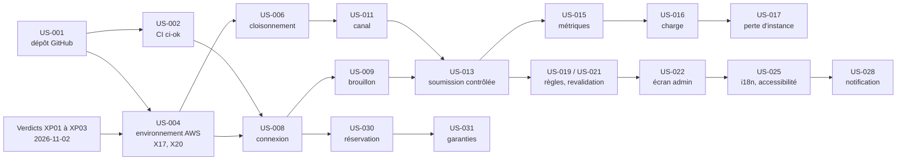

# Backlog du POC Collector

Backlog ordonné du POC : 33 user stories réparties sur trois sprints (J4, J5, J5 bis).
Règles du circuit : [PILOTAGE.md](../docs/PILOTAGE.md) § 3.3 et § 5 ; cycle de vie et dette : [developpement.md](../docs/processus/developpement.md) ; gabarit : [_GABARIT-US.md](_GABARIT-US.md) ; contenu des sprints : [sprints/](sprints/).

| Champ | Valeur |
|---|---|
| Date | 2026-10-26 |
| Fonctionnalité métier | Mise en vente d'un article avec contrôle automatisé de publication ([D01](../docs/decisions/D01-fonctionnalite-poc.md)) |
| Périmètre | Quatre services, option P2, walking skeleton WS-2 ([D02](../docs/decisions/D02-decoupage-applicatif.md)) |
| Statut | À valider par Martin |

## 1. Principes de découpage

- **Vertical et livrable** : chaque US produit un comportement observable (écran, API, commande, preuve de sécurité) et passe seule le circuit Dev. Les US d'infrastructure sont formulées par la valeur qu'elles rendent.
- **Démo garantie au plus tôt** : à la fin du sprint 1, le parcours soumission → contrôle → publication → consultation tourne sur AWS ; à la fin du sprint 2, la fonctionnalité métier, la charge et la disponibilité sont démontrables. **Si le sprint 3 saute, la soutenance reste possible** (voir § 5).
- **Taille** : 8 points au plus ; au-delà, l'US est découpée.
- **Ordre** : le rang ci-dessous est l'ordre d'engagement ; il respecte les dépendances et place en tête ce qui sert la démonstration.

## 2. Estimation et capacité

**Unité** : le point, estimation relative de l'effort complet d'une US (développement, test, revue, recette), suite 1, 2, 3, 5, 8.

**Hypothèse de capacité** : 10 points par jour calendaire de sprint, toutes fonctions confondues. Elle est **recalibrée à la clôture du sprint 1** sur la vélocité mesurée (points livrés), et la planification des sprints 2 et 3 est corrigée en conséquence.

| Sprint | Jalon | Dates proposées | Capacité | Réserve dette (20 %) | Engageable | Ferme | Coupable | Sessions AWS prévues | Coût estimé |
|---|---|---|---|---|---|---|---|---|---|
| 1 | J4 | 2026-11-03 → 2026-11-09 (7 j) | 70 | 14 | 56 | 54 | 0 | 4 | ≈ 5,4 $ |
| 2 | J5 | 2026-11-10 → 2026-11-14 (5 j) | 50 | 10 | 40 | 37 | 5 | 4 | ≈ 5,4 $ |
| 3 | J5 bis | 2026-11-15 → 2026-11-17 (3 j) | 30 | 6 | 24 | 15 | 4 | 2 | ≈ 2,7 $ |
| **Total** | | | **150** | **30** | **120** | **106** | **9** | **10** | **≈ 13,5 $** |

- Une US **coupable** n'est engagée que si la réserve de dette du sprint n'est pas consommée ; sinon elle passe au sprint suivant ou sort du POC, selon l'ordre de coupe (§ 5).
- Le sprint 3 garde de la marge pour absorber le report éventuel des coupables du sprint 2.
- Budget AWS : 50 $ réels ; seuil d'arrêt à 70 % (35 $) ([D11](../docs/decisions/D11-iac-allumage-cout.md), G5). Avec J3 (≈ 4,65 $), la couche persistante (≈ 2 $) et J7 (deux répétitions et la soutenance, ≈ 4 $), le projet est estimé à ≈ 24 $. Coût réel suivi dans `docs/mesures/couts.csv`.
- J6 (audit, remédiation, analyse de la dette, compétences) et J7 (répétitions, vidéo de secours, soutenance) ne sont pas des US : ils suivent [PILOTAGE.md](../docs/PILOTAGE.md) § 1.

## 3. Backlog ordonné

Epics : E1 Chaîne de livraison · E2 Plateforme AWS · E3 Mise en vente contrôlée · E4 Exploitation, charge et disponibilité · E5 Diffusion et notifications · E6 Réservation.

| Rang | ID | Titre | Epic | Sprint | Engagement | Est. | Dépend de | Critères grille |
|---|---|---|---|---|---|---|---|---|
| 1 | [US-001](US-001-publication-depot-github.md) | Publier le dépôt sur GitHub sans fuite | E1 | 1 | Ferme | 2 | — | C4, C8 |
| 2 | [US-002](US-002-pipeline-pr-ci-ok.md) | Pipeline de PR et vérification requise `ci-ok` | E1 | 1 | Ferme | 3 | US-001 | C4, C7, C6 |
| 3 | [US-004](US-004-environnement-aws-https.md) | Allumer, exposer en HTTPS et éteindre l'environnement AWS (X17, X20 bloquants) | E2 | 1 | Ferme | 8 | US-001, XP01, XP03 | C5, C2, C8 |
| 4 | [US-003](US-003-portes-securite-ci.md) | Portes de sécurité bloquantes dans la CI | E1 | 1 | Ferme | 3 | US-002 | C8, C4, C6 |
| 5 | [US-005](US-005-garde-fous-cout.md) | Garde-fous de coût : destruction programmée, journal des coûts | E2 | 1 | Ferme | 2 | US-004 | C5 |
| 6 | [US-008](US-008-connexion-keycloak.md) | Se connecter par le serveur d'autorisation | E3 | 1 | Ferme | 5 | US-002, US-004, XP03 | C8, C2 |
| 7 | [US-006](US-006-cloisonnement-cluster.md) | Cloisonnement du cluster : politiques réseau, admission, IMDS | E2 | 1 | Ferme | 5 | US-004 | C8, C2 |
| 8 | [US-011](US-011-canal-rabbitmq-identites.md) | Canal asynchrone avec une identité par service | E2 | 1 | Ferme | 3 | US-004, US-006, XP02 | C2, C8 |
| 9 | [US-012](US-012-contrat-controle-v1.md) | Contrat v1 du contrôle de publication | E3 | 1 | Ferme | 2 | US-002 | C2, C7 |
| 10 | [US-009](US-009-brouillon-article-vendeur.md) | Créer et modifier un brouillon d'article | E3 | 1 | Ferme | 5 | US-008 | C3, C8, C2 |
| 11 | [US-010](US-010-catalogue-public.md) | Consulter le catalogue public sans compte | E3 | 1 | Ferme | 3 | US-009 | C3, C5 |
| 12 | [US-013](US-013-soumission-controle-completude.md) | Soumettre un article au contrôle de complétude (clôt WS-2) | E3 | 1 | Ferme | 5 | US-009 à US-012 | C3, C2, C7 |
| 13 | [US-007](US-007-livraison-images-signees-flux.md) | Livraison continue : images signées, déploiement par Flux | E1 | 1 | Ferme | 5 | US-002, US-004 | C4, C8 |
| 14 | [US-014](US-014-journaux-centralises.md) | Journaux centralisés et corrélés | E4 | 1 | Ferme | 3 | US-004, US-013 | C5, C6 |
| 15 | [US-015](US-015-metriques-tableaux-de-bord.md) | Métriques et tableaux de bord | E4 | 2 | Ferme | 3 | US-007, US-013 | C5, C6 |
| 16 | [US-016](US-016-montee-en-charge-catalogue.md) | Absorber un pic de visiteurs sur le catalogue | E4 | 2 | Ferme | 5 | US-010, US-015 | C5, C10, C6 |
| 17 | [US-017](US-017-perte-instance-sous-charge.md) | Rester disponible quand une instance tombe sous charge | E4 | 2 | Ferme | 2 | US-016 | C5, C6 |
| 18 | [US-018](US-018-filtrage-coordonnees.md) | Refuser les annonces avec coordonnées personnelles | E3 | 2 | Ferme | 3 | US-013 | C3, C8 |
| 19 | [US-019](US-019-regles-prix-statut-vendeur.md) | Mettre à vérifier les prix incohérents et les vendeurs à risque | E3 | 2 | Ferme | 3 | US-013 | C3, C2 |
| 20 | [US-021](US-021-revalidation-apres-modification.md) | Recontrôler toute modification d'un article | E3 | 2 | Ferme | 3 | US-013 | C3, C8 |
| 21 | [US-020](US-020-photo-securisee.md) | Ajouter une photo à un article, en toute sécurité | E3 | 2 | Ferme | 5 | US-013, X6 | C3, C8 |
| 22 | [US-022](US-022-ecran-admin-a-verifier.md) | Trancher les articles « à vérifier » | E3 | 2 | Ferme | 5 | US-019, US-021 | C3, C8 |
| 23 | [US-024](US-024-controle-ferme-par-defaut.md) | Aucune annonce publiée ni perdue quand le contrôle est indisponible | E4 | 2 | Ferme | 2 | US-013, US-015 | C5, C8, C2 |
| 24 | [US-023](US-023-catalogue-filtre-fiche.md) | Filtrer le catalogue et consulter la fiche d'un article | E3 | 2 | Ferme | 3 | US-010, US-020 | C3 |
| 25 | [US-025](US-025-francais-anglais-accessibilite.md) | Utiliser Collector en anglais, avec des écrans accessibles | E3 | 2 | Ferme | 3 | US-022, US-023 | C3, C7 |
| 26 | [US-026](US-026-controle-echelle-file.md) | Absorber une vague de soumissions (KEDA sur le Contrôle) | E4 | 2 | Coupable | 3 | US-016, US-024, X8 | C5 |
| 27 | [US-027](US-027-limitation-debit.md) | Limiter le débit sur les routes sensibles | E4 | 2 | Coupable | 2 | US-016 | C8, C5 |
| 28 | [US-030](US-030-reserver-article.md) | Réserver un article publié | E6 | 3 | Ferme | 5 | US-006, US-008, US-010 | C2, C3, C8 |
| 29 | [US-031](US-031-garanties-reservation.md) | Garantir qu'un objet unique n'est réservé qu'une fois | E6 | 3 | Ferme | 3 | US-030 | C3, C8, C7 |
| 30 | [US-028](US-028-notification-vendeur.md) | Être notifié de la décision de publication | E5 | 3 | Ferme | 5 | US-011, US-013, US-025 | C2, C3, C8 |
| 31 | [US-029](US-029-reprise-interactions.md) | Aucune notification perdue quand Interactions est arrêté | E5 | 3 | Ferme | 2 | US-028 | C2, C5 |
| 32 | [US-032](US-032-espace-acheteur.md) | Suivre ses réservations dans l'espace acheteur | E6 | 3 | Coupable | 2 | US-031 | C3 |
| 33 | [US-033](US-033-non-regression-quatre-services.md) | Rejouer la charge avec les quatre services | E4 | 3 | Coupable | 2 | US-016, US-028, US-030 | C5, C6 |

Les identifiants suivent l'ordre de rédaction ; le **rang** fait foi pour l'engagement.

## 4. Chemin critique

Chaîne la plus longue : **verdicts XP → US-004 → US-008 → US-009 → US-013 → US-015 → US-016 → US-017**. Tout retard d'US-004 (allumage, DNS, certificat, X17, X20) décale tout le reste : c'est la première US engagée, avec US-001 et US-002 en parallèle.

## 5. Ordre de coupe et démonstration minimale

Le parcours **soumission → contrôle → publication → consultation n'est jamais coupé** ([D02](../docs/decisions/D02-decoupage-applicatif.md)).

| Ordre | Sprint | Ce qui est coupé ou réduit | Effet |
|---|---|---|---|
| 1 | 1 | US-007 : Flux remplacé par le déploiement depuis le poste (`up.sh --sans-flux`), signature conservée | C4 tenu par la CI et la signature ; GitOps présenté en V1 |
| 2 | 1 | US-014 glisse en tête du sprint 2 | Observabilité livrée au sprint 2 au lieu du sprint 1 |
| — | 1 | XP02 non concluant : WS-1 (US-011 à US-013 au sprint 2), jamais de publication directe | Prévu par [PILOTAGE.md](../docs/PILOTAGE.md) § 3.4 |
| 3 | 2 | US-027 reportée au sprint 3 | ES-29 partielle (limite de Keycloak seule) |
| 4 | 2 | US-026 (vague de soumissions, KEDA) | Charge démontrée sur la consultation seule |
| 5 | 2 | US-022 réduite à une liste et deux actions | Confort admin |
| 6 | 2 | US-020 réduite à une photo par article | Photos multiples en V1 |
| 7 | 3 | US-032 (espace acheteur) | L'écran de confirmation d'US-030 suffit |
| 8 | 3 | US-033 (troisième profil, non-régression) | Tir du sprint 2 conservé comme preuve |
| 9 | 3 | Sprint 3 entier | Voir ci-dessous |

**Si le sprint 3 saute**, la soutenance s'appuie sur les sprints 1 et 2 : deux services reliés par le canal (C2), mise en vente contrôlée complète (C3), CI/CD et portes (C4), charge et perte d'instance (C5), indicateurs (C6), tests d'acceptation et négatifs (C7), cinq bonnes pratiques (C8). Interactions et Transactions sont alors présentés comme documentés (repli P1 de D02), ce qui **demande une décision de Martin** consignée dans D02.

## 6. Dette technique : règle des 20 %

- **20 % de la capacité de chaque sprint** sont réservés au remboursement de la dette (colonne « Réserve dette » du § 2).
- Toute dette est inscrite dans la section « Dette technique » du fichier du sprint où elle apparaît, avec un identifiant **`DT-nn`** (numérotation unique sur le projet), sa source (revue, audit, indicateur, test mis en quarantaine), son impact et, une fois remboursée, la date et l'US ou la PR qui la rembourse ([developpement.md](../docs/processus/developpement.md) § 6).
- **Priorité** à la planification suivante : dette à impact sécurité ou fiabilité d'abord (constat P1 ou P2, événement perdu, test instable), puis le reste, arbitré contre les US coupables.
- Une dette qui dépasse 3 points devient une US du backlog (`US-0nn`, dépendance `DT-nn`).
- Réserve non consommée : elle sert à engager les US coupables du sprint, dans l'ordre du § 5.
- Une dette remboursée garde sa ligne : l'historique prouve que la mesure a produit une action (C6).

## 7. Prête à engager

Une US entre dans un sprint quand :

- [ ] ses AC fonctionnels et non fonctionnels sont rédigés en Given/When/Then et numérotés ;
- [ ] ses exigences ES sont citées et ses AC de sécurité sont des tests négatifs ;
- [ ] ses dépendances sont livrées ou engagées avant elle dans le même sprint ;
- [ ] ses décisions liées sont `Décidée`, ou `Candidate` avec un verdict d'expérimentation favorable ;
- [ ] son estimation tient dans la capacité restante du sprint.

## 8. Couverture de la grille

| Critère | US principales |
|---|---|
| C1 Protocole d'expérimentation | Hors backlog (XP00 à XP03, J3) ; US-004, US-006, US-011 rejouent les critères bloquants sur l'IaC du POC |
| C2 Qualité technique du POC | US-004, US-006, US-008, US-011, US-012, US-013, US-024, US-028, US-030 |
| C3 Fonctionnalité métier | US-009, US-010, US-013, US-018 à US-023, US-025, US-030, US-031 |
| C4 Processus CI/CD | US-001, US-002, US-003, US-007 |
| C5 Environnement managé, disponibilité, charge | US-004, US-005, US-014 à US-017, US-024, US-026, US-033 |
| C6 Indicateurs qualité | US-002 (couverture), US-003 (I6), US-014, US-015 (I2, I3), US-016, US-017 |
| C7 Processus de test | Tous les AC étiquetés `@US-xxx-ACn` ; US-012 (contrat), US-013, US-031 (concurrence) |
| C8 Sécurité | BP1 US-004 · BP2 US-009 · BP3 US-003 · BP4 US-018 · BP5 US-009, US-022, US-028, US-032 ; US-006, US-011, US-020, US-030 |
| C9 Compétences | Hors backlog ([competences-formation.md](../docs/processus/competences-formation.md)) |
| C10 Présentation | US-016 et `tools/demo.sh` ; préparation en J7 |
