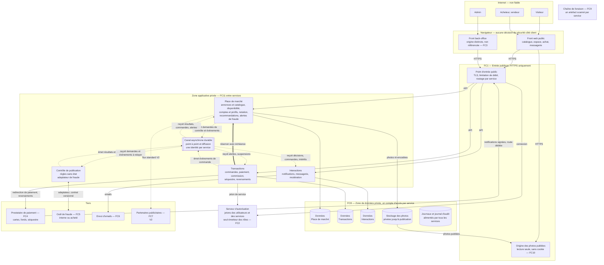
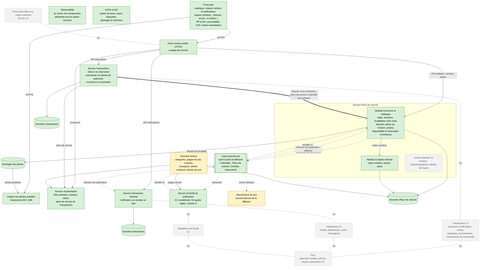
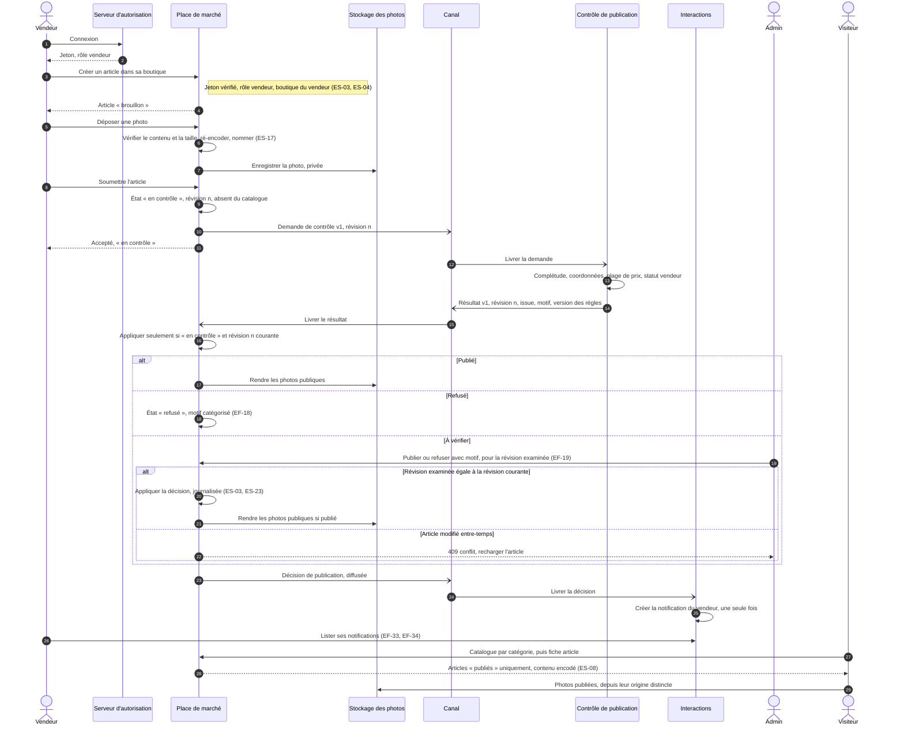
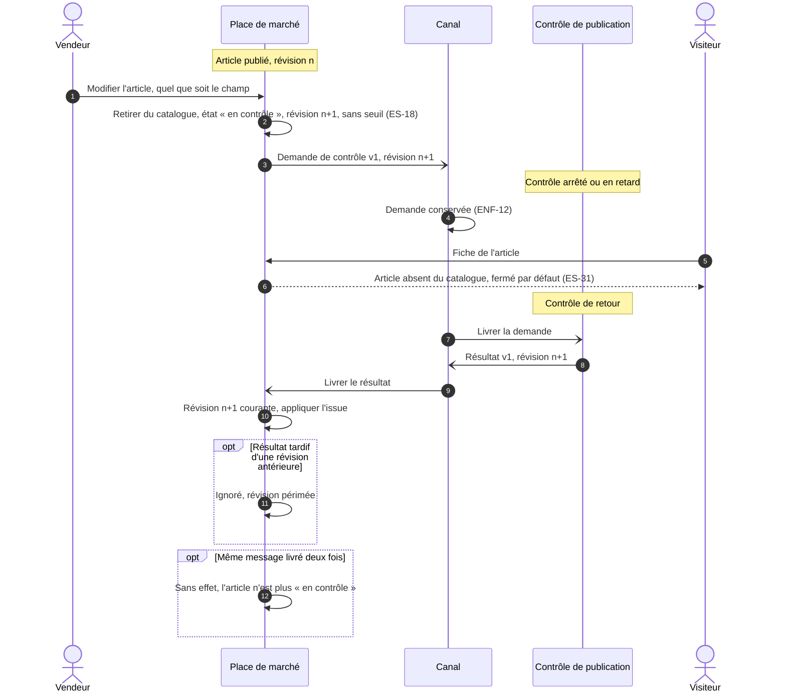
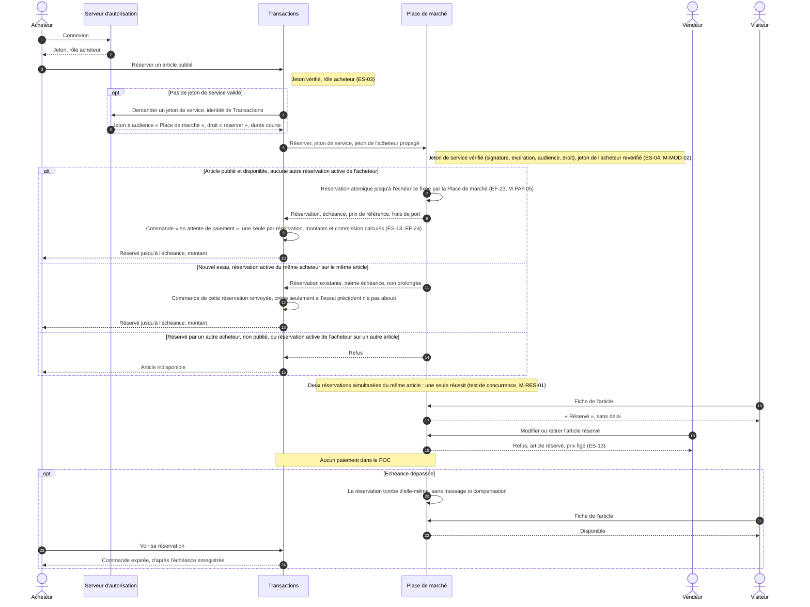
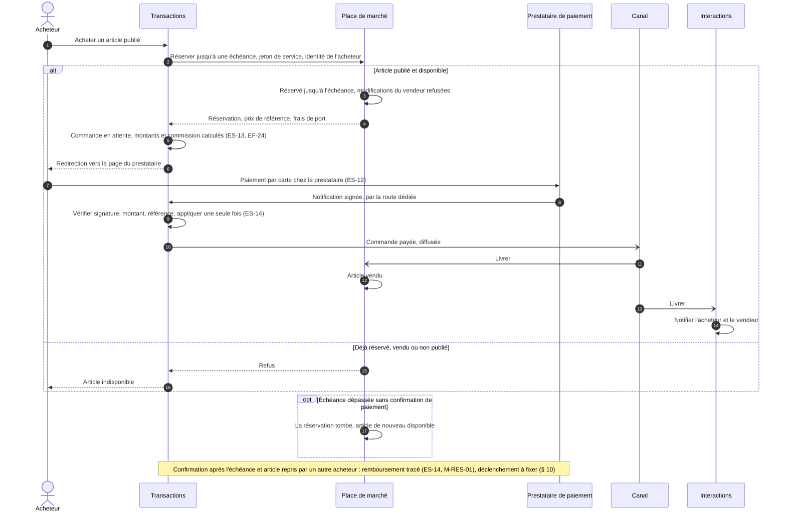

# Architecture technique de Collector.shop

| | |
|---|---|
| Statut | v0.2 — POC option P2 (D02) ; option B retenue |
| Date | 2026-10-09 |
| Fonction | Architecture |
| Décisions | [D01](../decisions/D01-fonctionnalite-poc.md) (décidée), [D02](../decisions/D02-decoupage-applicatif.md) (décidée ; complément POC : option P2) |
| Références | [exigences.md](../00-cadrage/exigences.md), [exigences-securite.md](../securite/exigences-securite.md) |
| Critères servis | C2, C10, C8 |

## 1. Objet et conventions

- Ce document décrit l'architecture **logique** de la V1 retenue par Martin dans D02 : **option B, quatre services** (Place de marché, Transactions, Interactions, Contrôle de publication), chacun propriétaire de ses données.
- La consigne (§ 1.2.1) demande un « schéma d'architecture technique intégrant la sécurité et les solutions techniques retenues ». Cette version fixe les services, les données, les échanges et les zones de sécurité. Les solutions techniques seront ajoutées après D03 à D11 (§ 9).
- Le POC n'est pas la V1 : il en construit une tranche (§ 3), fixée par le complément de D02 (**option P2**) : les quatre services, avec Interactions minimal et Transactions réduit à la réservation.

Conventions des schémas :

| Notation | Signification |
|---|---|
| Trait plein | Échange synchrone (requête, réponse) |
| Trait épais | Appel synchrone entre services, authentifié de service à service |
| Trait pointillé | Message asynchrone par le canal |
| FCn | Frontière de confiance n° n ; FC1 à FC11 : [exigences-securite.md](../securite/exigences-securite.md) § 3 ; FC11, ajoutée pour l'option B, est détaillée ici (§ 2.3) |
| ES-xx, ENF-xx, EF-xx | Exigences de sécurité, non fonctionnelles et fonctionnelles |

## 2. Vue logique de la V1 cible

### 2.1 Schéma d'ensemble

Lecture :
- **Quatre services, chacun propriétaire de ses données**, avec son propre compte d'accès. Le Contrôle n'a pas de données propres.
- **Isolement de la finance** : clé du prestataire, réception de ses notifications (route dédiée, sans session utilisateur), commandes et séquestre sont dans Transactions seul. Une compromission de la Place de marché, le service le plus exposé (contenu public, photos déposées), n'atteint pas l'argent.
- **Un seul appel synchrone entre services** : Transactions réserve un article auprès de la Place de marché, avec un jeton de service. Tout autre échange entre services passe par le canal.
- **Outil de fraude** : jamais connecté au canal. L'adaptateur du Contrôle relaie les échanges dans les deux sens (D02, « Arbitrages de cohérence »).
- **Le navigateur n'est pas une zone de confiance** : montants, rôles et propriété sont vérifiés côté serveur (ES-03, ES-04, ES-13).

### 2.2 Échanges entre services

Règle : la demande et le résultat de contrôle, une commande et sa réponse, sont **point à point**. Les événements métier sont **diffusés**, pour qu'un nouveau consommateur (analyse des ventes, partenaires) s'abonne sans modifier le producteur (ENF-21). Chaque sujet n'a qu'un producteur, seul autorisé à y publier ; chaque consommateur n'est abonné qu'aux sujets dont il a besoin, par l'exploitation et jamais par un service (ES-38, M-CAN-05, M-CAN-06).

| Message ou appel | Producteur | Mode | Consommateurs | Exigences |
|---|---|---|---|---|
| Demande de contrôle v1 | Place de marché | Point à point | Contrôle | EF-16, EF-17, ES-31 |
| Résultat de contrôle v1 | Contrôle | Point à point | Place de marché | EF-17, EF-18 |
| Décision de publication (article, révision, issue, motif, ancien et nouveau prix publiés) | Place de marché | Diffusion | Interactions : notification au vendeur, acheteurs intéressés, alertes, suiveurs en cas de variation de prix ; adaptateur de fraude | EF-29 à EF-31, EF-34, EF-42 |
| Prix modifié, dès la saisie du vendeur | Place de marché | Diffusion | Adaptateur de fraude | EF-13, EF-41 |
| Nouveau vendeur, vendeur suspendu | Place de marché | Diffusion | Adaptateur de fraude ; Transactions (achats et reversements suspendus) ; Interactions (messagerie bloquée) | EF-20, ES-21 |
| Centres d'intérêt modifiés | Place de marché | Diffusion | Interactions (copie des intérêts) | EF-09, EF-29 |
| Commande payée, expédiée, conclue | Transactions | Diffusion | Place de marché (article vendu, notation ouverte) ; Interactions (notifications) ; adaptateur de fraude | EF-23, EF-25, EF-34, EF-46, ES-21 |
| Alerte de fraude | Contrôle (adaptateur) | Diffusion | Place de marché (liste de l'admin) ; Transactions (reversement suspendu) | EF-43, ES-15 |
| Réserver un article jusqu'à une échéance | Transactions → Place de marché | Synchrone, authentifié de service à service ; un nouvel essai renvoie la réservation existante | — | EF-23, ES-13, ES-14, ES-38 |
| Notification de paiement | Prestataire → Transactions | Synchrone entrant, signé, idempotent | — | ES-14 |

Ce qui est immédiat et ce qui est différé :
- **Immédiat** : la réservation (atomique dans la Place de marché), la publication et le retrait du catalogue.
- **Différé, avec une conséquence de sécurité** : « vendu ». Tant que l'échéance court, l'article réservé n'est plus achetable. Mais une « commande payée » livrée après l'échéance (canal en retard, Place de marché arrêtée), alors qu'un autre acheteur a réservé l'article entre-temps, produit une double vente (M-RES-01). Parade (ES-14) : échéance fixée par la Place de marché au-delà de la durée de session du prestataire et du délai de livraison des événements ; une confirmation reçue après l'échéance sur un article réservé entre-temps donne lieu à un remboursement tracé (déclenchement : § 10).
- **Différé, sans conséquence de sécurité** : les notifications, la copie des intérêts, les alertes de fraude. Chaque consommateur est idempotent ; un message livré deux fois est sans effet.
- La variation de prix n'est notifiée aux acheteurs qu'une fois le nouveau prix publié, après contrôle. La fraude la reçoit dès la saisie.

### 2.3 Zones de sécurité et frontières de confiance

FC1 à FC11 : [exigences-securite.md](../securite/exigences-securite.md) § 3. FC11, ajoutée ici pour l'option B, y est reprise avec ses menaces (§ 4.11 : M-CAN-01 à M-CAN-06, M-MOD-01 à M-MOD-03, M-SYN-01, M-RES-01, M-RES-02) et l'exigence ES-38 (identités de service et cloisonnement).

| Zone ou frontière | Contenu dans le schéma | Contrôles attendus |
|---|---|---|
| Internet et navigateur | Acteurs ; fronts exécutés dans le navigateur | Aucune décision de sécurité côté client ; montants recalculés côté serveur (ES-13) |
| FC1 — Entrée publique | Point d'entrée, origine des photos publiées, pages de connexion du serveur d'autorisation | HTTPS seul, HSTS, en-têtes de sécurité, limitation de débit (ES-01, ES-07, ES-29) ; notifications du prestataire routées vers Transactions seul ; route « réserver » non exposée (ES-38, M-SYN-01) |
| FC2 — Espace authentifié | API authentifiées des services ; serveur d'autorisation | Jeton vérifié par chaque service à chaque requête ; contrôle par rôle et par objet (ES-02, ES-03, ES-04) |
| FC3 — Back-office | Front back-office ; API admin des services | Origine distincte, rôle admin vérifié côté serveur, second facteur, journal d'audit (ES-10, ES-20, ES-23) |
| **FC11 — Entre services, par le canal** | Messages entre la Place de marché, Transactions, Interactions et le Contrôle : point à point et diffusion | Une identité par service ; droits par sujet, en écriture comme en lecture (seul le Contrôle écrit les résultats, seule la Place de marché écrit les demandes) ; contrat validé à la réception, émetteur compris ; idempotence ; messages minimisés et conservés pour une durée bornée (ES-38, M-CAN-01 à M-CAN-04). **Diffusion** : seul le producteur d'un sujet y publie, contre un faux événement (M-CAN-05) ; chaque service n'est abonné qu'aux sujets dont il a besoin et aucun service ne crée d'abonnement, opération réservée à l'exploitation, contre un abonné ou un consommateur non autorisé (M-CAN-06) ; un événement reçu peut suspendre un achat ou un reversement, jamais déclencher un mouvement de fonds (ES-38) |
| **FC11 — Entre services, par appel synchrone** | Transactions → Place de marché (réservation) | Jeton de service vérifié (signature, expiration, émetteur, audience, droit limité à la réservation, durée courte) ; identité de l'acheteur propagée et revérifiée (ES-04, M-MOD-02) ; service appelé authentifié par l'appelant ; route absente du point d'entrée public, vérifiée par l'inventaire des points d'entrée, flux confiné à la zone privée (ES-38, M-SYN-01). Réservation atomique, nouvel essai sans seconde réservation, échéance fixée et plafonnée par la Place de marché et non prolongeable par l'appelant, une réservation active par acheteur (ES-14, M-RES-01, M-RES-02) |
| FC8 — Zone de données | Données de chaque service, stockage des photos, journaux, sauvegardes | Un compte d'accès par service, limité à ses données ; chiffrement au repos ; sauvegardes restaurables (ES-07, ES-30) |
| FC4 — Paiement | Prestataire de paiement | Carte jamais chez Collector ; notifications signées, vérifiées et idempotentes ; fonds en séquestre chez le prestataire (ES-12, ES-14, ES-15) |
| FC5 — Fraude | Outil de fraude, par l'adaptateur du Contrôle | Contrat versionné, authentification dans les deux sens, données minimisées, aucune approbation par défaut, aucun accès au canal (ES-21, ES-31) |
| FC6 — Emails | Service d'envoi, appelé par Interactions | Domaine authentifié, contenu utilisateur neutralisé (ES-24) |
| FC7 — Partenaires (V2) | Partenaires publicitaires | Consentement préalable, segments pseudonymisés, aucun script tiers sur les pages sensibles (ES-28) |
| FC9 — Livraison | Chaîne de livraison, accès d'exploitation | Scans bloquants, secrets hors dépôt, artefact construit une fois par service et promu (ES-05, ES-06, ES-32) |
| FC10 — Contenu d'un utilisateur vers un autre | Titres, descriptions, photos, messages, notifications | Validation à l'entrée, encodage à l'affichage, filtrage des coordonnées, photos ré-encodées servies sans cookie (ES-08, ES-16, ES-17) |

Limite connue de l'environnement de formation : tous les services s'y exécutent sous la même identité imposée. Le cloisonnement par l'hébergeur entre services n'est pas démontrable dans le POC ; la V1 exige une identité d'exécution par service (avis sécurité de D02, § 5 ; ES-38). L'isolement du périmètre financier n'est donc démontré dans le POC que dans sa structure : service, données, compte d'accès et jeton de service propres à Transactions, sans prestataire ni secret financier.

## 3. Périmètre du POC

Le POC déploie les **quatre services** de l'option B, selon l'**option P2** du complément de [D02](../decisions/D02-decoupage-applicatif.md) (sections « Périmètre du POC » et « Complément ») : la mise en vente contrôlée de D01, la diffusion de sa décision vers Interactions, et la réservation, première étape de l'achat, qui exerce l'appel synchrone authentifié Transactions → Place de marché.

Légende : vert = construit et déployé ; jaune = données fictives chargées à chaque allumage, et abonnement de test ; gris en pointillé = documenté, hors POC. Trait épais : appel synchrone authentifié de service à service ; flèche pointillée : message par le canal ; lien pointillé sans flèche, marqué V1 : extension documentée. L'observabilité et la chaîne CI/CD couvrent les quatre services ; leurs liens ne sont pas tracés, pour la lisibilité.

- **Construit et déployé** : front web, point d'entrée, serveur d'autorisation (utilisateurs et jeton de service de Transactions), Place de marché (modules Annonces, avec la disponibilité et la réservation à échéance, et Comptes minimal), Contrôle, Interactions minimal, Transactions réduit à la réservation, canal (point à point et diffusion, trois identités), trois espaces de données, stockage, observabilité, chaîne CI/CD et IaC.
- **Points clés de B exercés** (D02, complément) : K1, diffusion vers Interactions et vers l'abonnement de test ; K2, identités sur le canal et jeton de service ; K3, appel synchrone de réservation ; K4, notification différée avec un délai borné dans les AC ; K5, périmètre financier, en structure seulement (§ 2.3).
- **Découpage indicatif** (D02, « Conséquences ») : S1, walking skeleton WS-2 : Place de marché (module Annonces) + Contrôle à une règle (complétude du titre, de la description, de la catégorie et du prix) + canal point à point ; S2, mise en vente contrôlée complète, charge et autoscaling ; S3, diffusion vers Interactions et réservation.
- **Fictif ou de test** : données fictives rejouables ; échéance de réservation courte en configuration, pour montrer son expiration en démonstration ; abonnement de test posé par l'exploitation pour le test d'intégration, et non par un service (§ 6, règle 6), lu avec une identité en lecture seule, puis retiré.
- **Simulé** : rien. Ni prestataire ni simulateur de paiement : une réservation n'est jamais payée et tombe à l'échéance, comme en V1 quand le paiement n'aboutit pas. L'outil de fraude et son adaptateur ne sont pas simulés : le branchement est prouvé par le contrat v1 et son test de contrat (D01).
- **Documenté** : paiement, confirmation du prestataire, passage à « vendu », séquestre, reversements, événements de commande ; emails, préférences, suivis, messagerie ; notation, recommandations, alertes de fraude, adaptateur ; back-office sur une origine distincte.
- **Écarts assumés** : l'écran « à vérifier » est servi par le front web, protégé par le rôle admin, ES-07 et ES-08 ; en V1, le back-office a sa propre origine (ES-20). Identité d'exécution partagée, donc isolement financier démontré en structure seulement (§ 2.3). Échéance courte. Transactions et Interactions à une instance.

## 4. Flux

Les échanges entre le navigateur et les services passent par le point d'entrée HTTPS ; il n'est pas représenté, pour la lisibilité.

### 4.1 Soumission, contrôle, publication, consultation (POC)

Interactions minimal fait partie du POC (D02, option P2) ; dans le découpage indicatif, ses étapes arrivent au sprint 3.

### 4.2 Revalidation après modification et contrôle indisponible (POC)

Règles illustrées :
- **Fermé par défaut** : un article n'est visible qu'après une décision « publié ». Contrôle arrêté ou en retard signifie article invisible, jamais publié (ES-31).
- **Toute modification revalidée** : quel que soit le champ modifié, l'article publié, en contrôle ou à vérifier repart au contrôle (D02, retenu par défaut).
- **Révision** : demandes, résultats et décisions de l'admin portent le numéro de révision. Un résultat périmé est ignoré ; une décision de l'admin sur une révision périmée est refusée (409). Aucune version non examinée ne peut être publiée (M-ANN-05).
- **Idempotence** : un résultat n'est appliqué que si l'article est « en contrôle » à la révision du résultat ; cette seule garde traite doublons et livraisons tardives.
- **Aucune perte** : une demande émise pendant l'arrêt du contrôle est traitée à son retour (ENF-12).

### 4.3 Réservation (POC)

Première étape de l'achat de la V1, construite dans le POC sans paiement (D02, option P2). La disponibilité appartient à la Place de marché ; Transactions la réserve par le seul appel synchrone authentifié entre services.

Règles illustrées :
- **Une seule source de vérité** : la Place de marché réserve de façon atomique dans ses propres données. Aucune transaction commune entre les deux services (D02, « Arbitrages de cohérence »).
- **Deux identités vérifiées** : celle du service appelant (jeton de service à audience et droit limités) et celle de l'acheteur (jeton propagé, revérifié). Le prix vient des données de la Place de marché, jamais de la requête (ES-13). Transactions authentifie aussi la Place de marché, et la route « réserver » est absente du point d'entrée public (ES-38, M-SYN-01).
- **Nouvel essai sans doublon** : un nouvel essai de « réserver » pour le même acheteur et le même article (délai dépassé, double clic) renvoie la réservation existante, avec la même échéance, au lieu d'en créer une seconde ou d'être refusé ; Transactions ne crée qu'une commande par réservation (ES-14, M-RES-01).
- **Bornes contre l'abus** : échéance fixée et plafonnée par la Place de marché, non prolongeable par l'appelant, une seule réservation active par acheteur (réservation abusive, D01 ; ES-14, M-RES-02).
- **Prix figé** : le vendeur ne peut ni modifier ni retirer un article réservé ; sinon la revalidation le retirerait du catalogue et le prix réservé pourrait changer.
- **Une seule sortie dans le POC** : l'échéance. En V1, le paiement confirmé fait passer l'article « vendu » (§ 4.4).
- **Couplage assumé** : Place de marché indisponible, la réservation est refusée ; Transactions indisponible, consultation et mise en vente ne sont pas affectées (§ 6, règle 3).

### 4.4 Achat (V1, documenté)

Illustre l'arbitrage de D02 : la disponibilité appartient à la Place de marché, Transactions la réserve avec une échéance, sans transaction commune. La réservation est construite dans le POC (§ 4.3) ; le paiement et la suite sont documentés.

## 5. Composants

### 5.1 Services et socle

| Composant | Responsabilité | Données possédées | Interfaces exposées | Interfaces consommées | Exigences couvertes | POC |
|---|---|---|---|---|---|---|
| Front web public | Catalogue, espace acheteur et vendeur, achat, messagerie | Aucune | Écrans | API des services ; connexion au serveur d'autorisation ; origine des photos | EF-01 à EF-04, EF-08, EF-12, EF-18, ENF-26, ENF-27, ENF-30, ES-07, ES-08 | Construit : catalogue avec la mention « réservé », espace vendeur et ses notifications, espace acheteur (réserver, voir sa réservation), écran « à vérifier » |
| Front back-office | Catégories, articles « à vérifier », modération, alertes de fraude, suspensions | Aucune | Écrans d'administration, origine distincte | API admin des services | EF-05, EF-19, EF-20, EF-38, EF-43, ES-20 | Documenté |
| Point d'entrée public | Terminaison TLS, routage par service, limitation de débit ; route dédiée aux notifications du prestataire | Aucune | HTTPS public | Services ; serveur d'autorisation | ENF-02, ES-01, ES-07, ES-14, ES-29 | Construit ; route du prestataire documentée |
| Origine des photos publiées | Servir les seules photos publiées, sans cookie | Aucune | Lecture HTTPS | Stockage des photos | ES-17, FC10 | Construit (mécanisme : D07, D08) |
| Serveur d'autorisation | Identité, connexion, second facteur ; jetons et rôles des utilisateurs ; jetons des services | Identités, secrets d'authentification, rôles, identités de service | Connexion ; émission et clés de vérification des jetons | — | EF-06, EF-07, ES-02, ES-03, ES-09, ES-10, ES-38 | Construit, comptes fictifs ; jeton de service de Transactions |
| **Service Place de marché** | Modules : Annonces et catalogue (catégories, boutiques, articles, cycle de vie, revalidation, photos, **disponibilité et réservation à échéance**) ; Comptes et profils ; Notation ; Recommandations ; Alertes de fraude | Catégories, boutiques, articles, révisions, décisions de contrôle, historique des prix, disponibilité, références des photos, profils, intérêts, statut vendeur, notes, alertes | API publique (catalogue) ; API vendeur, acheteur et admin ; appel synchrone « réserver » réservé à Transactions ; émet demandes de contrôle et événements métier | Résultats de contrôle ; événements de commande ; alertes de fraude ; stockage des photos | EF-01 à EF-14, EF-16, EF-18 à EF-20, EF-23, EF-39, EF-43, EF-46, EF-47, ES-04, ES-08, ES-13, ES-14, ES-17, ES-18, ES-31, ES-38 | Construit : modules Annonces (avec la disponibilité et la réservation à échéance) et Comptes minimal ; diffusion de la décision de publication |
| **Service Transactions** | Commandes, montants et commission, paiement, séquestre, reversements, suivi | Commandes, montants, références du prestataire, états du séquestre et des reversements | API acheteur et vendeur ; réception des notifications du prestataire ; émet les événements de commande | Place de marché (réserver) ; interface prestataire ; alertes de fraude ; suspensions de vendeurs | EF-22 à EF-26, ENF-01, ENF-04, ENF-18, ES-12 à ES-15, ES-38 | Construit, réduit à la réservation : appel « réserver », commande en attente de paiement, montants et commission. Paiement, séquestre, reversements et événements de commande documentés |
| **Service Interactions** | Modules : Notifications (suivis, alertes, préférences, notifications dans l'espace et par email) ; Messagerie (chat, filtrage des coordonnées, signalement, modération) | Suivis, alertes, préférences, notifications, copie des intérêts, conversations, signalements | API authentifiée ; API admin (modération) | Événements diffusés (décisions de publication, commandes, intérêts, suspensions) ; interface d'envoi d'emails | EF-15, EF-29 à EF-38, ES-16 (chat), ES-19, ES-24, ES-25 | Construit, minimal : notification au vendeur sur décision de publication, et liste (EF-33, EF-34 partiels) |
| **Service Contrôle de publication** | Règles : conclure publié, refusé avec motif, ou à vérifier. Adaptateur : relayer vers l'outil de fraude et publier ses alertes | Aucune ; règles et plages de prix en configuration | Contrat v1 (demande, résultat) ; émet les alertes de fraude | Canal ; outil de fraude par l'adaptateur | EF-16, EF-17, EF-36 (annonces), EF-41, EF-42, ENF-17, ES-16, ES-21, ES-31 | Construit : règles ; adaptateur documenté |
| Canal asynchrone | Transport durable : point à point (contrôle) et diffusion (événements métier) ; une identité par service, droits par sujet ; abonnements posés par l'exploitation | Messages en transit, pour une durée bornée | Flux de demandes, de résultats, d'événements | — | ENF-12, ES-21, ES-31, ES-38, FC11 | Construit : point à point et diffusion de la décision de publication ; trois identités (Place de marché, Contrôle, Interactions) |
| Données des services | Persistance de chaque service dans son espace | Données de chaque service | Accès réservé au service propriétaire, par son compte | — | ENF-13, ES-07, ES-30, ES-38 | Construit : Place de marché, Interactions, Transactions |
| Stockage des photos | Photos | Photos ré-encodées | Écriture par la Place de marché ; lecture publique des seules photos publiées | — | ES-07, ES-17 | Construit |
| Observabilité et journal d'audit | Diagnostic d'un parcours à travers les services ; traçabilité des actions sensibles | Journaux, métriques ou traces ; journal d'audit | Consultation par l'exploitation | Tous les services ; identifiant de corrélation propagé | ENF-25, ES-23 | Construit : au moins une composante (D09) |
| Chaîne de livraison | Build, tests, scans, déploiement de chaque service, création et destruction de l'environnement | Artefacts, rapports | — | Dépôt | ENF-22, ENF-28, ES-05, ES-06, ES-32 | Construite |

### 5.2 Intégrations externes

| Tiers | Échange | Interface côté plateforme | Exigences | POC |
|---|---|---|---|---|
| Prestataire de paiement (FC4) | Redirection de l'acheteur vers la page du prestataire ; notifications serveur à serveur signées ; reversements et séquestre | Interface prestataire du service Transactions ; route dédiée du point d'entrée | ENF-04, ENF-18, ES-12, ES-14, ES-15 | Documenté ; aucun simulateur, la réservation non payée tombe à l'échéance |
| Outil de fraude (FC5) | Contrat du contrôle ; événements prix modifié, nouveau vendeur, transaction ; verdicts et alertes en retour | Adaptateur du service Contrôle de publication ; jamais d'accès au canal | ENF-17, EF-41, EF-42, ES-21 | Documenté ; contrat v1 construit et testé |
| Envoi d'emails (FC6) | Emails de notification | Interface d'envoi du service Interactions | ENF-18, ES-24, ES-25 | Documenté |
| Partenaires publicitaires (FC7, V2) | Flux standard d'articles et de catégories, après consentement | Nouveau composant abonné aux événements de la Place de marché, à créer en V2 | EF-44, EF-45, ENF-20, ES-28 | Hors V1 |

## 6. Règles d'architecture

1. **Propriété des données** : chaque service est seul à lire et écrire ses données, avec son propre compte d'accès. Les autres passent par ses événements ou, pour la seule réservation, par son appel synchrone.
2. **Modules dans un service** : la Place de marché et Interactions regroupent plusieurs domaines. Leurs modules gardent des frontières vérifiées en CI, pour pouvoir être séparés plus tard (règle E1 à E4, [D02](../decisions/D02-decoupage-applicatif.md), option A).
3. **Un seul appel synchrone entre services en V1** : Transactions → Place de marché. Tout nouvel appel synchrone entre services doit être justifié : il couple la disponibilité des deux services.
4. **Diffusion par défaut des événements métier** ; point à point pour la demande et le résultat de contrôle.
5. **Aucun événement perdu** : un événement est émis de façon fiable après le changement d'état qu'il annonce (mécanisme fixé en D05) ; chaque consommateur est idempotent ; un identifiant de corrélation suit le parcours.
6. **Identités de service** (ES-38) : une identité par service sur le canal, avec des droits par sujet en écriture et en lecture ; seul le producteur d'un sujet y publie. **Aucun service ne crée d'abonnement sur le canal** : les abonnements, abonnement de test du POC compris, sont posés par l'exploitation (M-CAN-06). Jeton de service sur l'appel synchrone ; l'identité de l'utilisateur est propagée et revérifiée par le service appelé.
7. **Tiers derrière une interface ou un adaptateur** : paiement, emails, outil de fraude (ENF-17, ENF-18). Aucun outil externe sur le canal.
8. **Contrats versionnés** : API exposées et messages, avec compatibilité ascendante au sein d'une version (ENF-19) ; un test de contrat par paire producteur-consommateur.
9. **Fermé par défaut, toute modification revalidée, décisions sur une révision** (ES-18, ES-31, M-ANN-05).
10. **Aucune confiance au client** : montants recalculés côté serveur, rôles fournis par le seul serveur d'autorisation, propriété vérifiée sur chaque objet (ES-03, ES-04, ES-13).
11. **Un événement ne déplace pas d'argent** (ES-38) : un événement venu d'un autre service peut suspendre un achat ou un reversement, **jamais déclencher un mouvement de fonds**. Un faux événement diffusé (M-CAN-05) ne peut donc déclencher ni remboursement ni reversement.

## 7. Évolutions (ENF-21)

| Évolution | Branchement | Réutilise | Nouveau service |
|---|---|---|---|
| Enchères (EF-48) | Nouveau service Enchères | Article, disponibilité et contrôle de la Place de marché ; Transactions pour le règlement final ; Interactions pour les surenchères | Oui : pics en fin d'enchère, offres à ordonner de façon stricte |
| Vente en direct lors d'événements (EF-49) | Nouveau service ; diffusion vidéo confiée à un tiers derrière une interface | Enchères ou achat direct, messagerie, notifications | Oui |
| Bot avant-vente (EF-50) | Composant séparé, interne ou tiers | API publique du catalogue, en lecture seule, sans donnée personnelle | Oui |
| Analyse des ventes (EF-51) | Nouveau consommateur des événements diffusés | Événements de commande et de publication ; aucune écriture dans les autres services | Oui, sans toucher aux producteurs |
| Publicités partenaires (EF-44, V2) | Nouveau composant qui produit un flux standard | Événements de publication ; consentements (ES-28) | Oui |

Aucune de ces évolutions ne réécrit un service existant : elles ajoutent des services ou des abonnés, et s'appuient sur les contrats déjà définis.

## 8. Contrat du contrôle : exigences à reprendre dans D05

Le contrat lui-même est porté par D05 (conséquence de D01). L'architecture en attend les propriétés suivantes :

- version du contrat dans chaque message ;
- identifiant de l'article et numéro de révision, pour écarter un résultat périmé ;
- données minimales : aucun email ni identité du vendeur, seulement l'identifiant opaque de compte et les attributs de statut utiles aux règles (ES-21) ;
- nombre de photos et dates utiles portés par la demande : le contrôle ne lit ni base, ni stockage, ni horloge ;
- issue (publié, refusé, à vérifier) et motif catégorisé, sans citer la règle exacte (D01, « Avis sécurité ») ;
- version des règles appliquées : règles v1 au sprint 1 (complétude sans photo), v2 au sprint 2, sans changer le contrat ;
- une catégorie inconnue du contrôle donne « à vérifier », jamais « publié » ;
- traitement idempotent des deux côtés ;
- un test de contrat vérifie que la Place de marché et le Contrôle le respectent ; un outil de substitution doit pouvoir le passer (ENF-17).

## 9. Technologies

**À compléter après D03–D11.** Aucune technologie n'est retenue à ce stade.

| Élément | Décision | Technologie retenue |
|---|---|---|
| Hébergement et orchestration de quatre services | D03 | À compléter |
| Langages et frameworks, back et front | D04 | À compléter |
| Canal asynchrone (point à point et diffusion), format et contrats des messages, identités par service | D05 | À compléter |
| Serveur d'autorisation, protocole, authentification de service à service | D06 | À compléter |
| Bases ou espaces de données par service, stockage des photos | D07 | À compléter |
| Point d'entrée, TLS, domaine, origine des photos, route du prestataire | D08 | À compléter |
| Observabilité, corrélation, traces distribuées | D09 | À compléter |
| Forge, CI/CD par service, registre, portes DevSecOps | D10 | À compléter |
| IaC, allumage et extinction, garde-fou coût | D11 | À compléter |

## 10. Points ouverts

| Point | Où il se tranche |
|---|---|
| Découpage en trois sprints et jalons (l'option P2 ajoute ≈ 12 à 15 jours) | [PILOTAGE.md](../PILOTAGE.md), Martin ; proposition dans D02, « Conséquences » |
| Mode de diffusion, identités et droits par sujet sur le canal (le canal doit authentifier lui-même chaque service), abonnements réservés à l'exploitation, mécanisme anti-perte, mode de retour du résultat ; confirmation des règles 6 et 11 du § 6 (ES-38) | D05, avant J4 ; expérimentation du canal en J3 |
| Authentification de service à service et propagation de l'identité de l'utilisateur | D06, avant le sprint 3 ; jeton de service expérimenté en J3 (D14) |
| Mécanisme de la réservation atomique, de la limite d'une réservation active par acheteur et du nouvel essai qui renvoie la réservation existante | D07 |
| Durée de l'échéance de réservation au regard de la durée de session du prestataire et du délai de livraison des événements (V1, ES-14) ; échéance courte de démonstration dans le POC | D02 (V1), choix du prestataire |
| Confirmation de paiement tardive (M-RES-01) : si « commande payée » arrive à la Place de marché après l'échéance, l'article ayant été réservé entre-temps par un autre acheteur, c'est la Place de marché qui constate le conflit ; or un événement ne peut pas déclencher le remboursement tracé exigé par ES-14 (§ 6, règle 11). Qui constate le conflit et qui décide le remboursement | D05 ; conception de l'achat V1 |
| Réception des alertes de l'outil de fraude par l'adaptateur, sans nouveau point d'entrée public si possible | D05 |
| Moindre privilège entre services dans l'environnement de formation (rôle d'accès unique) | D03, expérimentation en J3 |
| Partage des règles de détection des coordonnées entre le Contrôle (annonces) et Interactions (chat, V1) | D04, conception de la messagerie |
| Mécanisme de l'origine des photos publiées | D07, D08 |

## 11. Historique

| Date | Version | Changement |
|---|---|---|
| 2026-10-09 | v0 | Première version logique, pour l'option A recommandée par D02 (alors proposée) |
| 2026-10-09 | v0.1 | Option B retenue par Martin : quatre services, diffusion, appel synchrone authentifié, adaptateur de fraude, FC11 ; réservation à échéance détenue par la Place de marché ; revalidation sans seuil ; décision admin sur une révision (409) ; schéma du POC sous réserve du complément D02 |
| 2026-10-09 | v0.2 | POC option P2 (D02) : quatre services déployés, Interactions minimal et Transactions réduit à la réservation ; schéma du POC redessiné ; séquence de la réservation du POC (§ 4.3), achat V1 en § 4.4 ; composants, technologies et points ouverts mis à jour. Cohérence avec la révision de sécurité pour l'option B : ES-38, M-CAN-05, M-CAN-06, M-SYN-01, M-RES-01 et M-RES-02 en § 2.3 ; « vendu » différé et double vente (§ 2.2) ; règles 6 et 11 du § 6 ; nouvel essai de la réservation (§ 4.3) |
