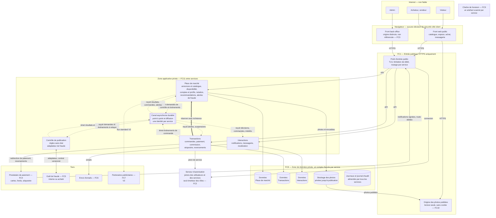
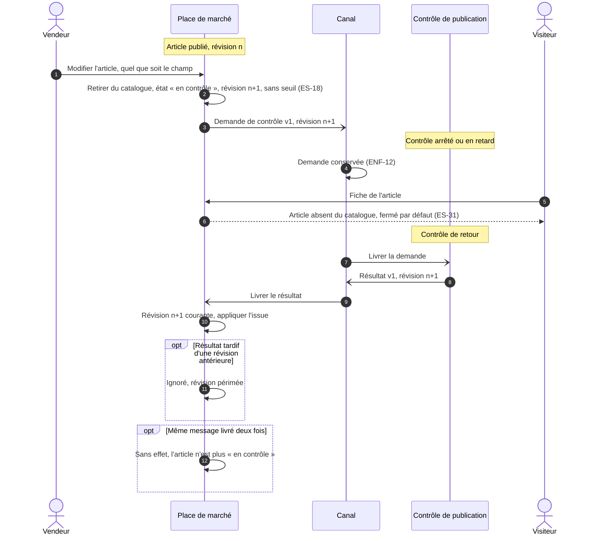
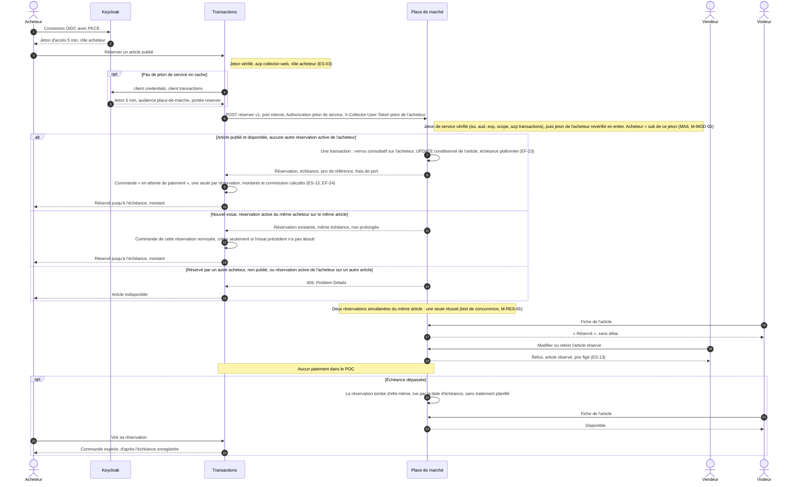
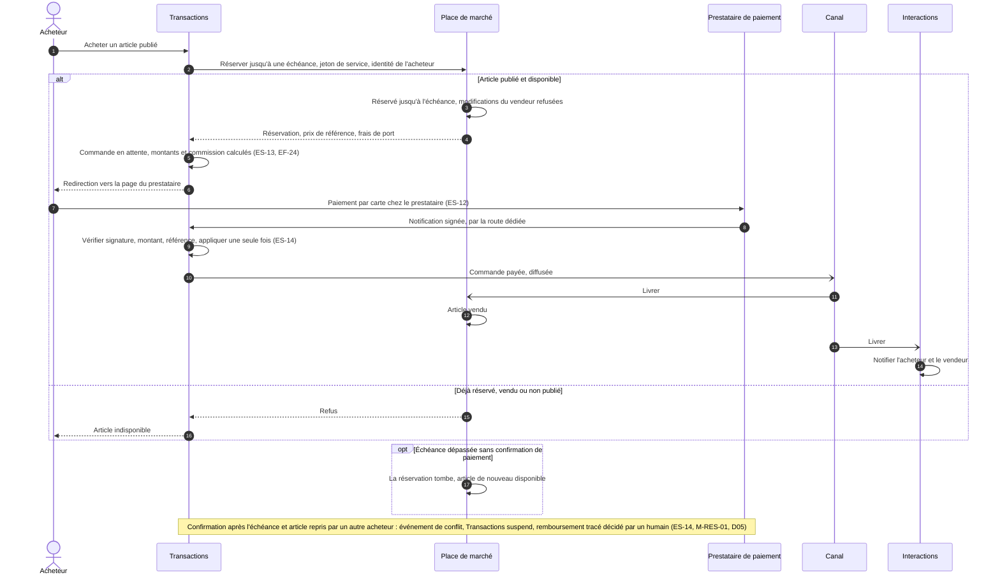

# Architecture technique de Collector.shop

| | |
|---|---|
| Statut | v1.0 — décisions D01 à D14 intégrées ; D03, D05, D06 et D08 **Candidate**, sous réserve du bac à sable (D14) |
| Date | 2026-10-26 |
| Fonction | Architecture |
| Décisions | [INDEX.md](../decisions/INDEX.md) : D01, D02, D04, D07, D09 à D14 décidées ; D03, D05, D06, D08 candidates |
| Références | [exigences.md](../00-cadrage/exigences.md), [exigences-securite.md](../securite/exigences-securite.md) |
| Critères servis | C2, C10, C8 |

## 1. Objet, conventions et vue d'ensemble

- Ce document est le **schéma d'architecture technique** demandé par la consigne (§ 1.2.1) : il intègre la sécurité et les solutions retenues (base de données, protocoles, frameworks, hébergement).
- Il décrit **ce qui est retenu** et renvoie aux décisions pour **pourquoi** : les options, avis et justifications vivent dans les fichiers Dxx, pas ici.
- La V1 retenue par Martin dans D02 est l'**option B, quatre services** (Place de marché, Transactions, Interactions, Contrôle de publication), chacun propriétaire de ses données. Le POC en construit une tranche (§ 3), selon l'**option P2** du complément de D02.
- **Statut Candidate** : l'hébergement EKS (D03), RabbitMQ (D05), Keycloak (D06) et l'exposition Route 53 / ACM / ALB (D08) sont retenus **sous réserve du bac à sable** (XP01 à XP03, du 2026-10-27 au 2026-11-02). Chacun a un repli nommé (§ 9.1) ; un repli activé donnera une v1.1 de ce document.

### 1.1 Vue d'ensemble

Un navigateur charge une application React statique, servie par nginx dans un cluster EKS, et s'authentifie auprès de Keycloak (OIDC avec PKCE). Ses appels arrivent sur un ALB HTTPS, qui route vers quatre services Go. Les services échangent par RabbitMQ (contrôle en point à point, événements en diffusion), sauf la réservation, seul appel synchrone, authentifié de service à service. Chaque service a sa base dans une instance RDS PostgreSQL ; les photos sont dans un bucket S3 privé. Les métriques restent dans le cluster (Prometheus, Grafana), les journaux et l'audit partent dans CloudWatch Logs. La CI GitHub publie des images signées sur GHCR ; Flux les déploie. Tout l'environnement AWS est recréé à chaque session et détruit à la fin.

| Vue | Section | Schéma |
|---|---|---|
| Vue logique V1 cible | § 2 | Dans ce document (§ 2.1) |
| Vue logique du POC : services, canal, contrats | § 3 | [01-vue-logique.md](schemas/01-vue-logique.md) |
| Flux : mise en vente, contrôle, décision, diffusion | § 4.1 | [04-flux-mise-en-vente.md](schemas/04-flux-mise-en-vente.md) |
| Flux : revalidation, réservation, achat V1 | § 4.2 à 4.4 | Dans ce document |
| Vue technique AWS | § 9.2 | [02-vue-aws.md](schemas/02-vue-aws.md) |
| Vue de déploiement et livraison | § 9.4 | [03-livraison.md](schemas/03-livraison.md) |
| Sécurité intégrée | § 9.5 | [05-securite.md](schemas/05-securite.md) |

### 1.2 Conventions des schémas

| Notation | Signification |
|---|---|
| Trait plein | Échange synchrone (requête, réponse) |
| Trait épais | Appel synchrone entre services, authentifié de service à service |
| Trait pointillé | Message asynchrone par le canal |
| FCn | Frontière de confiance n° n ; FC1 à FC11 : [exigences-securite.md](../securite/exigences-securite.md) § 3 ; FC11, ajoutée pour l'option B, est détaillée ici (§ 2.3) |
| ES-xx, ENF-xx, EF-xx | Exigences de sécurité, non fonctionnelles et fonctionnelles |
| MSn, MCn, MAn, MDn, MEn, MOn, MPn, MIn | Mesures de sécurité de D03, D05, D06, D07, D08, D09, D10, D11 |
| Xn, XCn, XEn | Critères du bac à sable (D03, D05, D08, protocole D14) |
| ‹domaine› | Sous-domaine du projet, délégué à Route 53 (D08) |

## 2. Vue logique de la V1 cible

### 2.1 Schéma d'ensemble

Lecture :
- **Quatre services, chacun propriétaire de ses données**, avec son propre compte d'accès. Le Contrôle n'a pas de données propres.
- **Isolement de la finance** : clé du prestataire, réception de ses notifications (route dédiée, sans session utilisateur), commandes et séquestre sont dans Transactions seul. Une compromission de la Place de marché, le service le plus exposé (contenu public, photos déposées), n'atteint pas l'argent.
- **Un seul appel synchrone entre services** : Transactions réserve un article auprès de la Place de marché, avec un jeton de service. Tout autre échange entre services passe par le canal.
- **Outil de fraude** : jamais connecté au canal. L'adaptateur du Contrôle relaie les échanges dans les deux sens (D02, « Arbitrages de cohérence »).
- **Le navigateur n'est pas une zone de confiance** : montants, rôles et propriété sont vérifiés côté serveur (ES-03, ES-04, ES-13).

### 2.2 Échanges entre services

Règle : la demande et le résultat de contrôle, une commande et sa réponse, sont **point à point**. Les événements métier sont **diffusés**, pour qu'un nouveau consommateur (analyse des ventes, partenaires) s'abonne sans modifier le producteur (ENF-21). Chaque sujet n'a qu'un producteur, seul autorisé à y publier ; chaque consommateur n'est abonné qu'aux sujets dont il a besoin, par l'exploitation et jamais par un service (ES-38, M-CAN-05, M-CAN-06).

| Message ou appel | Producteur | Mode | Consommateurs | Exigences |
|---|---|---|---|---|
| Demande de contrôle v1 | Place de marché | Point à point | Contrôle | EF-16, EF-17, ES-31 |
| Résultat de contrôle v1 | Contrôle | Point à point | Place de marché | EF-17, EF-18 |
| Décision de publication (article, révision, issue, motif, ancien et nouveau prix publiés) | Place de marché | Diffusion | Interactions : notification au vendeur, acheteurs intéressés, alertes, suiveurs en cas de variation de prix ; adaptateur de fraude | EF-29 à EF-31, EF-34, EF-42 |
| Prix modifié, dès la saisie du vendeur | Place de marché | Diffusion | Adaptateur de fraude | EF-13, EF-41 |
| Nouveau vendeur, vendeur suspendu | Place de marché | Diffusion | Adaptateur de fraude ; Transactions (achats et reversements suspendus) ; Interactions (messagerie bloquée) | EF-20, ES-21 |
| Centres d'intérêt modifiés | Place de marché | Diffusion | Interactions (copie des intérêts) | EF-09, EF-29 |
| Commande payée, expédiée, conclue | Transactions | Diffusion | Place de marché (article vendu, notation ouverte) ; Interactions (notifications) ; adaptateur de fraude | EF-23, EF-25, EF-34, EF-46, ES-21 |
| Alerte de fraude | Contrôle (adaptateur) | Diffusion | Place de marché (liste de l'admin) ; Transactions (reversement suspendu) | EF-43, ES-15 |
| Réserver un article jusqu'à une échéance | Transactions → Place de marché | Synchrone, authentifié de service à service ; un nouvel essai renvoie la réservation existante | — | EF-23, ES-13, ES-14, ES-38 |
| Notification de paiement | Prestataire → Transactions | Synchrone entrant, signé, idempotent | — | ES-14 |

Ce qui est immédiat et ce qui est différé :
- **Immédiat** : la réservation (atomique dans la Place de marché), la publication et le retrait du catalogue.
- **Différé, avec une conséquence de sécurité** : « vendu ». Tant que l'échéance court, l'article réservé n'est plus achetable. Mais une « commande payée » livrée après l'échéance (canal en retard, Place de marché arrêtée), alors qu'un autre acheteur a réservé l'article entre-temps, produit une double vente (M-RES-01). Parade (ES-14) : échéance fixée par la Place de marché au-delà de la durée de session du prestataire et du délai de livraison des événements ; une confirmation reçue après l'échéance sur un article réservé entre-temps produit un événement de conflit : Transactions suspend la commande et un humain décide du remboursement tracé (D05 ; § 6, règle 11).
- **Différé, sans conséquence de sécurité** : les notifications, la copie des intérêts, les alertes de fraude. Chaque consommateur est idempotent ; un message livré deux fois est sans effet.
- La variation de prix n'est notifiée aux acheteurs qu'une fois le nouveau prix publié, après contrôle. La fraude la reçoit dès la saisie.

### 2.3 Zones de sécurité et frontières de confiance

FC1 à FC11 : [exigences-securite.md](../securite/exigences-securite.md) § 3. FC11, ajoutée ici pour l'option B, y est reprise avec ses menaces (§ 4.11 : M-CAN-01 à M-CAN-06, M-MOD-01 à M-MOD-03, M-SYN-01, M-RES-01, M-RES-02) et l'exigence ES-38 (identités de service et cloisonnement).

| Zone ou frontière | Contenu dans le schéma | Contrôles attendus |
|---|---|---|
| Internet et navigateur | Acteurs ; fronts exécutés dans le navigateur | Aucune décision de sécurité côté client ; montants recalculés côté serveur (ES-13) |
| FC1 — Entrée publique | Point d'entrée, origine des photos publiées, pages de connexion du serveur d'autorisation | HTTPS seul, HSTS, en-têtes de sécurité, limitation de débit (ES-01, ES-07, ES-29) ; notifications du prestataire routées vers Transactions seul ; route « réserver » non exposée (ES-38, M-SYN-01) |
| FC2 — Espace authentifié | API authentifiées des services ; serveur d'autorisation | Jeton vérifié par chaque service à chaque requête ; contrôle par rôle et par objet (ES-02, ES-03, ES-04) |
| FC3 — Back-office | Front back-office ; API admin des services | Origine distincte, rôle admin vérifié côté serveur, second facteur, journal d'audit (ES-10, ES-20, ES-23) |
| **FC11 — Entre services, par le canal** | Messages entre la Place de marché, Transactions, Interactions et le Contrôle : point à point et diffusion | Une identité par service ; droits par sujet, en écriture comme en lecture (seul le Contrôle écrit les résultats, seule la Place de marché écrit les demandes) ; contrat validé à la réception, émetteur compris ; idempotence ; messages minimisés et conservés pour une durée bornée (ES-38, M-CAN-01 à M-CAN-04). **Diffusion** : seul le producteur d'un sujet y publie, contre un faux événement (M-CAN-05) ; chaque service n'est abonné qu'aux sujets dont il a besoin et aucun service ne crée d'abonnement, opération réservée à l'exploitation, contre un abonné ou un consommateur non autorisé (M-CAN-06) ; un événement reçu peut suspendre un achat ou un reversement, jamais déclencher un mouvement de fonds (ES-38) |
| **FC11 — Entre services, par appel synchrone** | Transactions → Place de marché (réservation) | Jeton de service vérifié (signature, expiration, émetteur, audience, droit limité à la réservation, durée courte) ; identité de l'acheteur propagée et revérifiée (ES-04, M-MOD-02) ; service appelé authentifié par l'appelant ; route absente du point d'entrée public, vérifiée par l'inventaire des points d'entrée, flux confiné à la zone privée (ES-38, M-SYN-01). Réservation atomique, nouvel essai sans seconde réservation, échéance fixée et plafonnée par la Place de marché et non prolongeable par l'appelant, une réservation active par acheteur (ES-14, M-RES-01, M-RES-02) |
| FC8 — Zone de données | Données de chaque service, stockage des photos, journaux, sauvegardes | Un compte d'accès par service, limité à ses données ; chiffrement au repos ; sauvegardes restaurables (ES-07, ES-30) |
| FC4 — Paiement | Prestataire de paiement | Carte jamais chez Collector ; notifications signées, vérifiées et idempotentes ; fonds en séquestre chez le prestataire (ES-12, ES-14, ES-15) |
| FC5 — Fraude | Outil de fraude, par l'adaptateur du Contrôle | Contrat versionné, authentification dans les deux sens, données minimisées, aucune approbation par défaut, aucun accès au canal (ES-21, ES-31) |
| FC6 — Emails | Service d'envoi, appelé par Interactions | Domaine authentifié, contenu utilisateur neutralisé (ES-24) |
| FC7 — Partenaires (V2) | Partenaires publicitaires | Consentement préalable, segments pseudonymisés, aucun script tiers sur les pages sensibles (ES-28) |
| FC9 — Livraison | Chaîne de livraison, accès d'exploitation | Scans bloquants, secrets hors dépôt, artefact construit une fois par service et promu (ES-05, ES-06, ES-32) |
| FC10 — Contenu d'un utilisateur vers un autre | Titres, descriptions, photos, messages, notifications | Validation à l'entrée, encodage à l'affichage, filtrage des coordonnées, photos ré-encodées servies sans cookie (ES-08, ES-16, ES-17) |

Limite connue de l'environnement de formation : tous les services s'y exécutent sous la même identité imposée. Le cloisonnement par l'hébergeur entre services n'est pas démontrable dans le POC ; la V1 exige une identité d'exécution par service (avis sécurité de D02, § 5 ; ES-38). L'isolement du périmètre financier n'est donc démontré dans le POC que dans sa structure : service, données, compte d'accès et jeton de service propres à Transactions, sans prestataire ni secret financier. Mécanismes techniques et écarts : § 9.5, § 9.8 et [05-securite.md](schemas/05-securite.md).

## 3. Périmètre du POC

Le POC déploie les **quatre services** de l'option B, selon l'**option P2** du complément de [D02](../decisions/D02-decoupage-applicatif.md) (sections « Périmètre du POC » et « Complément ») : la mise en vente contrôlée de D01, la diffusion de sa décision vers Interactions, et la réservation, première étape de l'achat, qui exerce l'appel synchrone authentifié Transactions → Place de marché.

Schéma : **[01-vue-logique.md](schemas/01-vue-logique.md)** — services, canal RabbitMQ (échanges et files), contrats, bases, avec ce qui est construit, de test et documenté.

- **Construit et déployé** : front web, point d'entrée, Keycloak (utilisateurs et jeton de service de Transactions), Place de marché (modules Annonces, avec la disponibilité et la réservation à échéance, et Comptes minimal), Contrôle, Interactions minimal, Transactions réduit à la réservation, canal (point à point et diffusion, trois identités de service), trois bases de services, stockage des photos, observabilité, chaîne CI/CD et IaC.
- **Points clés de B exercés** (D02, complément) : K1, diffusion vers Interactions et vers l'abonnement de test ; K2, identités sur le canal et jeton de service ; K3, appel synchrone de réservation ; K4, notification différée avec un délai borné dans les AC ; K5, périmètre financier, en structure seulement (§ 2.3).
- **Découpage indicatif** (D02, « Conséquences ») : S1, walking skeleton WS-2 : Place de marché (module Annonces) + Contrôle à une règle (complétude du titre, de la description, de la catégorie et du prix) + canal point à point ; S2, mise en vente contrôlée complète, charge et autoscaling ; S3, diffusion vers Interactions et réservation.
- **Fictif ou de test** : jeu de démonstration rejoué à chaque allumage (catégories, plages de prix, comptes créés par l'import du realm, boutiques, statuts vendeurs, photos de test) ; échéance de réservation courte en configuration ; file `test.publication-decidee` posée par l'exploitation pour le test d'intégration, et non par un service (§ 6, règle 6), lue avec une identité en lecture seule, puis retirée.
- **Simulé** : rien. Ni prestataire ni simulateur de paiement : une réservation n'est jamais payée et tombe à l'échéance, comme en V1 quand le paiement n'aboutit pas. L'outil de fraude et son adaptateur ne sont pas simulés : le branchement est prouvé par le contrat v1 et son test de contrat (D01).
- **Documenté** : paiement, confirmation du prestataire, passage à « vendu », séquestre, reversements, événements de commande ; emails, préférences, suivis, messagerie ; notation, recommandations, alertes de fraude, adaptateur ; back-office sur une origine distincte.
- **Écarts assumés** : § 9.8.

## 4. Flux

Les échanges entre le navigateur et les services passent par l'ALB ; il n'est pas représenté, pour la lisibilité.

### 4.1 Soumission, contrôle, publication, consultation (POC)

Schéma : **[04-flux-mise-en-vente.md](schemas/04-flux-mise-en-vente.md)** — de la connexion du vendeur à la consultation par un visiteur, avec l'outbox, les échanges RabbitMQ, la diffusion vers Interactions et les photos par URL présignée. Interactions minimal fait partie du POC (D02, option P2) ; dans le découpage indicatif, ses étapes arrivent au sprint 3.

### 4.2 Revalidation après modification et contrôle indisponible (POC)

Règles illustrées :
- **Fermé par défaut** : un article n'est visible qu'après une décision « publié ». Contrôle arrêté ou en retard signifie article invisible, jamais publié (ES-31).
- **Toute modification revalidée** : quel que soit le champ modifié, l'article publié, en contrôle ou à vérifier repart au contrôle (D02, retenu par défaut).
- **Révision** : demandes, résultats et décisions de l'admin portent le numéro de révision. Un résultat périmé est ignoré ; une décision de l'admin sur une révision périmée est refusée (409). Aucune version non examinée ne peut être publiée (M-ANN-05).
- **Idempotence** : un résultat n'est appliqué que si l'article est « en contrôle » à la révision du résultat ; cette seule garde traite doublons et livraisons tardives.
- **Aucune perte** : une demande émise pendant l'arrêt du contrôle est traitée à son retour (ENF-12) ; si le broker a perdu son état, le renvoi des articles restés « en contrôle » au-delà d'un délai la reconstruit (D05).

### 4.3 Réservation (POC)

Première étape de l'achat de la V1, construite dans le POC sans paiement (D02, option P2). La disponibilité appartient à la Place de marché ; Transactions la réserve par le seul appel synchrone authentifié entre services : HTTP/JSON sur un port interne de la Place de marché, contrat OpenAPI interne (D05), jetons Keycloak (D06), mise à jour conditionnelle en base (D07, option R1).

Règles illustrées :
- **Une seule source de vérité** : la Place de marché réserve de façon atomique dans sa propre base. Aucune transaction commune entre les deux services (D02, « Arbitrages de cohérence »).
- **Deux identités vérifiées** : celle du service appelant (jeton de service à audience et portée limitées) et celle de l'acheteur (jeton propagé, revérifié). Le prix vient des données de la Place de marché, jamais de la requête (ES-13).
- **Route non exposée** : « réserver » est servie par un second serveur HTTP de la Place de marché, sur un port interne d'un Service `ClusterIP`, qu'aucune règle de l'ALB ne route et que seul Transactions peut joindre (politique réseau). Sans TLS interne dans le POC, Transactions n'authentifie pas la Place de marché : la politique de sortie de Transactions le compense (écart M-SYN-01, § 9.8).
- **Nouvel essai sans doublon** : un nouvel essai de « réserver » pour le même acheteur et le même article (délai dépassé, double clic) renvoie la réservation existante, avec la même échéance, au lieu d'en créer une seconde ou d'être refusé ; Transactions ne crée qu'une commande par réservation (ES-14, M-RES-01).
- **Bornes contre l'abus** : échéance fixée et plafonnée par la Place de marché, non prolongeable par l'appelant, une seule réservation active par acheteur (réservation abusive, D01 ; ES-14, M-RES-02).
- **Prix figé** : le vendeur ne peut ni modifier ni retirer un article réservé ; sinon la revalidation le retirerait du catalogue et le prix réservé pourrait changer.
- **Une seule sortie dans le POC** : l'échéance. En V1, le paiement confirmé fait passer l'article « vendu » (§ 4.4).
- **Couplage assumé** : Place de marché indisponible, la réservation est refusée ; Transactions indisponible, consultation et mise en vente ne sont pas affectées (§ 6, règle 3).

### 4.4 Achat (V1, documenté)

Illustre l'arbitrage de D02 : la disponibilité appartient à la Place de marché, Transactions la réserve avec une échéance, sans transaction commune. La réservation est construite dans le POC (§ 4.3) ; le paiement et la suite sont documentés.

## 5. Composants

### 5.1 Services et socle

Technologies de chaque composant : § 9.1.

| Composant | Responsabilité | Données possédées | Interfaces exposées | Interfaces consommées | Exigences couvertes | POC |
|---|---|---|---|---|---|---|
| Front web public | Catalogue, espace acheteur et vendeur, achat, messagerie | Aucune | Écrans | API des services ; connexion au serveur d'autorisation ; origine des photos | EF-01 à EF-04, EF-08, EF-12, EF-18, ENF-26, ENF-27, ENF-30, ES-07, ES-08 | Construit : catalogue avec la mention « réservé », espace vendeur et ses notifications, espace acheteur (réserver, voir sa réservation), écran « à vérifier » |
| Front back-office | Catégories, articles « à vérifier », modération, alertes de fraude, suspensions | Aucune | Écrans d'administration, origine distincte | API admin des services | EF-05, EF-19, EF-20, EF-38, EF-43, ES-20 | Documenté |
| Point d'entrée public | Terminaison TLS, routage par service, limitation de débit ; route dédiée aux notifications du prestataire | Aucune | HTTPS public | Services ; serveur d'autorisation | ENF-02, ES-01, ES-07, ES-14, ES-29 | Construit : ALB (D08) ; route du prestataire documentée |
| Origine des photos publiées | Servir les seules photos publiées, sans cookie | Aucune | Lecture HTTPS | Stockage des photos | ES-17, FC10 | Construit : S3 par URL présignée, sans route d'ALB (D07, D08) |
| Serveur d'autorisation | Identité, connexion, second facteur ; jetons et rôles des utilisateurs ; jetons des services | Identités, secrets d'authentification, rôles, identités de service | Connexion ; émission et clés de vérification des jetons | — | EF-06, EF-07, ES-02, ES-03, ES-09, ES-10, ES-38 | Construit : Keycloak (D06), comptes fictifs ; jeton de service de Transactions |
| **Service Place de marché** | Modules : Annonces et catalogue (catégories, boutiques, articles, cycle de vie, revalidation, photos, **disponibilité et réservation à échéance**) ; Comptes et profils ; Notation ; Recommandations ; Alertes de fraude | Catégories, boutiques, articles, révisions, décisions de contrôle, historique des prix, disponibilité, références des photos, profils, intérêts, statut vendeur, notes, alertes | API publique (catalogue) ; API vendeur, acheteur et admin ; appel synchrone « réserver » réservé à Transactions ; émet demandes de contrôle et événements métier | Résultats de contrôle ; événements de commande ; alertes de fraude ; stockage des photos | EF-01 à EF-14, EF-16, EF-18 à EF-20, EF-23, EF-39, EF-43, EF-46, EF-47, ES-04, ES-08, ES-13, ES-14, ES-17, ES-18, ES-31, ES-38 | Construit : modules Annonces (avec la disponibilité et la réservation à échéance) et Comptes minimal ; diffusion de la décision de publication |
| **Service Transactions** | Commandes, montants et commission, paiement, séquestre, reversements, suivi | Commandes, montants, références du prestataire, états du séquestre et des reversements | API acheteur et vendeur ; réception des notifications du prestataire ; émet les événements de commande | Place de marché (réserver) ; interface prestataire ; alertes de fraude ; suspensions de vendeurs | EF-22 à EF-26, ENF-01, ENF-04, ENF-18, ES-12 à ES-15, ES-38 | Construit, réduit à la réservation : appel « réserver », commande en attente de paiement, montants et commission. Paiement, séquestre, reversements et événements de commande documentés |
| **Service Interactions** | Modules : Notifications (suivis, alertes, préférences, notifications dans l'espace et par email) ; Messagerie (chat, filtrage des coordonnées, signalement, modération) | Suivis, alertes, préférences, notifications, copie des intérêts, conversations, signalements | API authentifiée ; API admin (modération) | Événements diffusés (décisions de publication, commandes, intérêts, suspensions) ; interface d'envoi d'emails | EF-15, EF-29 à EF-38, ES-16 (chat), ES-19, ES-24, ES-25 | Construit, minimal : notification au vendeur sur décision de publication, et liste (EF-33, EF-34 partiels) |
| **Service Contrôle de publication** | Règles : conclure publié, refusé avec motif, ou à vérifier. Adaptateur : relayer vers l'outil de fraude et publier ses alertes | Aucune ; règles et plages de prix en configuration | Contrat v1 (demande, résultat) ; émet les alertes de fraude | Canal ; outil de fraude par l'adaptateur | EF-16, EF-17, EF-36 (annonces), EF-41, EF-42, ENF-17, ES-16, ES-21, ES-31 | Construit : règles ; adaptateur documenté |
| Canal asynchrone | Transport durable : point à point (contrôle) et diffusion (événements métier) ; une identité par service, droits par sujet ; abonnements posés par l'exploitation | Messages en transit, pour une durée bornée | Flux de demandes, de résultats, d'événements | — | ENF-12, ES-21, ES-31, ES-38, FC11 | Construit : RabbitMQ (D05), point à point et diffusion de la décision de publication ; trois identités (Place de marché, Contrôle, Interactions) |
| Données des services | Persistance de chaque service dans son espace | Données de chaque service | Accès réservé au service propriétaire, par son compte | — | ENF-13, ES-07, ES-30, ES-38 | Construit : une base par service dans RDS PostgreSQL (D07) |
| Stockage des photos | Photos | Photos ré-encodées | Écriture par la Place de marché ; lecture publique des seules photos publiées | — | ES-07, ES-17 | Construit : bucket S3 privé (D07) |
| Observabilité et journal d'audit | Diagnostic d'un parcours à travers les services ; traçabilité des actions sensibles | Journaux, métriques ou traces ; journal d'audit | Consultation par l'exploitation | Tous les services ; identifiant de corrélation propagé | ENF-25, ES-23 | Construit : Prometheus, Grafana, CloudWatch Logs (D09) |
| Chaîne de livraison | Build, tests, scans, déploiement de chaque service, création et destruction de l'environnement | Artefacts, rapports | — | Dépôt | ENF-22, ENF-28, ES-05, ES-06, ES-32 | Construite : GitHub Actions, GHCR, Flux, Terraform (D10, D11) |

### 5.2 Intégrations externes

| Tiers | Échange | Interface côté plateforme | Exigences | POC |
|---|---|---|---|---|
| Prestataire de paiement (FC4) | Redirection de l'acheteur vers la page du prestataire ; notifications serveur à serveur signées ; reversements et séquestre | Interface prestataire du service Transactions ; route dédiée du point d'entrée | ENF-04, ENF-18, ES-12, ES-14, ES-15 | Documenté ; aucun simulateur, la réservation non payée tombe à l'échéance |
| Outil de fraude (FC5) | Contrat du contrôle ; événements prix modifié, nouveau vendeur, transaction ; verdicts et alertes en retour | Adaptateur du service Contrôle de publication ; jamais d'accès au canal | ENF-17, EF-41, EF-42, ES-21 | Documenté ; contrat v1 construit et testé |
| Envoi d'emails (FC6) | Emails de notification | Interface d'envoi du service Interactions | ENF-18, ES-24, ES-25 | Documenté |
| Partenaires publicitaires (FC7, V2) | Flux standard d'articles et de catégories, après consentement | Nouveau composant abonné aux événements de la Place de marché, à créer en V2 | EF-44, EF-45, ENF-20, ES-28 | Hors V1 |

## 6. Règles d'architecture

1. **Propriété des données** : chaque service est seul à lire et écrire ses données, avec son propre compte d'accès. Les autres passent par ses événements ou, pour la seule réservation, par son appel synchrone.
2. **Modules dans un service** : la Place de marché et Interactions regroupent plusieurs domaines. Leurs modules gardent des frontières vérifiées en CI, pour pouvoir être séparés plus tard (règle E1 à E4, [D02](../decisions/D02-decoupage-applicatif.md), option A).
3. **Un seul appel synchrone entre services en V1** : Transactions → Place de marché. Tout nouvel appel synchrone entre services doit être justifié : il couple la disponibilité des deux services.
4. **Diffusion par défaut des événements métier** ; point à point pour la demande et le résultat de contrôle.
5. **Aucun événement perdu** : un événement est émis de façon fiable après le changement d'état qu'il annonce (outbox transactionnelle, D05) ; chaque consommateur est idempotent ; un identifiant de corrélation suit le parcours.
6. **Identités de service** (ES-38) : une identité par service sur le canal, avec des droits par sujet en écriture et en lecture ; seul le producteur d'un sujet y publie. **Aucun service ne crée d'abonnement sur le canal** : les abonnements, abonnement de test du POC compris, sont posés par l'exploitation (M-CAN-06). Jeton de service sur l'appel synchrone ; l'identité de l'utilisateur est propagée et revérifiée par le service appelé.
7. **Tiers derrière une interface ou un adaptateur** : paiement, emails, outil de fraude (ENF-17, ENF-18). Aucun outil externe sur le canal.
8. **Contrats versionnés** : API exposées et messages, avec compatibilité ascendante au sein d'une version (ENF-19) ; un test de contrat par paire producteur-consommateur.
9. **Fermé par défaut, toute modification revalidée, décisions sur une révision** (ES-18, ES-31, M-ANN-05).
10. **Aucune confiance au client** : montants recalculés côté serveur, rôles fournis par le seul serveur d'autorisation, propriété vérifiée sur chaque objet (ES-03, ES-04, ES-13).
11. **Un événement ne déplace pas d'argent** (ES-38) : un événement venu d'un autre service peut suspendre un achat ou un reversement, **jamais déclencher un mouvement de fonds**. Un faux événement diffusé (M-CAN-05) ne peut donc déclencher ni remboursement ni reversement.

## 7. Évolutions (ENF-21)

| Évolution | Branchement | Réutilise | Nouveau service |
|---|---|---|---|
| Enchères (EF-48) | Nouveau service Enchères | Article, disponibilité et contrôle de la Place de marché ; Transactions pour le règlement final ; Interactions pour les surenchères | Oui : pics en fin d'enchère, offres à ordonner de façon stricte |
| Vente en direct lors d'événements (EF-49) | Nouveau service ; diffusion vidéo confiée à un tiers derrière une interface | Enchères ou achat direct, messagerie, notifications | Oui |
| Bot avant-vente (EF-50) | Composant séparé, interne ou tiers | API publique du catalogue, en lecture seule, sans donnée personnelle | Oui |
| Analyse des ventes (EF-51) | Nouveau consommateur des événements diffusés | Événements de commande et de publication ; aucune écriture dans les autres services | Oui, sans toucher aux producteurs |
| Publicités partenaires (EF-44, V2) | Nouveau composant qui produit un flux standard | Événements de publication ; consentements (ES-28) | Oui |

Aucune de ces évolutions ne réécrit un service existant : elles ajoutent des services ou des abonnés, et s'appuient sur les contrats déjà définis.

## 8. Contrat du contrôle

Le contrat est porté par D05 (conséquence de D01) : JSON Schema v1 dans `contracts/messages/`, enveloppe commune, validation stricte à la réception. Il tient les propriétés suivantes :

- version du contrat dans chaque message ;
- identifiant de l'article et numéro de révision, pour écarter un résultat périmé ;
- données minimales : aucun email ni identité du vendeur, seulement l'identifiant opaque de compte et les attributs de statut utiles aux règles (ES-21) ;
- nombre de photos et dates utiles portés par la demande : le contrôle ne lit ni base, ni stockage, ni horloge ;
- issue (publié, refusé, à vérifier) et motif catégorisé, sans citer la règle exacte (D01, « Avis sécurité ») ;
- version des règles appliquées : règles v1 au sprint 1 (complétude sans photo), v2 au sprint 2, sans changer le contrat ;
- une catégorie inconnue du contrôle donne « à vérifier », jamais « publié » ;
- traitement idempotent des deux côtés ;
- un test de contrat vérifie que la Place de marché et le Contrôle le respectent ; un outil de substitution doit pouvoir le passer (ENF-17).

## 9. Solutions techniques retenues

### 9.1 Synthèse

Le choix est ici ; sa justification est dans la décision citée. « Candidate » : retenue sous réserve du bac à sable (D14, verdicts au 2026-11-02).

| Élément | Solution retenue | Statut | Repli | Décision |
|---|---|---|---|---|
| Fonctionnalité du POC | Mise en vente avec contrôle automatisé de publication, contrat versionné | Décidée | — | [D01](../decisions/D01-fonctionnalite-poc.md) |
| Découpage | 4 services, tous déployés dans le POC (P2), walking skeleton WS-2 | Décidée | WS-1 si le canal n'est pas prêt en J4 | [D02](../decisions/D02-decoupage-applicatif.md) |
| Hébergement, orchestration | Amazon EKS 1.35+, node group géré t3.medium (2 à 4), HPA, KEDA, Cluster Autoscaler ; un chart Helm commun | **Candidate** (XP01) | ECS sur Fargate | [D03](../decisions/D03-hebergement-orchestration.md) |
| Back | Go, bibliothèque standard (`net/http`, `encoding/json`, `slog`), sans framework ni ORM ; `libs/platform` pour les jetons, Problem Details, OpenTelemetry, canal | Décidée | — | [D04](../decisions/D04-stack.md) |
| Front | React, TypeScript strict, MUI, Vite, react-i18next ; application statique, TanStack Query | Décidée | — | [D04](../decisions/D04-stack.md) |
| API | REST/JSON, préfixe `/v1`, OpenAPI par service dans `contracts/api/`, erreurs RFC 9457 | Décidée | — | [D04](../decisions/D04-stack.md) |
| Canal asynchrone | RabbitMQ 4.x en conteneur dans EKS, files quorum, client `amqp091-go` ; messages JSON validés par JSON Schema (`contracts/messages/`) ; outbox côté Place de marché, idempotence côté consommateur | **Candidate** (XP02) | NATS JetStream | [D05](../decisions/D05-communication-interservice.md) |
| Appel synchrone | « Réserver » en HTTP/JSON sur un port interne non routé, OpenAPI interne | Décidée avec D05 | — | [D05](../decisions/D05-communication-interservice.md) |
| Identité, autorisation | Keycloak en conteneur, base dans RDS ; OIDC + PKCE, jetons d'accès de 5 min en mémoire, rotation du jeton de rafraîchissement ; MFA admin ; jeton de service par `client_credentials` ; vérification `jwx` | **Candidate** (XP03) | Cognito, sous conditions | [D06](../decisions/D06-authentification-autorisation.md) |
| Données | Une instance RDS PostgreSQL db.t3.micro Single-AZ, recréée à chaque session ; une base, un rôle de migration et un rôle d'exécution par service ; migrations `goose` ; pilote `pgx` | Décidée | — | [D07](../decisions/D07-donnees.md) |
| Photos | Dépôt par l'API, ré-encodage, bucket S3 privé, lecture par URL présignée courte | Décidée, conditionnée à X6 | — | [D07](../decisions/D07-donnees.md) |
| Exposition | Sous-domaine délégué à Route 53, certificat ACM, ALB créé par Terraform sans contrôleur d'entrée, front `nginx-unprivileged` sur la même origine que l'API | **Candidate** (XP03) | DNS chez le registrar ; sans ACM : NLB et Let's Encrypt | [D08](../decisions/D08-exposition-tls-domaine.md) |
| Observabilité | OpenTelemetry Go ; Prometheus et Grafana dans le cluster ; Fluent Bit vers CloudWatch Logs pour journaux et audit | Décidée | Sous ECS : `awslogs`, Container Insights | [D09](../decisions/D09-observabilite.md) |
| Livraison | GitHub public, GitHub Actions, GHCR, cosign ; GitOps par Flux | Décidée | Déploiement depuis le poste (P1) | [D10](../decisions/D10-forge-ci-cd.md) |
| IaC, exploitation | Terraform épinglé, état local chiffré par le poste, couches persistante et éphémère, scripts `up`, `down`, `status`, `demo` | Décidée | — | [D11](../decisions/D11-iac-allumage-cout.md) |
| Qualité | Sept indicateurs I1 à I7 mesurés par les outils de la CI | Décidée | — | [D12](../decisions/D12-indicateurs-qualite.md) |
| Tests, charge | 15 types de tests, tests négatifs de sécurité ; k6 depuis le poste à travers l'ALB ; Playwright | Décidée | — | [D13](../decisions/D13-strategie-tests-charge.md) |
| Expérimentations | XP00 sonde, XP01 EKS contre ECS Fargate, XP02 RabbitMQ, XP03 Keycloak + ALB + ACM + Route 53 | Décidée | — | [D14](../decisions/D14-experimentations.md) |

### 9.2 Vue technique AWS

Schéma : **[02-vue-aws.md](schemas/02-vue-aws.md)**.

- **Région et réseau** : us-east-1, un VPC sur deux zones (us-east-1a, us-east-1b). Sous-réseaux publics : l'ALB et la passerelle NAT, rien d'autre. Sous-réseaux privés applicatifs : les nœuds, sans IP publique. Sous-réseaux privés de données : RDS.
- **Sortie** : une passerelle NAT unique (images GHCR et tierces, API AWS) ; point de terminaison S3 de type passerelle, gratuit, pour les photos.
- **Calcul** : plan de contrôle EKS opéré par AWS ; node group géré de t3.medium, 2 nœuds au repos, 4 au plus. Un namespace par service, plus ceux du socle (Keycloak, RabbitMQ) et de l'exploitation (Flux, observabilité).
- **Mise à l'échelle** : Place de marché par le HPA sur la CPU (2 à 6 réplicas) ; Contrôle par KEDA sur la longueur de sa file (1 à 3) ; nœuds par le Cluster Autoscaler (2 à 4). Transactions, Interactions, Keycloak et RabbitMQ : une instance.
- **Données** : RDS PostgreSQL hors du cluster, joignable depuis le seul groupe de sécurité des nœuds ; bases `marche`, `transactions`, `interactions`, `keycloak`. Le Contrôle n'a pas de base. Bucket S3 des photos créé une fois par `bootstrap.sh`.
- **Accès AWS des pods** : sans IRSA dans le Learner Lab, par le rôle du nœud (`LabRole`) via l'IMDSv2, réservé par politique réseau aux seuls pods qui en ont besoin (Place de marché pour S3, Fluent Bit, Cluster Autoscaler) (MS3, X16).
- **Couches d'IaC** : persistante (zone Route 53, certificat ACM, configuration du bucket, groupes de journaux), appliquée une fois ; éphémère (VPC, NAT, ALB et alias DNS, EKS et node group, RDS), créée et détruite à chaque session ; Helm pour tout ce qui vit dans le cluster.

### 9.3 Exposition et routage

| Hôte | Chemin | Cible |
|---|---|---|
| `‹domaine›` | préfixe de chaque service (port public) | Place de marché, Interactions, Transactions |
| `‹domaine›` | tout le reste | Front (nginx, repli SPA, `config.json` lu à l'exécution) |
| `auth.‹domaine›` | liste blanche : protocole OIDC du realm `collector`, pages de connexion, ressources, document de découverte | Keycloak |
| tout autre hôte | — | 404 |

- **Jamais routés** : « réserver », `/admin/` et `/realms/master/` de Keycloak, ports de gestion et de métriques, RabbitMQ, Prometheus, Grafana, photos.
- **Même origine** pour le front et les API : aucune règle CORS ; `auth.‹domaine›` est une origine distincte, qui isole les cookies de Keycloak.
- **En-têtes, un seul lieu chacun** : HSTS par l'écouteur de l'ALB ; CSP stricte et en-têtes du front par nginx ; en-têtes des API par `libs/platform` ; en-têtes des pages de Keycloak par le realm.
- **Limitation de débit** : force brute de Keycloak sur la connexion ; seau de jetons par adresse et par compte dans `libs/platform` sur les routes sensibles (429) ; adresse lue dans la dernière valeur de `X-Forwarded-For`, ALB en mode `append` (ME4).
- **DNS** : alias `‹domaine›` et `auth.‹domaine›` créés avec l'ALB et détruits avec lui ; l'émetteur Keycloak `https://auth.‹domaine›/realms/collector` reste stable d'une session à l'autre.

### 9.4 Vue de déploiement et livraison

Schéma : **[03-livraison.md](schemas/03-livraison.md)**.

- **Pipeline** : une PR vers `main` passe des portes bloquantes (D10) ; la vérification requise unique `ci-ok` agrège les jobs du monorepo.
- **Artefacts** : une image par service, plus le front et Keycloak, construite une fois sur `main`, signée par cosign, poussée sur GHCR et déployée par empreinte partout (local k3d, acceptation, AWS).
- **Déploiement** : la CI écrit les empreintes sur la branche `env/demo` ; Flux, installé par `up.sh`, la tire et applique la `HelmRelease`. La CI ne touche jamais AWS. Filet : `helm upgrade` depuis le poste.
- **Migrations** : Job `goose` en crochet Helm `pre-install` et `pre-upgrade` ; un échec arrête le déploiement.
- **Environnements** : poste (docker compose), CI (docker compose éphémère), poste (k3d, même chemin qu'AWS), AWS (démonstration, recréé à chaque session). Pas de préproduction dans le POC.

### 9.5 Sécurité intégrée

Schéma : **[05-securite.md](schemas/05-securite.md)** — frontières de confiance sur l'architecture technique, avec le tableau des contrôles et de leurs preuves. Les zones logiques et leurs contrôles attendus sont en § 2.3 ; les menaces et exigences dans [exigences-securite.md](../securite/exigences-securite.md).

En bref :
- **Authentification** : Keycloak pour les utilisateurs (PKCE, MFA admin) et pour le jeton de service de Transactions ; chaque service vérifie chaque jeton (signature, `iss`, `aud`, `exp`, `azp`) puis la propriété de l'objet.
- **Entre services** : identité par service sur RabbitMQ, droits par échange et par file, aucun droit de créer une file ; deux jetons sur « réserver ».
- **Réseau** : politiques réseau en refus par défaut, en entrée et en sortie ; PSS « restricted » ; nœuds et base privés ; API du cluster limitée à l'adresse du poste ; ALB restreint à l'adresse de Martin hors démonstration.
- **Chiffrement** : TLS public par l'ALB (certificat ACM, TLS 1.2 minimum) ; TLS imposé vers RDS ; RDS, disques et bucket chiffrés au repos. Le trafic interne au VPC est confiné, pas chiffré (écart, § 9.8).
- **Secrets** : générés à chaque `up`, rangés dans Secrets Manager si nécessaire, injectés en Secrets Kubernetes par l'entrée standard ; jamais dans le dépôt, l'état Terraform ou les valeurs Helm.
- **Chaîne de livraison** : portes bloquantes, images signées, Flux limité aux namespaces applicatifs.

### 9.6 Observabilité

- **Instrumentation** : SDK OpenTelemetry Go dans `libs/platform` ; métriques exposées sur un port distinct, relevé par Prometheus ; journaux `slog` JSON sur la sortie standard (`service`, `trace_id`, `correlation_id`, `audit`) ; masquage des jetons, URL présignées et secrets à la source, puis dans Fluent Bit (MO3).
- **Corrélation** : identifiant de corrélation fixé à l'entrée, recopié dans chaque message et chaque journal ; contexte de trace W3C dans les en-têtes HTTP et AMQP. Pas de stockage de traces sur AWS ; une trace exemplaire est capturée avec Jaeger en local.
- **Métriques** : Prometheus (rétention 12 h) et Grafana dans le cluster, Grafana par `port-forward` seulement ; tableaux de bord versionnés ; export après chaque tir dans `docs/mesures/charge/`.
- **Journaux et audit** : Fluent Bit en DaemonSet vers CloudWatch Logs ; groupe applicatif (7 jours) et groupe d'audit (30 jours) créés dans la couche persistante, qui survivent à l'extinction. L'origine d'un événement d'audit vient des métadonnées Kubernetes, pas du message (MO2).
- **Alertes** : règles Prometheus visibles dans Grafana (entrée dans une file `.ecartes`, outbox non publiée, erreurs 5xx, latence p95, HPA au maximum, redémarrages) ; liste dans D09. Aucune notification externe dans le POC.
- **Indicateurs qualité** : I2 et I3 de D12 calculés depuis Prometheus et le rapport k6.

### 9.7 Allumage, extinction et coût

| Script | Rôle | Durée cible |
|---|---|---|
| `bootstrap.sh` | Une fois : couche persistante, bucket des photos | — |
| `up.sh` | Couche éphémère (réseau, puis RDS et cluster en parallèle, node group, ALB et DNS) ; garde-fou armé ; KEDA et Cluster Autoscaler ; Secrets ; amorçage des bases ; vérification des signatures, Flux et chart ; jeu de démonstration ; tests de fumée et inventaire des points d'entrée | ≈ 40 min, alerte à 60 min |
| `down.sh` | Flux retiré en premier, releases, bucket vidé, secrets de session supprimés sans délai, destruction de la couche éphémère, inventaire strict bloquant | 12 à 20 min |
| `status.sh` | Ressources présentes, temps de session restant, coût estimé, orphelins | — |
| `demo.sh` | Tir progressif, perte d'un pod, vague de soumissions pour KEDA | — |

- **Garde-fous** : destruction programmée par EventBridge Scheduler avant la fin de session (G1, à prouver par X15) ; inventaire bloquant (G2) ; étiquettes (G3) ; plafonds validés par l'IaC (G4) ; journal des coûts et arrêt à 70 % du budget (G5).
- **Coût estimé** : ≈ 0,34 $/h, ≈ 1,35 $ par session de 4 h, ≈ 38 $ sur le projet (≈ 47 $ avec marge), à rapprocher du budget réel lu le premier jour (D11).
- **Démarrage sans dépendance dure** : les services démarrent sans Keycloak (clés chargées à la première requête) ; leurs sondes n'appellent pas Keycloak.

### 9.8 Écarts du POC par rapport à la V1

Chaque écart est assumé pour le POC, borné et documenté dans la décision citée.

| Écart du POC | Cible V1 | Source |
|---|---|---|
| Identité d'exécution unique (`LabRole`) pour tous les pods ; cloisonnement seulement réseau et applicatif ; isolement financier démontré en structure seulement | Une identité d'exécution par service | D02, D03 (MS3), ES-38 |
| Trafic interne en clair dans le VPC : ALB → NodePorts, AMQP, « réserver » (confinement réseau) ; l'appelant de « réserver » n'authentifie pas l'appelé | TLS jusqu'aux cibles et TLS interne | D05, D08 (ME9), M-SYN-01 |
| Jetons d'accès en mémoire dans le navigateur | Intermédiaire serveur (BFF), cookie `HttpOnly` | D06 |
| Points uniques de défaillance : RDS Single-AZ, NAT unique, Keycloak et RabbitMQ à une instance, Transactions et Interactions à une instance | Haute disponibilité de ces composants | D03, D02 |
| Broker sans volume persistant ; pertes couvertes par le renvoi des articles « en contrôle » et le rejeu de l'outbox | Stockage persistant du broker | D05 |
| Base recréée à chaque session ; sauvegardes restaurables (ES-30) non démontrées | Sauvegardes dans un coffre verrouillé ou un compte séparé | D03, D07 |
| Limitation de débit par réplica ; pas de limite par origine sur la connexion | Limite partagée, règle WAF à base de débit | D08 (ME9) |
| Audit « ajout seul » non garanti sous `LabRole` | Identité dédiée à la collecte, Object Lock, audit 6 mois à 1 an | D09 (MO10) |
| Signature des images vérifiée par `up.sh` ; les empreintes publiées pendant la session sont appliquées par Flux sans nouvelle vérification | Vérification par Flux (artefact OCI signé) ou à l'admission | D10 |
| Écran « à vérifier » servi par le front web, protégé par le rôle admin | Back-office sur une origine distincte (ES-20) | D02 |
| Rôles des comptes de test posés par l'import du realm | Attribution du rôle vendeur par un compte de service limité à ce seul rôle | D06 |
| Échéance de réservation courte, pour la démonstration | Échéance au-delà de la session du prestataire et du délai des événements | D02 |
| Aucune préproduction | Environnement de préproduction | D10 |

## 10. Points ouverts

| Point | Où il se tranche |
|---|---|
| Verdicts du bac à sable : EKS ou ECS Fargate, RabbitMQ ou NATS, Keycloak ou Cognito, Route 53 / ACM ou repli ; critères de sécurité bloquants (X16, X12/X19, XC2, XC7, XC9, XE4/ME8) | D14, le 2026-11-02 ; un repli activé donne une v1.1 de ce document |
| Réservation de l'IMDS aux seuls pods autorisés (MS3) et accès S3 de la Place de marché par le rôle du nœud (X6), qui conditionne le stockage des photos | XP01 |
| Cluster Autoscaler et destruction programmée (X15) sous `LabRole` | XP00, XP01 |
| Namespaces : MS4 et le cloisonnement des Secrets (D05) posent un namespace par service ; D10 limite Flux au « namespace de l'application ». Le compte de service de Flux doit recevoir un `Role` dans chaque namespace applicatif | Première US d'infrastructure |
| Découpage en trois sprints et jalons | [PILOTAGE.md](../PILOTAGE.md), Martin ; proposition dans D02, « Conséquences » |
| Durée de l'échéance de réservation en V1, au regard de la session du prestataire et du délai de livraison des événements (ES-14) | D02 (V1), choix du prestataire |
| Confirmation de paiement tardive (M-RES-01) : principe fixé par D05 (événement de conflit, Transactions suspend, un humain décide du remboursement tracé) ; conception détaillée | Conception de l'achat V1 |

Points fermés depuis la v0.2 : mode de diffusion, identités et droits sur le canal, anti-perte et retour du résultat (D05) ; authentification de service à service et propagation de l'identité (D06) ; mécanisme de la réservation atomique (D07, R1) ; réception des alertes de fraude, l'adaptateur interrogeant l'outil en V1 (D05) ; partage des règles de détection des coordonnées, paquet Go du Contrôle importé par Interactions en V1 (D04) ; origine des photos publiées, URL présignées S3 (D07, D08).

## 11. Historique

| Date | Version | Changement |
|---|---|---|
| 2026-10-09 | v0 | Première version logique, pour l'option A recommandée par D02 (alors proposée) |
| 2026-10-09 | v0.1 | Option B retenue par Martin : quatre services, diffusion, appel synchrone authentifié, adaptateur de fraude, FC11 ; réservation à échéance détenue par la Place de marché ; revalidation sans seuil ; décision admin sur une révision (409) ; schéma du POC sous réserve du complément D02 |
| 2026-10-09 | v0.2 | POC option P2 (D02) : quatre services déployés, Interactions minimal et Transactions réduit à la réservation ; schéma du POC redessiné ; séquence de la réservation du POC (§ 4.3), achat V1 en § 4.4 ; composants, technologies et points ouverts mis à jour. Cohérence avec la révision de sécurité pour l'option B : ES-38, M-CAN-05, M-CAN-06, M-SYN-01, M-RES-01 et M-RES-02 en § 2.3 ; « vendu » différé et double vente (§ 2.2) ; règles 6 et 11 du § 6 ; nouvel essai de la réservation (§ 4.3) |
| 2026-10-26 | v1.0 | Décisions D03 à D14 intégrées : vue d'ensemble (§ 1.1) ; solutions retenues, vue AWS, exposition, livraison, sécurité intégrée, observabilité, allumage et extinction, écarts POC / V1 (§ 9) ; schémas 01 à 05 dans `schemas/` ; schéma du POC et séquence de mise en vente déplacés vers 01 et 04 ; réservation précisée avec les jetons Keycloak, le port interne et la mise à jour conditionnelle (§ 4.3) ; § 8 aligné sur D05 ; points ouverts revus (§ 10). Statut Candidate de D03, D05, D06 et D08 signalé |
