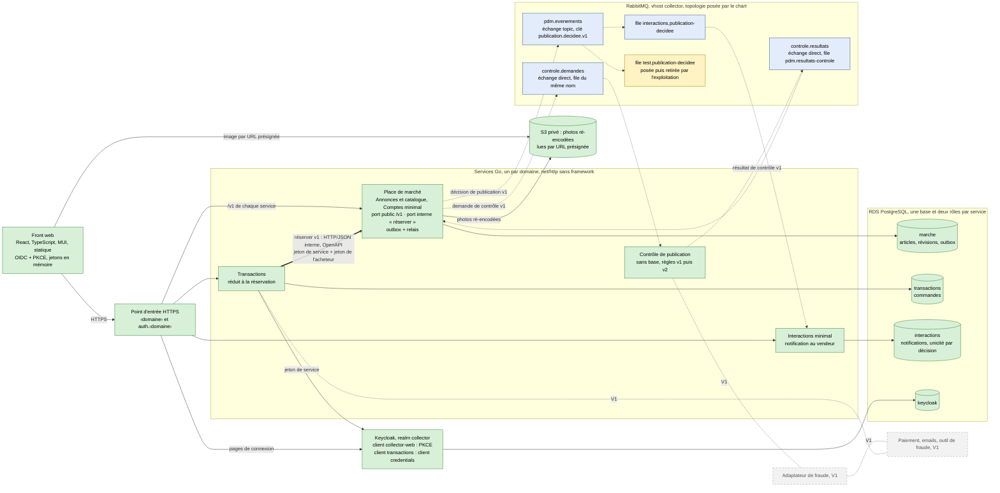

# Schéma 01 — Vue logique du POC : services, canal, contrats

Document parent : [architecture-technique.md](../architecture-technique.md) § 3. Décisions : [D02](../../decisions/D02-decoupage-applicatif.md), [D04](../../decisions/D04-stack.md), [D05](../../decisions/D05-communication-interservice.md), [D06](../../decisions/D06-authentification-autorisation.md), [D07](../../decisions/D07-donnees.md).
Statut : D05 et D06 sont **Candidate**, sous réserve du bac à sable (XP02, XP03 de [D14](../../decisions/D14-experimentations.md)).

Légende :
- Vert : construit et déployé dans le POC. Bleu : objets du canal, déclarés dans le fichier de définitions de RabbitMQ (aucun service ne les crée). Jaune : abonnement de test. Gris en pointillé : V1, documenté.
- Trait plein : HTTP synchrone. Trait épais : seul appel synchrone entre services, authentifié. Pointillé fléché : message par le canal.
- Contrats : `contracts/messages/` (JSON Schema, un par message et par version, `additionalProperties: false`) et `contracts/api/` (OpenAPI par service, dont l'OpenAPI interne de « réserver »). Un test de contrat par paire producteur-consommateur ([D13](../../decisions/D13-strategie-tests-charge.md)).
- Enveloppe commune des messages : identifiant unique, type, version, date, identifiant de corrélation ; contexte de trace W3C dans les en-têtes AMQP.
- Chaque service se connecte au canal avec sa propre identité RabbitMQ : écriture sur le seul échange qu'il produit, lecture sur ses seules files, aucun droit `configure` (MC1, MC2 de D05).
