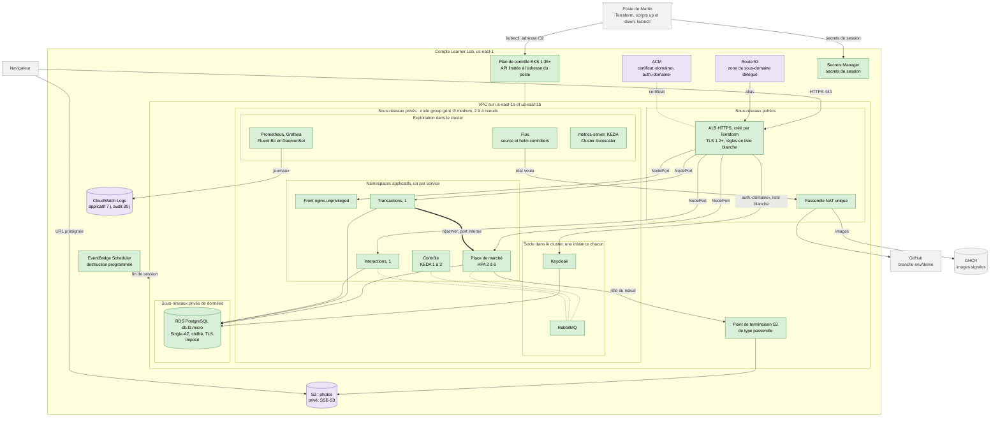

# Schéma 02 — Vue technique AWS du POC

Document parent : [architecture-technique.md](../architecture-technique.md) § 9.2. Décisions : [D03](../../decisions/D03-hebergement-orchestration.md), [D07](../../decisions/D07-donnees.md), [D08](../../decisions/D08-exposition-tls-domaine.md), [D09](../../decisions/D09-observabilite.md), [D11](../../decisions/D11-iac-allumage-cout.md).
Statut : EKS (D03) et l'exposition Route 53 / ACM / ALB (D08) sont **Candidate**, sous réserve du bac à sable (XP01, XP03 de [D14](../../decisions/D14-experimentations.md)). Repli de D03 : ECS sur Fargate.

Légende :
- Violet : couche persistante (`infra/persistant/`), appliquée une fois : zone et certificat, bucket des photos, groupes de journaux. Vert : couche éphémère (`infra/ephemere/` puis Helm), créée par `up` et détruite par `down` à chaque session.
- Le front et les API partagent l'origine `‹domaine›` ; Keycloak a sa propre origine `auth.‹domaine›`. Les photos ne passent par aucune route de l'ALB.
- Non routés par l'ALB : « réserver », consoles et ports de gestion (Keycloak, RabbitMQ), Prometheus, Grafana, ports de métriques.
- Aucun registre AWS : les images viennent de GHCR, par la NAT. Aucun load balancer créé par Kubernetes.
- Identité d'exécution unique (`LabRole`, rôle des nœuds) : écart ES-38, borné par la réservation de l'IMDS (MS3). Voir [05-securite.md](05-securite.md).
