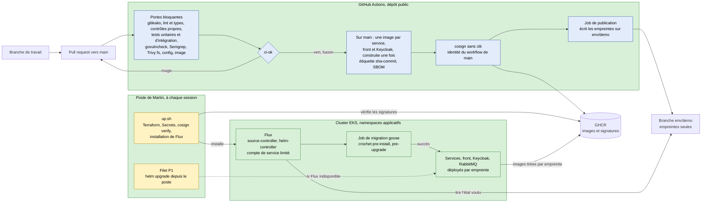

# Schéma 03 — Livraison : GitHub, GHCR, Flux, EKS

Document parent : [architecture-technique.md](../architecture-technique.md) § 9.4. Décisions : [D10](../../decisions/D10-forge-ci-cd.md), [D11](../../decisions/D11-iac-allumage-cout.md), [D07](../../decisions/D07-donnees.md) (migrations).
Le détail des portes et du cycle DevSecOps vit dans `docs/processus/` (D10, « Conséquences ») ; ce schéma n'en montre que l'enchaînement.

Lecture :
- **La CI ne détient aucun identifiant AWS ni du cluster** : elle construit, analyse, signe et publie des empreintes. Le cluster tire l'état voulu (modèle « pull »), ce qui rend la livraison continue compatible avec une API du cluster fermée à Internet (MS1) et sans fédération OIDC vers AWS.
- **Promotion sans reconstruction** : l'image construite sur `main` est celle qui tourne sur EKS, en local (k3d) et en acceptation.
- **Une migration en échec arrête le déploiement** (crochet Helm, D07).
- **Frontières de confiance de la chaîne (FC9)** : compte GitHub de Martin (double facteur), job de publication (seul à écrire `env/demo`), droits de Flux (namespaces applicatifs, aucune ressource de cluster). Mesures MP1 à MP10 de D10.
