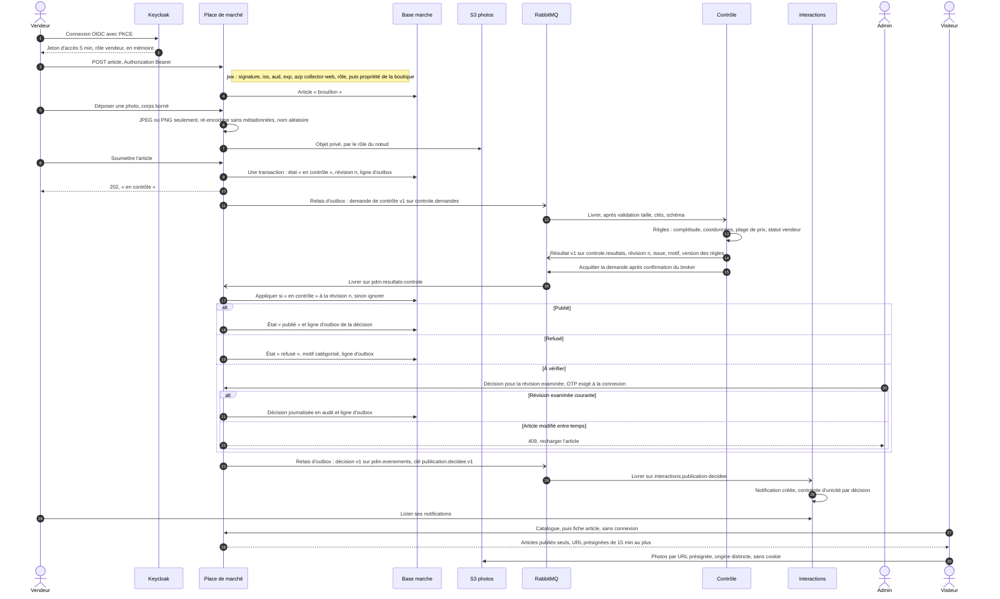

# Schéma 04 — Flux de mise en vente : soumission, contrôle, décision, diffusion

Document parent : [architecture-technique.md](../architecture-technique.md) § 4.1. Décisions : [D01](../../decisions/D01-fonctionnalite-poc.md), [D02](../../decisions/D02-decoupage-applicatif.md), [D05](../../decisions/D05-communication-interservice.md), [D06](../../decisions/D06-authentification-autorisation.md), [D07](../../decisions/D07-donnees.md).
Le passage par l'ALB n'est pas représenté. Les messages passent par RabbitMQ (statut **Candidate**, XP02).

Points de lecture :
- **Aucune perte** : l'événement est écrit dans la même transaction que le changement d'état (outbox) ; le relais ne marque une ligne publiée qu'après la confirmation du broker. Un article resté « en contrôle » au-delà d'un délai est renvoyé au contrôle (filet de la file, D05).
- **Aucun doublon d'effet** : la Place de marché n'applique un résultat qu'à la révision courante ; Interactions refuse une seconde notification pour la même décision.
- **Message non conforme** : écarté sans nouvel essai, vers la file `.ecartes` de sa file, avec une alerte (ES-31, D09).
- **Émetteur vérifié** : chaque producteur pose `user-id`, vérifié par RabbitMQ contre l'identité connectée, puis par le consommateur (MC2).
- Revalidation après modification et contrôle indisponible : [architecture-technique.md](../architecture-technique.md) § 4.2.
