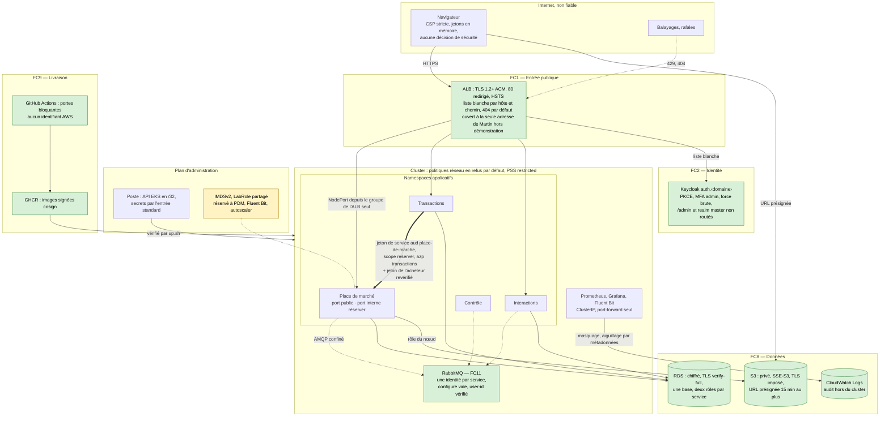

# Schéma 05 — Sécurité intégrée : frontières de confiance et contrôles

Document parent : [architecture-technique.md](../architecture-technique.md) § 9.5. Frontières FC1 à FC11 : [exigences-securite.md](../../securite/exigences-securite.md) § 3 et architecture § 2.3. Mesures : MS (D03), MC (D05), MA (D06), MD (D07), ME (D08), MO (D09), MP (D10), MI (D11).
Statut : D03, D05, D06 et D08 sont **Candidate** ; les critères de sécurité bloquants du bac à sable (X16, X12/X19, XC2, XC7, XC9, XE4/ME8) conditionnent leur adoption ([D14](../../decisions/D14-experimentations.md)).

Légende : vert, contrôle démontré dans le POC (sous réserve des critères du bac à sable) ; jaune, écart connu du Learner Lab, borné et documenté. Trait épais : appel synchrone authentifié ; pointillé : canal.

| Contrôle | Où | Preuve prévue |
|---|---|---|
| Authentification utilisateur et rôles | Keycloak (OIDC, PKCE), vérification `jwx` dans `libs/platform/` à chaque requête, propriété vérifiée dans chaque service | Tests négatifs MA3 à MA6, ES-03, ES-04 |
| Service à service | Jeton `client_credentials` de Transactions + `X-Collector-User-Token` ; route servie sur un port interne distinct, `ClusterIP`, absent de l'ALB | MC7, MA6, XE4, X17 |
| Canal | Identités RabbitMQ par service, droits par échange et par file, `user-id` vérifié, validation stricte avant décodage | XC2, XC4, XC9 |
| Réseau | Nœuds et base en sous-réseaux privés ; politiques réseau en refus par défaut, entrée et sortie ; NodePorts ouverts au seul groupe de l'ALB | X12, X17, X19 |
| Chiffrement en transit | TLS public jusqu'à l'ALB ; TLS vers RDS ; en clair dans le VPC (ALB → NodePort, AMQP, « réserver ») : confinement réseau, écart V1 | XE3, MD3, ME9 |
| Chiffrement au repos | RDS chiffré, bucket SSE-S3, disques des nœuds chiffrés | MI9, inventaire |
| Secrets | Générés à chaque `up`, injectés par l'entrée standard, un Secret par service, jamais dans le dépôt, les valeurs Helm ni l'état Terraform | X20, MI3, MI4 |
| Admission | PSS « restricted », Services `LoadBalancer` et NodePorts hors liste refusés, pas de jeton de compte de service monté | X18 |
| Chaîne de livraison | Portes bloquantes, images signées et vérifiées, Flux limité aux namespaces applicatifs | MP1 à MP10 |
| Audit | Journaux JSON masqués, groupe d'audit CloudWatch aiguillé par les métadonnées Kubernetes | MO2, MO3, X21 |
