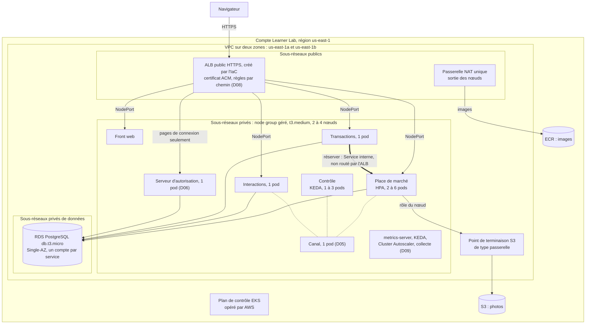

# D03 — Hébergement et orchestration AWS

| Champ | Valeur |
|---|---|
| Statut | Candidate (XP à définir en D14) |
| Date | 2026-10-09 |
| Décideur | Martin |
| Dépend de | [D02](D02-decoupage-applicatif.md) |
| Impacte | D05, D06, D07, D08, D09, D10, D11, D13, D14, [architecture-technique.md](../architecture/architecture-technique.md) § 9, [exigences-securite.md](../securite/exigences-securite.md), section « Démarrer / arrêter » du README |
| Critères grille | C5, C2, C1, C9, C10 |

## Contexte et besoin

D03 fixe où et comment s'exécutent les composants du POC décidés dans D02 (option B, POC option P2), dans le compte AWS Academy Learner Lab.
C'est une décision de plateforme qui demande une vérification sur le terrain : le statut visé est `Candidate (XPnn)`, confirmé ou rejeté par une expérimentation ([PILOTAGE.md](../PILOTAGE.md) § 3.1).
D03 ne choisit ni le canal (D05), ni le serveur d'autorisation (D06), ni les données (D07), ni l'exposition (D08), ni l'observabilité (D09), ni la chaîne de livraison (D10), ni l'IaC (D11). Elle vérifie que l'hébergement retenu peut les accueillir.
D04 (stack) est instruite en parallèle : l'empreinte mémoire des services influe sur le dimensionnement, pas sur le choix.

### Ce qu'il faut héberger

Source : D02, « Périmètre du POC » et « Conséquences » (point D03).

| Composant | Instances au repos | Mise à l'échelle dans le POC | Particularité pour l'hébergement |
|---|---|---|---|
| Place de marché | 2 (ENF-11) | Automatique, sur la charge de consultation | API publique, vendeur et admin ; port interne « réserver » absent du point d'entrée public (ES-38) |
| Contrôle de publication | 1 | Automatique, sur les messages en attente | Aucun port exposé, aucune base |
| Interactions minimal | 1 | Aucune (D02) | API des notifications |
| Transactions, réduit à la réservation | 1 | Aucune (D02) | API de réservation ; seul appelant de « réserver » |
| Front web | 1 | Aucune | Fichiers statiques servis en HTTPS |
| Canal (D05) | 1 | Aucune | Doit authentifier lui-même chaque service, le rôle d'exécution étant unique (D02) |
| Serveur d'autorisation (D06) | 1 | Aucune | Pages de connexion publiques ; jetons de service |
| Base relationnelle (D07) | 1 instance, 3 espaces et 3 comptes | — | Place de marché, Interactions, Transactions |
| Stockage des photos (D07) | — | — | Privé jusqu'à la publication |
| Observabilité (D09) | Au moins une composante | — | Alimentée par les quatre services |

Le sprint 1 (WS-2) déploie la Place de marché, le Contrôle et le canal ; le sprint 3 ajoute Interactions et Transactions (D02).

### Exigences

| Source | Exigence (extrait) | Ce que l'hébergement doit permettre |
|---|---|---|
| ENF-10 | « Disponibilité mensuelle de 99,5 % pour la consultation du catalogue et l'achat. » | Cible V1. Non mesurable dans un environnement allumé quelques heures : le POC démontre les mécanismes (ENF-11, ENF-15). |
| ENF-11 | « La perte d'une instance d'un composant n'interrompt pas le service. » Vérification : « arrêt volontaire d'une instance pendant un test de charge ». | Réplicas répartis sur deux zones ; remplacement automatique d'une instance perdue. |
| ENF-14 | Catalogue et fiche « en moins de 500 ms au 95e centile, sous charge nominale ». | Capacité suffisante au repos et pendant la montée. |
| ENF-15 | Pic « absorbé par ajout automatique de capacité », moins de 1 % d'erreurs ; « la capacité redescend après le pic ». | Mise à l'échelle automatique dans les deux sens, en un délai visible pendant la soutenance. |
| ENF-16 | « Hors pic, les ressources allouées reviennent au minimum défini. » | Retour au minimum, idéalement jusqu'à la capacité facturée. |
| ENF-28 | « L'environnement complet se crée depuis zéro et s'éteint par commande. » | Création et destruction complètes par l'IaC, dans une session. |
| ENF-29 | « Un même artefact s'exécute en local et dans l'environnement managé ; seule la configuration externalisée change. » | Mêmes images ; idéalement, mêmes descripteurs de déploiement. |
| ES-01 | « Les flux internes, dont le canal et l'appel synchrone entre services, sont chiffrés ou confinés dans un réseau privé non exposé. » | Services, canal et base en réseau privé. |
| ES-06 | « Secrets injectés à l'exécution depuis un stockage de secrets, avec des droits minimaux par secret. » | Injection des secrets sans identité AWS par service. |
| ES-07 | « Seuls les points d'entrée HTTPS publics sont accessibles depuis Internet. Bases, stockage de fichiers et accès d'administration restent privés. » | Sous-réseaux privés ; accès d'administration de l'orchestrateur restreint. |
| ES-29 | « Mise à l'échelle automatique avec un minimum, un maximum et une alerte de coût. » | Plafonds explicites, compatibles avec les limites du Learner Lab. |
| ES-38 | Hébergement V1 : « une identité d'exécution par service ». Écart connu : « l'environnement de formation impose un rôle d'exécution unique ». | Cloisonnement réseau entre services, en compensation partielle ; écart documenté. |
| ES-26 | « Données hébergées dans l'UE, ou transfert encadré. » | Écart POC : régions US imposées, données fictives. V1 en eu-west-3 (Paris). |
| Consigne | Déploiement « via un orchestrateur ou un fournisseur cloud » ; test de charge en soutenance (M15, M16). Expérimentations valides citées : « orchestrateur de type Kubernetes (ex : Minikube), services d'un fournisseur cloud » ; « broker de messages déployé dans un orchestrateur ». | — |
| Grille C5 | « Le POC s'exécute dans un environnement managé. La disponibilité et la montée en charge de l'application sont démontrées. » | Un POC local plafonne C5 à 1 ou 2 points. |
| Grille C2 | Le POC « valide la faisabilité des points clés de l'architecture (… hébergement, orchestration, etc.) ». | L'orchestration est exercée par le POC lui-même. |
| Grille C1 | Protocole présentant « les technologies et plateformes testées ainsi que leurs interactions », résultats qui « permettent de valider l'adoption ». Écart à éviter : « expérimentation non reproductible intégralement ». | Expérimentation locale puis cloud, critères fixés avant. |

### Contraintes de l'environnement

État des connaissances au 2026-10-09, par recherche documentaire. **Aucune sonde n'a encore été lancée sur le compte de Martin.**
Niveaux de preuve :
- **[DOC]** : Readme officiel du Learner Lab (version du 2025-06-24), documentation ou tarifs AWS ;
- **[REX]** : retour d'expérience daté (dépôts d'étudiants 2025-2026 : sondes d'API, états Terraform, procédures) ;
- **[?]** : information contradictoire, déduite ou introuvable, à lever par la sonde ou l'expérimentation.

Sources en fin de document.

| Contrainte | Conséquence pour D03 | Preuve |
|---|---|---|
| Sessions de 4 h ; relancer « Start Lab » avant l'échéance remet le compteur à 4 h | Allumage, travail et extinction tiennent dans une session ; la soutenance se joue dans une session fraîchement relancée | [DOC] |
| Fin de session : seules les instances EC2 sont arrêtées, puis redémarrées à la session suivante. Plan de contrôle EKS, NAT, load balancers, tâches Fargate et RDS continuent de facturer | Destruction par l'IaC à la fin de chaque session, vérifiée par un inventaire | [DOC] |
| L'ASG d'un node group remplace les nœuds arrêtés par le lab | Sans destruction, un cluster EKS consomme en silence | [REX] |
| Budget inférieur à 100 $ pour tout le projet ; épuisement = compte désactivé et tout perdu ; affichage du budget en retard de 8 à 12 h | Coût estimé avant, mesuré en heures-ressources pendant ; garde-fou en D11 | [DOC] |
| IAM figé : ni rôle, ni utilisateur, ni fournisseur OIDC créables. Rôles fournis : `LabRole`, `LabInstanceProfile`, et selon les comptes `LabEksClusterRole` et `LabEksNodeRole` | Ni IRSA ni EKS Pod Identity ; une seule identité d'exécution pour tous les services (écart ES-38 déjà documenté) | [DOC] ; IRSA et rôles `LabEks*` [REX] |
| EC2 : tailles nano à large ; au plus 9 instances et 32 vCPU par région, nœuds EKS et ECS compris ; 20 instances ou plus, ou toute tentative de dépasser une limite, peut désactiver le compte | Plafonds d'autoscaling stricts, sur les nœuds comme sur les tâches | [DOC] |
| Régions us-east-1 et us-west-2 seulement | us-east-1 (clé `vockey`, REX les plus nombreux) ; écart ES-26 assumé pour des données fictives | [DOC] |
| ECR : `LabRole` en lecture seule ; écriture avec les identifiants de l'utilisateur | Images poussées depuis le poste ou la CI avec les identifiants de session (D10) | [DOC] |
| Amazon MQ, MSK, CloudFront, CodeBuild, CodePipeline et Cloud Map indisponibles | Canal en conteneur ; pas de découverte de services managée sur ECS ; HTTPS sans CloudFront | [REX] |
| Cognito : User Pool, client et domaine créés en REX, mais absent du Readme 2025 | Prévoir un serveur d'autorisation en conteneur ; Cognito seulement si la sonde le confirme (D06) | [REX] ; disponibilité [?] |
| RDS PostgreSQL db.t3.micro créé en 10 à 16 min ; Multi-AZ refusé dans un REX | Base managée hors de l'orchestrateur, Single-AZ | [REX] ; Multi-AZ [?] |
| S3 : une SCP refuse `s3:GetBucketObjectLockConfiguration`, ce qui fait échouer la ressource `aws_s3_bucket` de Terraform | Bucket créé hors du provider (CLI) ou dans la couche persistante | [REX], plus de 10 dépôts |
| Identifiants de session d'environ 4 h ; une expiration en plein `apply` laisse l'état IaC verrouillé | Pas d'`apply` long après la 3e heure ; CI sans fédération OIDC (D10) | [REX] ; durée exacte [?] |
| Variantes de Learner Lab : certaines n'offrent ni ECS ni EKS ; permissions variables d'un compte à l'autre et dans le temps | Sonde du compte avant toute expérimentation | [DOC], [REX] |

**Prérequis** : sonde du compte lors de la session de configuration AWS ([PILOTAGE.md](../PILOTAGE.md) § 3.2). Points à lever pour D03 : ECS et EKS disponibles ; rôles `LabEks*` présents ; versions EKS proposées et leur statut de support ; Cognito ; Route 53 et ACM (D08) ; quota de vCPU Fargate ; Multi-AZ RDS ; SCP S3.
Un refus qui cite la politique `voc-cancel-cred` signale une session expirée, pas une interdiction [REX].

### Critères de choix

Fixés avant la comparaison des options.

| # | Critère | Ce qui est regardé |
|---|---|---|
| CR1 | Environnement managé (C5) | Qui opère l'orchestrateur : AWS ou Martin |
| CR2 | Montée en charge démontrable en direct (C5, ENF-15, ENF-16) | Pods ou tâches, et si possible nœuds ; les deux signaux de D02 (consultation, messages en attente) ; délai compatible avec 20 minutes de soutenance ; retour au minimum |
| CR3 | Disponibilité démontrable (C5, ENF-11) | Perte d'une instance sous charge avec moins de 1 % d'erreurs ; répartition sur deux zones |
| CR4 | Création et destruction par l'IaC (ENF-28) | Durées d'allumage et d'extinction ; aucune ressource créée hors de l'état IaC |
| CR5 | Coût | Par heure, par session de 4 h, sur environ 25 sessions ; coût d'un oubli d'extinction |
| CR6 | Expérimentable d'abord en local (PILOTAGE § 3.2, C1, ENF-29) | Fidélité de l'environnement local à l'environnement managé |
| CR7 | Compatibilité Learner Lab | Rôles imposés, services indisponibles, quotas, niveau de preuve |
| CR8 | Canal, serveur d'autorisation et S3 | Conteneurs à état, découverte interne, accès aux API AWS sans identité par service |
| CR9 | Exposition et cloisonnement réseau (ES-01, ES-07, ES-38) | Services privés ; qui peut joindre la route « réserver », le canal, la base |
| CR10 | Schéma interne exploitable en soutenance (C10, C2) | Lisibilité, vocabulaire précis |
| CR11 | Compétence à acquérir (C9) et effort solo | Compétence réaliste et transférable ; jours d'infrastructure |

## Options

### Socle commun aux trois options

Ce qui suit vaut pour A, B et C, sauf mention contraire.

- **Région** : us-east-1 [DOC].
- **Réseau** : un VPC sur deux zones, us-east-1a et us-east-1b (us-east-1e ne peut pas héberger le plan de contrôle EKS [REX]).
  - Sous-réseaux publics : le load balancer public et la passerelle NAT, rien d'autre.
  - Sous-réseaux privés applicatifs : les nœuds ou les tâches.
  - Sous-réseaux privés de données : la base.
- **Une seule passerelle NAT**, pour la sortie (images, API AWS). Elle est un point unique de défaillance de la seule sortie, accepté dans le POC.
  - Des points de terminaison d'interface coûteraient davantage (environ 0,01 $/h par service et par zone).
  - Placer les nœuds en sous-réseaux publics économiserait environ 0,03 $/h, au prix d'une exposition moins sûre (ES-07).
  - Un point de terminaison S3 de type passerelle, gratuit, évite que les photos passent par la NAT.
- **Entrée** : un ALB public créé par l'IaC, en HTTPS avec un certificat ACM et un domaine externe (D08). Le front est servi par un conteneur derrière l'ALB.
- **Base** : RDS PostgreSQL db.t3.micro, Single-AZ, hors de l'orchestrateur, un espace et un compte par service (D07).
- **Photos** : bucket S3 créé hors du provider Terraform, à cause de la SCP [REX].
- **Images** : ECR, alimenté avec les identifiants de l'utilisateur (D10).
- **Deux couches d'IaC** (D11) :
  - une couche persistante bon marché : ECR, zone DNS, certificat, bucket, état IaC ;
  - une couche éphémère, créée et détruite à chaque session : VPC, NAT, orchestrateur, RDS, ALB.
- **Identité d'exécution** : une seule pour tous les services, quelle que soit l'option (écart ES-38, D02). Le cloisonnement entre services ne peut être que réseau et applicatif.
- **Points uniques de défaillance du POC**, hors du chemin démontré par ENF-11 : base Single-AZ, canal et serveur d'autorisation à une instance, NAT. Écarts à documenter.

### Option A — Amazon EKS : node group géré, HPA et KEDA

- **Description** :
  - *Cluster* : plan de contrôle EKS opéré par AWS, en version de support standard (1.35 ou plus en octobre 2026). Politique de mise à niveau « standard », pour ne jamais basculer en support étendu (à vérifier en expérimentation). Accès par access entries, mode `API_AND_CONFIG_MAP` [REX].
  - *Nœuds* : un node group géré de t3.medium (2 vCPU, 4 Gio, 17 pods au plus [REX]), réparti sur les deux zones. 2 nœuds au repos, 4 au plus : sous la limite de 9 instances et 32 vCPU [DOC].
  - *Rôles* :
    - `LabEksClusterRole` pour le cluster, à défaut `LabRole` [REX] ;
    - `LabRole` comme rôle des nœuds. Faute d'IRSA, les pods obtiennent les droits AWS du nœud par le service de métadonnées de l'instance (IMDS, limite de sauts à 2) : S3, CloudWatch, Cluster Autoscaler [REX partiel, ?] ;
    - tous les pods partagent ce rôle : c'est l'écart ES-38, le même que sous ECS.
  - *Entrée* :
    - l'ALB du socle, avec un groupe cible par service exposé (front, Place de marché, Interactions, Transactions, serveur d'autorisation), en mode instance sur un NodePort ;
    - les groupes cibles sont attachés à l'ASG du node group : un nœud ajouté est enregistré seul ;
    - routage par règles de chemin dans l'ALB ;
    - ni AWS Load Balancer Controller (il exige IRSA), ni Service de type `LoadBalancer` : aucun load balancer n'existe hors de l'état IaC ;
    - un contrôleur d'entrée dans le cluster n'est ajouté que si D08 en a besoin (limitation de débit, en-têtes).
  - *Flux internes* :
    - découverte par le DNS du cluster, sans load balancer interne ;
    - l'appel « réserver » vise un Service interne de la Place de marché, sur un port qu'aucune règle de l'ALB ne route (ES-38) ;
    - politiques réseau, appliquées par le moteur intégré au CNI du VPC [?] : seul Transactions joint le port « réserver », seuls les services joignent le canal, rien ne joint l'administration du serveur d'autorisation ;
    - le groupe de sécurité de la base n'accepte que celui des nœuds.
  - *Canal et serveur d'autorisation* :
    - conteneurs dans le cluster, une instance chacun, joints par un Service interne ;
    - le serveur d'autorisation n'est exposé par l'ALB que pour ses pages de connexion ;
    - stockage du canal : disque du pod, perdu si le pod est replanifié. Un volume EBS demanderait le pilote EBS CSI, qui suppose IRSA ; il reste à tester avec le rôle du nœud [?].
  - *Mise à l'échelle* :
    - metrics-server (module complémentaire EKS) et HPA sur la CPU pour la Place de marché, de 2 à 6 réplicas ;
    - KEDA pour le Contrôle, de 1 à 3 réplicas, sur la longueur de sa file. Des scalers existent pour RabbitMQ, NATS JetStream et Kafka ;
    - Cluster Autoscaler pour les nœuds, de 2 à 4 [?] ;
    - mettre à l'échelle sur le nombre de requêtes demanderait une source de métriques (D09) : la CPU en tient lieu.
  - *Secrets* : lus dans Secrets Manager ou SSM par le script de déploiement, avec les identifiants de session, puis créés en Secrets Kubernetes. External Secrets Operator ne fonctionne pas sans IRSA [REX].
  - *Déploiement* : un chart Helm commun aux quatre services, avec un fichier de valeurs par service et par environnement.
  - *Local* : le même chart sur minikube (cité par la consigne) ou k3d. PostgreSQL et un stockage compatible S3 en conteneurs remplacent RDS et S3. Seuls l'ALB et le Cluster Autoscaler ne s'expérimentent que dans AWS.
- **Schéma interne** (à reprendre dans `docs/architecture/schemas/` après décision) :

  Légende : trait épais, appel synchrone authentifié de service à service ; pointillé, connexion au canal. Les politiques réseau, le pilotage des nœuds par le plan de contrôle et la collecte des journaux ne sont pas tracés.

- **Démonstrations C5** :
  - *Montée en charge* :
    - tir progressif sur la consultation ;
    - le HPA ajoute des pods en moins d'une minute en principe : métriques relevées toutes les 15 s, boucle du HPA toutes les 15 s, image déjà présente sur le nœud ;
    - les pods en attente déclenchent un nœud en 2 à 4 minutes [estimation] ;
    - après le tir, retour à 2 pods (fenêtre de stabilisation du HPA de 5 min par défaut, réglable), puis retrait du nœud (10 min d'inutilité par défaut, réglable) ;
    - délais à mesurer en expérimentation.
  - *Second signal* : une vague de soumissions remplit la file du Contrôle ; KEDA ajoute des consommateurs, puis revient à 1.
  - *Disponibilité* :
    - suppression forcée d'un pod de la Place de marché pendant le tir : le Service retire le pod, l'ALB continue sur les autres, le pod est remplacé ;
    - variante plus forte, l'arrêt d'un nœud : sans réglage, les pods d'un nœud perdu ne sont replanifiés qu'au bout d'environ 5 min (tolérance par défaut de 300 s), et des erreurs apparaissent tant que le nœud n'est pas déclaré indisponible (environ 40 s). À mesurer ; à montrer seulement si le taux d'erreurs reste sous 1 %.
- **IaC et durées** :
  - Terraform, avec `aws_eks_cluster` et `aws_eks_node_group` écrits directement : le module communautaire échoue sur `iam:GetRole` [REX] ;
  - Helm pour les composants du cluster et les services ;
  - allumage depuis zéro en 35 à 45 min : cluster 15 à 20 min, node group 8 à 12 min, RDS en parallèle [REX : 40 min] ;
  - extinction en 15 min environ [REX] ;
  - aucun `apply` du cluster après la 3e heure de session [REX].
- **Avantages** :
  - Environnement managé sans ambiguïté, avec deux niveaux de mise à l'échelle (pods, nœuds) : la démonstration la plus complète pour C5.
  - Les deux signaux de D02 sont natifs : CPU par le HPA, messages en attente par KEDA, sans métrique à fabriquer.
  - Canal et serveur d'autorisation en conteneurs, joints par le DNS du cluster, sans load balancer interne.
  - Le même chart tourne en local et dans AWS : expérimentation locale fidèle (C1), et ENF-29 tenue jusqu'aux descripteurs de déploiement.
  - Retour au minimum jusqu'aux nœuds facturés (ENF-16), si le Cluster Autoscaler fonctionne.
  - Compétence standard et transférable (C9).
- **Inconvénients** :
  - Allumage le plus long, environ 40 min, soit un sixième de chaque session.
  - Composants à installer et à tenir à jour : metrics-server, KEDA, Cluster Autoscaler, chart Helm.
  - Absence d'IRSA contournée par le rôle du nœud : tous les pods, pas seulement ceux qui en ont besoin, peuvent obtenir `LabRole`.
  - Cloisonnement réseau dépendant des politiques réseau du CNI du VPC [?].
  - Stockage du canal éphémère, sauf pilote EBS CSI [?].
  - Courbe d'apprentissage Kubernetes si la compétence manque.
- **Pièges** :
  - **Support étendu** : en octobre 2026, les versions 1.31 à 1.33 coûtent 0,60 $/h au lieu de 0,10 $/h pour le plan de contrôle ; la 1.34 sort du support standard le 2026-12-02, avant ou pendant la soutenance [DOC]. Épingler 1.35 ou plus.
  - **Load balancers créés par Kubernetes** (Service `LoadBalancer`, Ingress avec le contrôleur AWS) : hors de l'état IaC, ils font échouer la destruction ou restent facturés [REX]. Exclus par construction ; `down` vérifie qu'il n'en reste aucun.
  - **ASG qui relance les nœuds** arrêtés par le lab en fin de session [REX] : sans destruction, la pile continue de facturer.
  - **ingress-nginx**, souvent repris des REX, est retiré par le projet Kubernetes depuis mars 2026 : plus de correctifs de sécurité [DOC]. À ne pas utiliser si D08 veut un contrôleur d'entrée.
  - **Densité** : 17 pods par t3.medium, 11 par t3.small, sans délégation de préfixes [REX].
  - **Point de terminaison public de l'API Kubernetes** : c'est un accès d'administration (ES-07), à restreindre.
  - **Plafonds** : HPA, KEDA et node group bornés ; dépasser une limite peut désactiver le compte [DOC].
- **Variantes non retenues** :
  - *EKS Auto Mode* : AWS opère lui-même les nœuds, le stockage et les load balancers, ce qui contournerait l'absence d'IRSA. Mais : un seul REX, par la console ; il peut choisir des instances au-delà de « large », refusées ; surcoût d'environ 12 % sur les nœuds ; accès AWS des pods non garanti [?] ; il exige `LabEksClusterRole`, absent de certains comptes [REX]. À réévaluer seulement si le Cluster Autoscaler échoue et que la mise à l'échelle des nœuds devient indispensable.
  - *Karpenter installé par Martin* : exige des rôles et des profils d'instance à créer, refusés [déduit].
  - *EKS sur Fargate* : aucun REX de succès ; exige l'AWS Load Balancer Controller, donc IRSA [déduit].
- **Coût AWS et effort** :
  - Environ 0,34 $/h : plan de contrôle 0,10 ; 2 × t3.medium 0,083, plus environ 0,01 en moyenne pour les nœuds de pointe et les disques ; socle (ALB, NAT, RDS, IPv4 publiques, journaux) environ 0,14.
  - Environ 1,35 $ par session de 4 h ; environ 38 $ pour 25 sessions, couche persistante comprise (environ 4 $).
  - Oubli d'extinction : environ 7 à 8 $ par 24 h. Version en support étendu : + 0,50 $/h, soit + 2 $ par session.
  - Effort d'infrastructure, ordre de grandeur : 6 à 7 jours (IaC 2 à 3 j, chart et composants du cluster 2 j, expérimentation 2 j).
- **Complexité ajoutée** : un cluster et son cycle de vie, un node group, trois composants de cluster, un chart, deux contournements (rôle du nœud, secrets créés au déploiement). Chacun répond à un besoin nommé : expérimentation locale fidèle (CR6), deux signaux de mise à l'échelle (D02, CR2), retour au minimum des nœuds (ENF-16), découverte interne du canal sans load balancer (CR8).
- **Couverture grille** :
  - **C5** : managé, pods et nœuds, perte d'une instance : niveau 5 visé.
  - **C2** : hébergement et orchestration exercés par le POC lui-même.
  - **C1** : protocole local puis cloud, avec les mêmes descripteurs ; la consigne cite Kubernetes et Minikube ; l'expérimentation du canal peut partager le même cluster de test.
  - **C9** : « Kubernetes pour développeurs », action de formation crédible pour des développeurs confirmés.
  - **C10** : schéma riche et vocabulaire précis (plan de contrôle, node group, HPA, KEDA, politiques réseau).

### Option B — Amazon ECS sur Fargate

- **Description** :
  - *Orchestrateur* : un cluster ECS et des services sur Fargate : AWS fournit la capacité, il n'y a pas de nœuds. Tâches réparties sur les deux zones. `LabRole` sert nativement de rôle de tâche et d'exécution [DOC].
  - *Entrée* : l'ALB du socle, un groupe cible de type IP par service exposé.
  - *Flux internes* :
    - Cloud Map et Service Connect sont bloqués [REX] ;
    - un NLB interne porte le canal (TCP) et le port interne « réserver » de la Place de marché ;
    - les adresses sont passées par variables d'environnement.
  - *Cloisonnement* : un groupe de sécurité par service, natif. Seul Transactions atteint le port « réserver » par le NLB ; seuls les services atteignent le canal. Aucun composant à ajouter.
  - *Canal et serveur d'autorisation* : services ECS à une tâche. Stockage éphémère de la tâche, perdu à son remplacement. EFS est absent des listes consultées [?].
  - *Mise à l'échelle* : Application Auto Scaling, prouvé en REX [REX].
    - Place de marché : sur le nombre de requêtes par cible de l'ALB, nativement.
    - Contrôle : sa file est dans un broker en conteneur, donc sa longueur n'est pas une métrique CloudWatch. Il faut écrire un publieur de métrique (tâche planifiée, Lambda ou collecteur qui lit le broker), puis une politique par paliers.
    - Pas de nœuds : la capacité facturée suit les tâches.
  - *Journaux* : pilote `awslogs` vers CloudWatch Logs et Container Insights, natifs [REX].
  - *Local* : docker compose avec les mêmes images. Il ne teste ni le placement, ni la mise à l'échelle, ni le remplacement des tâches : l'orchestrateur ne s'expérimente que dans AWS.
- **Démonstrations C5** :
  - *Montée en charge* : en suivi de cible, l'alarme d'ajout attend 3 points d'une minute, puis la tâche démarre en une minute environ : 3 à 5 min avant qu'une nouvelle tâche serve. L'alarme de retrait attend 15 points d'une minute : environ 15 min avant de redescendre [doc AWS, à mesurer]. Pour tenir en 20 minutes, il faut des politiques par paliers.
  - *Disponibilité* : arrêt d'une tâche de la Place de marché pendant le tir ; le service la remplace. Délai de désinscription du groupe cible à réduire (300 s par défaut).
  - *Nœuds* : sans objet. ENF-16 est tenue sans effort, mais la démonstration ne montre qu'un niveau de mise à l'échelle.
- **IaC et durées** : Terraform, ou CloudFormation recommandé par le Readme [DOC]. Allumage en 15 à 20 min, la base étant le chemin critique (10 à 16 min [REX]) ; extinction en 10 min environ. Durées d'ECS non mesurées en REX [?].
- **Avantages** :
  - Le plus simple à exploiter : ni nœuds, ni composants de cluster, ni mise à jour d'orchestrateur.
  - `LabRole` natif comme rôle de tâche : S3, CloudWatch et Secrets Manager sans contournement.
  - Cloisonnement par groupe de sécurité de service, natif et démontrable (CR9).
  - Journaux centralisés sans composant à ajouter (aide D09).
  - Allumage deux fois plus rapide qu'EKS.
- **Inconvénients** :
  - Expérimentation locale limitée aux conteneurs : le protocole C1 ne teste l'orchestrateur que dans AWS, avec moins de répétitions possibles.
  - Deux descriptions du déploiement à garder alignées : compose en local, définitions de tâches dans AWS.
  - Un load balancer interne de plus, faute de découverte de services.
  - Mise à l'échelle sur les messages en attente à construire.
  - Réactions plus lentes : 3 à 5 min pour monter, environ 15 min pour redescendre en suivi de cible.
  - Compétence propre à AWS (C9).
- **Pièges** :
  - **Quota de vCPU Fargate** du compte inconnu ; un dépassement peut désactiver le compte [DOC pour la règle ; quota ?].
  - **Tâches Fargate et load balancers facturés après la fin de session** [DOC].
  - Délai de désinscription par défaut (300 s), qui ralentit chaque déploiement et chaque démonstration.
  - FireLens déclaré indisponible par un REX [?].
- **Variante non retenue — ECS sur EC2** : un fournisseur de capacité avec mise à l'échelle gérée montrerait l'ajout d'instances. Il réintroduit ASG, AMI optimisée ECS et cycle de vie des instances ; le Readme demande de créer l'ASG dans la console EC2 [DOC] ; la mise à l'échelle gérée n'a pas de REX [?]. Elle rapproche ECS de la complexité d'EKS, sans l'expérimentation locale.
- **Coût AWS et effort** :
  - Environ 0,31 $/h : tâches au repos, environ 3 vCPU et 6 Go, environ 0,15 (Place de marché 2 × 0,25 vCPU et 0,5 Go ; Contrôle, Interactions, Transactions et front 4 × 0,25 vCPU et 0,5 Go ; canal 0,5 vCPU et 1 Go ; serveur d'autorisation 1 vCPU et 2 Go) ; NLB interne environ 0,02 ; socle environ 0,14.
  - Environ 0,26 $/h si D06 retient Cognito.
  - Environ 1,25 $ par session (1,05 $ avec Cognito) ; environ 35 $ pour 25 sessions, couche persistante comprise (30 $ avec Cognito).
  - Oubli d'extinction : environ 6,5 $ par 24 h.
  - Effort d'infrastructure, ordre de grandeur : 5,5 à 6 jours (IaC 3 j, publieur de métrique 0,5 à 1 j, compose 0,5 j, expérimentation 1,5 j).
- **Complexité ajoutée** : la plus faible en exploitation. Elle ajoute un NLB interne, un publieur de métrique et une seconde description du déploiement.
- **Couverture grille** :
  - **C5** : managé, tâches, perte d'une instance : niveau 5 visé, avec un seul niveau de mise à l'échelle.
  - **C2** : hébergement et orchestration exercés par le POC.
  - **C1** : partie locale réduite aux conteneurs.
  - **C9** : compétence ECS, propre à AWS.
  - **C10** : schéma simple et lisible.

### Option C — k3s auto-géré sur EC2

- **Description** :
  - *Orchestrateur* : k3s installé par l'IaC sur des instances EC2 t3.medium, avec `LabInstanceProfile` : un serveur et un ou deux nœuds de travail, ou trois serveurs pour un plan de contrôle redondant.
  - *Entrée* : l'ALB du socle vers des NodePorts. En version minimale : Traefik, intégré à k3s, avec Let's Encrypt, sans ALB ni NAT.
  - *Flux internes, canal, serveur d'autorisation* : comme A. Politiques réseau appliquées par le contrôleur intégré à k3s. Volumes locaux pour le canal, perdus avec le nœud.
  - *Mise à l'échelle* : HPA et KEDA comme A. Aucune mise à l'échelle des nœuds native : ASG et jonction au cluster à construire [?].
  - *Local* : k3s ou k3d, fidélité maximale.
- **Démonstrations C5** : pods et perte d'un pod comme A ; pas de nœuds ; la perte du serveur unique arrête le plan de contrôle.
- **IaC et durées** : allumage en 15 min environ avec RDS, 5 à 8 min sans ; extinction en 10 min environ. Des instances non détruites redémarrent seules à la session suivante [DOC].
- **Avantages** :
  - Le moins cher et le plus rapide à allumer.
  - Fidélité maximale avec le local.
  - Pas de contournement d'IRSA : le profil d'instance suffit.
- **Inconvénients** :
  - **Ce n'est pas un environnement managé** [REX] : plan de contrôle, mises à jour, certificats et sauvegarde de l'état du cluster sont à la charge de Martin. Le descripteur de C5 commence par « Le POC s'exécute dans un environnement managé » : le jury peut ne pas le reconnaître.
  - Plan de contrôle à point unique de défaillance, sauf trois serveurs.
  - Pas de mise à l'échelle des nœuds : ENF-16 tenue au niveau des pods seulement.
  - Profil d'administrateur Kubernetes, irréaliste pour une équipe de trois développeurs (C9).
- **Coût AWS et effort** :
  - Environ 0,22 à 0,27 $/h avec le socle (2 ou 3 nœuds) ; environ 0,10 $/h en version minimale (sans ALB, NAT ni RDS).
  - Environ 0,9 à 1,1 $ par session ; environ 26 à 31 $ pour 25 sessions (14 $ en version minimale).
  - Oubli d'extinction : environ 2,5 $ par 24 h (instances arrêtées par le lab ; ALB, NAT et RDS facturés).
  - Effort, ordre de grandeur : 5,5 jours, plus l'exploitation du plan de contrôle.
- **Complexité ajoutée** : l'administration d'un cluster, que A et B confient à AWS.
- **Couverture grille** : **C5** en risque sur « environnement managé » ; **C2** orchestration exercée, hébergement auto-géré ; **C1** fort en local ; **C9** profil irréaliste.
- **Rôle proposé** : environnement local de l'expérimentation (k3d), pas cible du POC.

### Options écartées d'emblée

| Option | Motif |
|---|---|
| POC en local seulement, minikube en soutenance | C5 plafonné à 1 ou 2 points : pas d'environnement managé |
| Lambda | 10 environnements d'exécution concurrents au plus [DOC] : insuffisant pour un tir de charge ; consommateurs du canal à vie longue |
| App Runner | Non listé ; `LabRole` ne fait pas confiance à ce service [DOC] ; disponibilité [?] |
| EC2 et ASG avec docker compose, sans orchestrateur | Ni orchestration (C2), ni mise à l'échelle par service |

### Synthèse

| Critère | A — EKS | B — ECS Fargate | C — k3s sur EC2 |
|---|---|---|---|
| CR1 Managé | Oui : plan de contrôle opéré par AWS | Oui : sans serveur | Non : orchestrateur opéré par Martin |
| CR2 Montée en charge | Pods (HPA) et file (KEDA) natifs ; nœuds [?] ; montée en moins d'une minute attendue | Tâches ; requêtes natives, file à construire ; montée en 3 à 5 min, descente en 15 min en suivi de cible | Pods et file ; pas de nœuds |
| CR3 Disponibilité | Pod, nœud, zone | Tâche, zone | Pod ; plan de contrôle unique |
| CR4 Allumage / extinction | 35 à 45 min / 15 min | 15 à 20 min / 10 min [?] | 15 min / 10 min |
| CR5 Coût : session de 4 h / 25 sessions | ≈ 1,35 $ / ≈ 38 $ | ≈ 1,25 $ / ≈ 35 $ | ≈ 1 $ / ≈ 28 $ |
| CR6 Local d'abord | Même chart sur minikube ou k3d | Compose : conteneurs seulement | Même chart sur k3d |
| CR7 Learner Lab | REX nombreux ; contournements d'IRSA | REX ; `LabRole` natif ; pas de Cloud Map | REX ; profil d'instance |
| CR8 Canal, serveur d'autorisation, S3 | Conteneurs, DNS interne ; S3 par le rôle du nœud [?] | Conteneurs derrière un NLB interne ; S3 natif | Conteneurs, DNS interne ; S3 par le profil d'instance |
| CR9 Cloisonnement réseau | Politiques réseau [?] | Groupe de sécurité par service, natif | Politiques réseau (k3s) |
| CR10 Schéma de soutenance | Riche : plan de contrôle, nœuds, pods, HPA, KEDA | Simple : services, tâches, load balancers | Riche, mais « fait maison » |
| CR11 Compétence, effort | Kubernetes, transférable ; 6 à 7 j | ECS, propre à AWS ; 5,5 à 6 j | Administration Kubernetes ; 5,5 j |

## Recommandation

**Option A — Amazon EKS, node group géré, HPA et KEDA ; Cluster Autoscaler si l'expérimentation le valide.**
**Statut visé : `Candidate (XPnn)`. Repli : option B.**

1. **Elle vise C5 au niveau 5 avec la démonstration la plus complète** : environnement managé, montée en charge sur deux niveaux (pods, nœuds) et sur les deux signaux de D02, perte d'une instance sous charge.
2. **C'est la seule option managée qui s'expérimente d'abord en local de façon fidèle** (PILOTAGE § 3.2). Le même chart passe de minikube à EKS : le protocole est reproductible (C1) et ENF-29 tient jusqu'au déploiement. La consigne cite elle-même Kubernetes et Minikube.
3. **Elle loge simplement ce que le Learner Lab impose.** Le canal doit être un conteneur (Amazon MQ et MSK indisponibles, identité par service exigée par D02). Le DNS du cluster le rend joignable sans load balancer interne, et KEDA lit sa file sans métrique à fabriquer.
4. **Son surcoût est faible** : environ 0,1 $ de plus par session que B, 3 $ sur le projet. Son vrai coût est le temps : environ 20 min d'allumage de plus par session.
5. **Compétence (C9)** : Kubernetes est un standard du marché ; l'action de formation est crédible pour des développeurs confirmés.

**Pourquoi pas B, plus simple à exploiter.** B est l'option la plus simple en exploitation, et elle reste le repli. Elle perd sur deux besoins présents : l'expérimentation locale de l'orchestrateur (CR6) et la mise à l'échelle sur les messages en attente, à construire (CR2). Elle réagit aussi plus lentement, ce qui complique la démonstration en 20 minutes.

**Pourquoi pas C.** Elle est moins chère d'environ 0,3 $ par session, mais elle met en risque le premier mot du descripteur de C5 : « managé ». L'économie, environ 8 $ sur le projet, ne vaut pas ce risque. C sert d'environnement local.

**Volontairement exclu de A**, au nom de la simplicité : AWS Load Balancer Controller, Karpenter, EKS Auto Mode, Fargate sur EKS, maillage de services, opérateur GitOps (D10 le décidera s'il en a besoin), pile de supervision complète dans le cluster (D09), pilote EBS CSI (sauf si D05 exige un canal qui survive au redémarrage de son pod), plusieurs node groups, contrôleur d'entrée (sauf besoin de D08). Chaque ajout devra nommer le besoin qu'il sert.

**Si le Cluster Autoscaler échoue** : node group fixe de 3 nœuds, dimensionné pour le pic. La montée en charge reste démontrée sur les pods ; ENF-16 l'est au niveau des pods seulement. Ce repli ne remet pas A en cause.

### Ce que l'expérimentation doit prouver

- Le protocole est rédigé par DevOps ([PILOTAGE.md](../PILOTAGE.md) § 3.2), après la sonde du compte.
- Deux étapes : en local (minikube ou k3d), puis sur EKS.
- Charge de test : un service HTTP de test et un consommateur de file, pas le code du POC (le bac à sable est jetable).
- Les seuils ci-dessous sont des propositions, à figer dans le protocole avant l'exécution.

| # | Étape | Critère | Seuil de succès | Si échec |
|---|---|---|---|---|
| X1 | Sonde | EKS disponible ; rôles `LabEks*` ou repli `LabRole` ; version en support standard proposée | Cluster et node group créés dans le compte de Martin | Bascule vers B |
| X2 | Local | Le même chart déploie les services de test, le canal de test et le serveur d'autorisation en local puis sur EKS | Seul le fichier de valeurs change | Dérive à corriger, non éliminatoire |
| X3 | Local | HPA sous tir | De 2 à au moins 4 réplicas, puis retour à 2 | À corriger avant l'étape cloud |
| X4 | EKS | Allumage depuis zéro jusqu'à une réponse HTTPS 200 par l'ALB | ≤ 45 min, deux fois de suite | Au-delà de 60 min : bascule vers B |
| X5 | EKS | Extinction, puis inventaire : EKS, EC2, load balancers, NAT, Elastic IP, interfaces réseau, RDS, volumes | ≤ 20 min ; aucune ressource facturable restante hors couche persistante | Bloquant : IaC à corriger avant toute autre session |
| X6 | EKS | Accès d'un pod à S3 (écriture, lecture, URL présignée) sans identifiant statique | Réussi par le rôle du nœud | Repli : identifiants de session injectés, fragile, à documenter. Sans repli viable : bascule vers B |
| X7 | EKS | HPA : délai entre le franchissement du seuil et un nouveau pod prêt | ≤ 90 s ; p95 < 500 ms et moins de 1 % d'erreurs une fois la capacité ajoutée (ENF-14, ENF-15) ; retour au minimum ≤ 10 min après le tir (ENF-16) | Bascule vers B si le délai est imprévisible |
| X8 | EKS | KEDA sur la file d'un broker de test | De 1 à au moins 2 consommateurs ≤ 60 s après le seuil ; retour à 1 après vidage | Signal documenté ; Contrôle sur la CPU ou à nombre fixe |
| X9 | EKS | Cluster Autoscaler | Nœud prêt ≤ 5 min après l'apparition de pods en attente ; retrait après le tir ; 4 nœuds au plus | Node group fixe (voir ci-dessus) |
| X10 | EKS | Suppression forcée d'un pod sous tir | Moins de 1 % d'erreurs sur la fenêtre de tir ; remplaçant prêt ≤ 60 s | Bascule vers B |
| X11 | EKS | Arrêt d'un nœud sous tir | Erreurs et délai de reprise mesurés | Non éliminatoire ; décide si la démonstration l'inclut |
| X12 | EKS | Politiques réseau : un pod non autorisé ne joint ni le port « réserver » ni le canal | Refus constaté | Bascule vers B (avis sécurité) ; à défaut, écart documenté : cloisonnement par groupe de sécurité au niveau des nœuds seulement |
| X13 | EKS | Coût mesuré (heures-ressources × prix) ; aucun load balancer hors de l'état IaC | ≤ 0,40 $/h | Revue du dimensionnement |
| X14 | EKS | « Start Lab » relancé pendant que la pile tourne ; identifiants CLI changés ou non après la relance | Accès `kubectl` rétabli ≤ 5 min ; pile intacte ; si les identifiants changent, procédure établie pour recopier les identifiants utilisés par le kubeconfig (`aws eks get-token`) et recaler l'heure de référence du refus de `up.sh` sous 75 min restantes | Procédure de soutenance à adapter |
| X15 | EKS | Garde-fou coût : planification EventBridge Scheduler sous `LabRole` | Ressources facturables (node group, RDS, ALB, NAT, puis cluster et Elastic IP) réellement supprimées avant la fin de session, déclenchement avant l'expiration des identifiants ; comportement constaté si l'échéance tombe hors session | Garde-fou réduit à `down.sh` et au rappel sur le poste ; risque d'oubli (7 à 8 $ par 24 h) documenté |
| X16 | EKS | IMDS : depuis un pod non autorisé, demande d'un jeton IMDSv2 puis des identifiants du rôle ; requête IMDSv1 depuis n'importe quel pod | Refus dans 100 % des cas ; succès pour les seuls pods autorisés (X6) | Repli de MS3 (avis sécurité) ; sans repli : bascule vers B, motif de sécurité |
| X17 | EKS | Exposition vue d'Internet : balayage des adresses publiques du VPC ; `kubectl` depuis une adresse hors plage ; inventaire des load balancers, des Services et des règles de l'ALB | Seuls 443 et 80 (redirection) répondent ; nœuds, base et API injoignables ; un seul load balancer, aucun Service `LoadBalancer` ; « réserver » et console absents | Bloquant : IaC corrigée avant la session suivante |
| X18 | Local, EKS | Admission : pod privilégié, `hostNetwork` ou `hostPath`, Service `LoadBalancer`, dans un namespace applicatif | Tous refusés | À corriger, non éliminatoire |
| X19 | EKS | Cloisonnement, en complément de X12 : Contrôle → base ; pod quelconque → console du serveur d'autorisation ; chaque refus accompagné du test du flux autorisé | Refus constatés, flux autorisés fonctionnels | Politique mal réglée : à corriger ; politiques réseau inopérantes : bascule vers B, motif de sécurité |
| X20 | EKS | Secrets et images : recherche des valeurs de secrets dans les releases Helm, l'état Terraform, les journaux du déploiement et de la CI, les images ; analyse des images, des modules et de l'AMI | Aucune occurrence ; chaque pod ne monte que ses Secrets ; aucune vulnérabilité critique corrigible | Bloquant : révocation, puis procédure corrigée |
| X21 | EKS | Journal d'audit : action `kubectl` de test (création d'un Secret, `exec`) | Tracée dans CloudWatch en 5 min au plus, sans la valeur du secret ; volume compté dans X13 | Non éliminatoire ; écart ES-23 documenté |

**Bascule vers B** si X1, X4, X7 ou X10 échouent, ou si X6 échoue sans repli viable ; pour un motif de sécurité (avis sécurité), si l'IMDS ne peut pas être réservé aux pods qui en ont besoin (X16) ou si les politiques réseau sont inopérantes (X12, X19). B reçoit alors sa propre expérimentation, avec les mêmes critères transposés.

### Comparer deux options en bac à sable sert-il C1 ?

- **Ce n'est pas nécessaire.** Le niveau 5 de C1 demande un protocole reproductible, les technologies et leurs interactions, et des résultats qui « permettent de valider l'adoption ». Il n'exige pas de comparaison : des critères fixés avant et atteints suffisent.
- **C'est utile, mais secondaire.** Une comparaison mesurée justifie le rejet de B par des chiffres plutôt que par la documentation, et prépare la question « pourquoi pas ECS ? ».
  - Coût : une session, environ 1,25 $ et 4 h de travail.
  - Scénario minimal : un service, un consommateur, la mise à l'échelle et la perte d'une tâche.
  - Mesures : seulement les critères qui départagent (allumage, délais de montée et de descente, effort du second signal).
- **Proposition** : ne pas la rendre obligatoire. La mener seulement si l'expérimentation EKS déclenche une bascule (elle devient alors l'expérimentation de B), ou si le planning de J3 le permet. Martin tranche dans D14.

### Points soumis aux avis

- **Sécurité** :
  - rôle des nœuds `LabRole` accessible à tous les pods par IMDS : même exposition que le rôle de tâche unique sous ECS, à confirmer ; faut-il réserver IMDS aux seuls pods qui en ont besoin ?
  - point de terminaison public de l'API Kubernetes : plages d'adresses autorisées, ou point de terminaison privé, incompatible avec un déploiement depuis une CI hébergée (D10) ;
  - Secrets Kubernetes créés au déploiement depuis Secrets Manager ou SSM (ES-06) ;
  - NodePorts joignables par le seul groupe de sécurité de l'ALB ; politiques réseau entre services (X12) ;
  - écart ES-26 (région US, données fictives) et points uniques de défaillance du POC.
- **Faisabilité** :
  - effort d'infrastructure (6 à 7 jours) et compétence Kubernetes ;
  - environ 40 min d'allumage par session : travail local pendant l'allumage, séquence du jour de soutenance ;
  - dimensionnement des nœuds selon la stack de D04 (empreinte mémoire des services).

## Avis sécurité

Fonction : Sécurité — 2026-10-09. Références : [exigences-securite.md](../securite/exigences-securite.md) (FC11, ES-01, ES-06, ES-07, ES-23, ES-29, ES-30, ES-38, M-LIV-01 à M-LIV-08) et « Contraintes de l'environnement » ci-dessus. Avis sur dossier, avant toute sonde : les points [?] sont à lever par l'expérimentation.

### 1. Comparaison des options
| Point | A — EKS | B — ECS Fargate | C — k3s sur EC2 |
|---|---|---|---|
| Exposition (ES-07) | ALB seul point d'entrée si les nœuds sont privés, sans IP publique, et si leur groupe de sécurité n'ouvre que les NodePorts du chart, depuis l'ALB ; un Service `LoadBalancer` créerait un load balancer public hors IaC et hors HTTPS | ALB seul point d'entrée ; tâches privées sans IP publique ; NLB interne non exposé | Comme A derrière l'ALB ; la variante minimale (Traefik, sans ALB ni NAT) place les nœuds en sous-réseau public : refusée hors local |
| Accès d'administration | API Kubernetes publique, ouverte à 0.0.0.0/0 par défaut : authentifiée par IAM, mais joignable depuis tout Internet | Pas d'API de cluster : administration par les seules API AWS ; ECS Exec laissé désactivé | API k3s (6443), jeton de jonction et état du cluster sur les nœuds, à protéger soi-même |
| Cloisonnement entre services (FC11, ES-38) | Politiques réseau du CNI du VPC, à activer [?] ; un seul groupe de sécurité pour tous les pods ; aucun effet sur les pods `hostNetwork` | Un groupe de sécurité par service, natif, vérifiable par l'API AWS ; sur le NLB interne, une règle par port et par groupe source (canal, « réserver ») | Politiques réseau du contrôleur intégré (kube-router) |
| Secrets (ES-06) | Copiés de Secrets Manager en Secrets Kubernetes au déploiement ; chiffrement d'enveloppe actif par défaut sur EKS 1.28 et plus, à confirmer | Injection native par la définition de tâche (lecture par le rôle d'exécution) : chaque tâche ne reçoit que les siens | Comme A, mais Secrets non chiffrés par défaut (option `secrets-encryption`) |
| Rôle unique `LabRole` (ES-38) | Obtenu par **tous** les pods via l'IMDS, la limite de sauts étant à 2 ; droits « proches de ceux de l'utilisateur de la console » [DOC] : secrets, S3, base et journaux de tous les services | Obtenu par les seules tâches qui déclarent un rôle de tâche (facultatif ; pas d'IMDS sur Fargate) : la Place de marché seule, pour S3 | Comme A (`LabInstanceProfile`) |
| Mises à jour, surface (M-LIV-01) | Plan de contrôle par AWS ; AMI des nœuds et modules (CNI, CoreDNS, KEDA, Cluster Autoscaler) à suivre ; nœuds recréés à chaque session | La plus réduite : les images seulement | La plus large : système, k3s et ses composants, certificats, sauvegarde de l'état |
| Journal d'audit (ES-23, M-LIV-06) | Journaux du plan de contrôle (api, audit, authenticator) vers CloudWatch, à activer ; historique CloudTrail [?] | Historique CloudTrail [?] ; journaux applicatifs par `awslogs` | Journal d'audit de l'API à configurer, conservé sur le nœud |

- **Bilan** : B est la plus sûre par défaut (cloisonnement par groupe de sécurité, rôle refusé aux tâches qui n'en ont pas besoin) ; A atteint un niveau voisin avec les mesures du § 2, toutes démontrables ; C cumule la surface d'A et l'administration du plan de contrôle : écartée comme cible, acceptable en local si aucun identifiant AWS n'est monté dans le cluster.
- **Point soumis : « même exposition que sous ECS ? »** Non : sous B, une tâche sans rôle de tâche n'obtient aucun identifiant ; sous A, tout pod obtient `LabRole` tant que l'IMDS n'est pas réservé (MS3). Il faut donc le réserver.
- **ES-26 et points uniques de défaillance** : pas d'objection. ES-26 reste un écart accepté sur données fictives (§ 8 d'exigences-securite.md) ; un serveur d'autorisation arrêté n'émet plus de jeton (échec fermé) ; la perte du canal relève d'ES-31 et du mécanisme anti-perte de D05.
- **Vérifié sans objection** : ALB unique créé par l'IaC ; AWS Load Balancer Controller et ingress-nginx exclus ; base hors du cluster, en sous-réseau de données ; point de terminaison S3 de type passerelle ; « réserver » sur un Service interne non routé ; version épinglée en support standard.

### 2. Mesures minimales à imposer à A
| # | Mesure | Exigences, menaces | Dans le POC |
|---|---|---|---|
| MS1 | API du cluster : point de terminaison public limité à l'adresse du poste (/32, fixée à chaque `up`), point de terminaison privé activé (sinon l'adresse de la NAT doit être autorisée pour les nœuds) ; déploiement depuis le poste, la CI hébergée ne fait que construire et pousser | ES-07, M-LIV-03, M-LIV-05 | Démontrée (X17) ; point de terminaison privé seul : V1 |
| MS2 | Nœuds en sous-réseaux privés, sans IP publique ; groupe de sécurité des nœuds ouvert aux seuls NodePorts fixés dans le chart, depuis le groupe de l'ALB ; ALB en HTTPS (TLS 1.2 minimum, HTTP redirigé), règles de chemin en liste blanche, réponse 404 par défaut ; « réserver » et console du serveur d'autorisation sur des ports distincts, jamais publiés | ES-01, ES-07, ES-38, M-SYN-01 | Démontrée (X17, inventaire des points d'entrée) |
| MS3 | IMDSv2 obligatoire, fixé dans le modèle de lancement ; IMDS réservé à la Place de marché (S3), à la collecte des journaux et au Cluster Autoscaler par une politique réseau de sortie [?] ; à défaut, limite de sauts à 1 et composants système en `hostNetwork`, l'accès S3 de la Place de marché étant alors à arbitrer (X6) | ES-38, ES-06, ES-23 | Démontrée (X16) ; écart résiduel : la Place de marché garde `LabRole` |
| MS4 | Politiques réseau en refus par défaut, en entrée et en sortie, un namespace par service ; ouvertures : DNS ; ports publics depuis le VPC (trafic de l'ALB par les NodePorts) ; « réserver » depuis Transactions seul ; canal depuis les services ; base depuis les seuls services qui y ont un compte, pas le Contrôle | ES-01, ES-38, FC11 | Démontrée (X12, X19) |
| MS5 | Admission native : Pod Security Standards « restricted » en mode enforce sur les namespaces applicatifs ; ValidatingAdmissionPolicy refusant les Services `LoadBalancer` et les NodePorts hors liste ; `automountServiceAccountToken: false` ; requêtes, limites et quota par namespace | ES-07, ES-29, M-LIV-03, M-CAN-03 | Démontrée (X18) |
| MS6 | Secrets lus dans Secrets Manager, créés par `kubectl` depuis l'entrée standard : jamais en valeurs Helm (conservées dans la release), en argument de commande ni dans un journal ; état Terraform chiffré et privé | ES-06, M-LIV-02, M-LIV-07 | Démontrée (X20) ; droits minimaux par secret côté AWS : documentée |
| MS7 | RDS chiffré, non public, TLS imposé (`rds.force_ssl`), un compte par service ; bucket avec Block Public Access, chiffrement et refus des requêtes non TLS | ES-07, ES-38, M-LIV-03 | Démontrée (X17, inventaire) |
| MS8 | Journaux du plan de contrôle activés, rétention courte ; journaux applicatifs collectés hors du processus des services | ES-23, M-LIV-06 | Démontrée (X21) ; « non modifiable » : documentée, `LabRole` pouvant supprimer un groupe de journaux [?] |
| MS9 | Version 1.35 ou plus ; AMI des nœuds la plus récente, relevée à chaque `up` ; modules et charts épinglés et analysés ; images analysées avant déploiement | M-LIV-01 | Démontrée (X20) |
| MS10 | Plafonds : HPA 6, KEDA 3, node group 4, sous la limite de 9 instances ; alerte de coût [?] | ES-29 | Démontrée, sauf l'alerte [?] |

**ES-30** n'est pas démontrable dans le POC : la base est recréée à chaque session et un accès sous `LabRole` peut a priori supprimer un instantané ; elle reste documentée pour la V1 (sauvegardes dans un coffre verrouillé ou un compte séparé). **M-LIV-08** (injection) ne dépend pas de l'hébergement : aucune mesure de D03.

### 3. Critères ajoutés à l'expérimentation
| # | Étape | Critère | Seuil de succès | Si échec |
|---|---|---|---|---|
| X16 | EKS | IMDS : depuis un pod non autorisé, demande d'un jeton IMDSv2 puis des identifiants du rôle ; requête IMDSv1 depuis n'importe quel pod | Refus dans 100 % des cas ; succès pour les seuls pods autorisés (X6) | Repli de MS3 (avis sécurité) ; sans repli : bascule vers B, motif de sécurité |
| X17 | EKS | Exposition vue d'Internet : balayage des adresses publiques du VPC ; `kubectl` depuis une adresse hors plage ; inventaire des load balancers, des Services et des règles de l'ALB | Seuls 443 et 80 (redirection) répondent ; nœuds, base et API injoignables ; un seul load balancer, aucun Service `LoadBalancer` ; « réserver » et console absents | Bloquant : IaC corrigée avant la session suivante |
| X18 | Local, EKS | Admission : pod privilégié, `hostNetwork` ou `hostPath`, Service `LoadBalancer`, dans un namespace applicatif | Tous refusés | À corriger, non éliminatoire |
| X19 | EKS | Cloisonnement, en complément de X12 : Contrôle → base ; pod quelconque → console du serveur d'autorisation ; chaque refus accompagné du test du flux autorisé | Refus constatés, flux autorisés fonctionnels | Politique mal réglée : à corriger ; politiques réseau inopérantes : bascule vers B, motif de sécurité |
| X20 | EKS | Secrets et images : recherche des valeurs de secrets dans les releases Helm, l'état Terraform, les journaux du déploiement et de la CI, les images ; analyse des images, des modules et de l'AMI | Aucune occurrence ; chaque pod ne monte que ses Secrets ; aucune vulnérabilité critique corrigible | Bloquant : révocation, puis procédure corrigée |
| X21 | EKS | Journal d'audit : action `kubectl` de test (création d'un Secret, `exec`) | Tracée dans CloudWatch en 5 min au plus, sans la valeur du secret ; volume compté dans X13 | Non éliminatoire ; écart ES-23 documenté |

**Verdict** : avis favorable à l'option A, à condition que MS1 à MS10 soient décrites dans l'IaC et le chart dès le sprint 1 et que X17 et X20 réussissent ; si l'IMDS ne peut pas être réservé aux pods qui en ont besoin (X16) ou si les politiques réseau sont inopérantes (X12, X19), B, plus sûre par défaut, devient préférable : ce motif figure parmi les critères de bascule.

## Avis faisabilité

### Exploitation

Aucune durée n'est encore mesurée sur le compte de Martin. Les chiffres sont à confirmer par X4, X5 et X13 ; les niveaux de preuve sont ceux définis plus haut.

**1. Allumage et extinction**
- **Outil IaC.** Terraform ou OpenTofu conviennent à A, B et C. Ils partagent le même provider AWS, donc les mêmes pièges (SCP S3, `GetRole`) ; OpenTofu permet en plus de chiffrer l'état, qui contient le mot de passe RDS. CDK sans bootstrap convient à B, pas à A : sa construction EKS de haut niveau crée des rôles et des fonctions Lambda [déduit]. CloudFormation, lancé avec `--role-arn` sur `LabRole`, s'exécute côté AWS et annule seul ses changements en cas d'échec, même si les identifiants du poste expirent [?, à sonder]. C'est un atout net pour B, partiel pour A, dont la partie Helm reste sur le poste.
- **`up.sh`** enchaîne :
  - les contrôles : identité, région, couche persistante, au moins 75 min de session restante d'après l'heure du « Start Lab » saisie au lancement ;
  - l'`apply` éphémère : VPC, NAT, RDS et cluster en parallèle, puis node group ;
  - le kubeconfig et les composants du cluster ;
  - les Secrets Kubernetes lus dans Secrets Manager ;
  - le `helm upgrade --install` ;
  - un test HTTPS 200 par l'ALB ;
  - l'armement du garde-fou coût.

  Chaque phase est horodatée dans un journal (X4, X5, X13).
- **`down.sh`** enchaîne :
  - le retrait du Cluster Autoscaler en premier, pour qu'il n'ajoute plus de nœud, puis celui des releases Helm ;
  - un arrêt s'il reste un Service `LoadBalancer` ou un volume persistant ;
  - le `destroy` éphémère, dans cet ordre : node group puis cluster ; RDS avec `skip_final_snapshot` ; ALB, NAT, Elastic IP ; VPC en dernier, avec reprise sur `DependencyViolation` le temps que le CNI libère ses interfaces ;
  - l'inventaire.
- **`status.sh`** affiche les ressources éphémères, les nœuds et pods, le temps de session écoulé, le coût cumulé estimé et les orphelins. Son code retour est non nul si une ressource facturable subsiste après `down` : c'est bloquant (X5).
- **Temps attendus** (allumage / extinction) :
  - A : 35 à 45 min / 15 min, soit environ 1 h par session de 4 h, à occuper par du travail local ;
  - B : 15 à 20 min / 10 min ;
  - C : 15 min / 10 min.
- **Orphelins.**
  - Étiquettes `default_tags` : projet, couche, session. Les nœuds et leurs disques ne les reçoivent que par un modèle de lancement qui les déclare, le même qui fixe la limite de sauts IMDS à 2. Ce qu'EKS crée lui-même porte `kubernetes.io/cluster/<nom>`.
  - L'inventaire ne se fie donc pas à la seule API d'étiquetage. Il interroge EKS, EC2 (instances arrêtées comprises), NAT, Elastic IP, ELBv2, RDS, les volumes et interfaces réseau disponibles, et les groupes de journaux sans rétention.
  - Le groupe de journaux du plan de contrôle est créé par l'IaC, avec une rétention courte. B a moins de sources d'orphelins (ni nœuds ni ASG), mais ses interfaces de tâches sont libérées avec retard. C n'ajoute au socle que des instances et des Elastic IP.
- **Garde-fou coût.**
  - Le budget affiché a 8 à 12 h de retard [DOC] : une alerte AWS Budgets n'arrête pas un oubli d'une nuit.
  - Proposition : `up.sh` crée des planifications EventBridge Scheduler, exécutées sous `LabRole` (qui fait confiance à `scheduler`). Elles appellent directement les API de suppression : node group, RDS, ALB et NAT 30 min avant la fin de session, puis cluster et Elastic IP 10 min avant. Elles se déclenchent donc avant l'expiration des identifiants. Après un nouveau « Start Lab », une commande repousse les planifications ; le prochain `apply` recrée ce qui a été supprimé.
  - Reste à prouver [?] : le droit de confier `LabRole` à Scheduler, la suppression effective, et le comportement si l'échéance tombe hors session. Critère X15. En complément, un rappel sur le poste 45 min avant l'échéance.
- **Expiration des identifiants pendant `up`.**
  - Avec un état sur S3, l'écriture finale échoue aussi. Terraform laisse `errored.tfstate` en local et le verrou posé ; la ressource interrompue est marquée à recréer, ou absente de l'état. Une release Helm reste en `pending-install`.
  - Reprise : nouveaux identifiants, `state push`, `force-unlock`, `untaint` si la ressource a fini de se créer, `import` si elle manque, `helm rollback`, puis `apply`.
  - Parade : relancer « Start Lab » juste avant `up.sh` (compteur remis à 4 h [DOC]), et refus de `up.sh` sous 75 min restantes. Le risque porte surtout sur A, dont la montée est la plus longue.

**2. Livraison continue** (éléments pour D10, sans décision)
- **Images.** `LabRole` est en lecture seule sur ECR [DOC] : seule la session de Martin peut y écrire.
  - Voie la plus robuste : la CI construit, teste et pousse vers le registre de la forge une image étiquetée par commit, sans identifiant AWS. Elle reste verte hors session.
  - Le cluster tire de ce registre (jeton de lecture en Secret, sortie par la NAT), ou d'ECR après une copie par `up.sh` qui garde l'empreinte de l'image : c'est le même artefact (ENF-29).
  - Une poussée vers ECR depuis la CI échoue hors session (`voc-cancel-cred`) : ce job ne doit pas conditionner le merge.
- **Déploiement poussé** (seule voie native pour B) : la CI lance `helm upgrade` ou met à jour le service ECS. Les identifiants de session sont stockés en secrets de la forge et recopiés à chaque session par une commande. Deux coûts :
  - des identifiants aux droits proches de la console stockés dans la forge ;
  - sur A, une API Kubernetes ouverte aux exécuteurs hébergés, donc à presque tout Internet (ES-07, avis sécurité).
- **GitOps pull** (A et C) : Flux ou Argo CD, installé par `up.sh`, aligne le cluster sur le dépôt à chaque allumage. La CI ne touche jamais AWS et l'API Kubernetes peut être restreinte à l'adresse de Martin. Coûts : un composant de plus (Flux est le plus léger), 2 à 3 min d'allumage, un jeton de lecture du dépôt dans le cluster.
- Dans tous les cas, le déploiement depuis le poste par `up.sh` reste le filet commun aux trois options.

**3. Fiabilité de la démonstration**
- **`demo.sh`** part d'un état connu : `status.sh` vert, HPA et KEDA au minimum, 2 nœuds. Il enchaîne :
  - l'affichage en direct des pods, des nœuds, de la latence et des erreurs ;
  - un tir progressif ;
  - la suppression d'un pod de la Place de marché au plus fort du tir ;
  - une vague de soumissions pour KEDA.

  Un fichier de valeurs « démonstration » raccourcit la stabilisation du HPA (60 s) et le retrait d'un nœud (2 à 3 min). Sans lui, le retour au minimum dépasse les 20 min.
- **Densité** : environ 25 pods au repos et 31 au pic pour 34 places sur deux t3.medium [estimation], en comptant les composants système, KEDA, le Cluster Autoscaler et Flux. Un nœud peut donc s'ajouter faute de places plutôt que de CPU, ce qui brouille la lecture de la démonstration. À vérifier avec la stack de D04.
- **Préchauffage** : données fictives chargées par un script idempotent ; images déjà tirées sur chaque nœud ; tir d'échauffement au moins 15 min avant le passage, puis contrôle du retour au minimum.
- **Jour J** :
  - « Start Lab » et `up.sh` à H − 75 min pour A (allumage 45 min, échauffement 15, marge 15), à H − 45 min pour B ;
  - nom DNS testé depuis le poste de présentation dès l'allumage, car l'ALB change à chaque session ;
  - nouveau « Start Lab » juste avant le passage (X14) ;
  - `down.sh` après l'échange.

  Pas d'environnement laissé allumé la veille : les nœuds passent `NotReady` au renouvellement de session [REX], et la nuit coûte 7 à 8 $.
- **Plan B** : une vidéo complète enregistrée en J7 sur l'environnement managé (montée des pods et des nœuds, perte d'un pod, retour au minimum), horloge visible, accompagnée des mesures de `docs/mesures/charge/`.
  - Bascule décidée d'avance : test HTTPS non vert à H − 20 min, ou aucune montée en charge 2 min après le début du tir.
  - Repli intermédiaire en direct : le même chart sur k3d montre le HPA, mais ne prouve rien pour « managé ».
  - Partage de connexion mobile en secours du réseau du lieu.

**4. Effort de mise en place**
- **A** : 6 à 7 j selon D03, plus 1,5 à 2 j d'outillage d'exploitation (scripts, inventaire, garde-fou, journal), plus 0,5 à 1 j si D10 retient GitOps. Total : **8 à 10 j**. S'y ajoute environ 1 h d'allumage et d'extinction par session cloud.
- **B** : 5,5 à 6 j, plus 1 à 1,5 j d'outillage. Total : **6,5 à 7,5 j**. Réseau, base, ALB, garde-fou et inventaire sont communs aux deux options : une bascule après les premières sessions sur A les réutilise.

**5. Verdict** : A est exploitable dans le Learner Lab à condition que `down.sh`, l'inventaire et le garde-fou soient livrés et validés (X5, X15) avant toute autre session cloud ; son prix réel est d'environ une heure par session et deux jours d'outillage, et B reste le repli le plus simple à exploiter.

## Décision de Martin

> **« EKS candidate, Fargate repli »** : option A (EKS, node group géré, mise à l'échelle des pods par HPA et KEDA et des nœuds par le Cluster Autoscaler si l'expérimentation le confirme), avec les mesures de sécurité MS1 à MS10, en statut **Candidate** jusqu'à l'expérimentation en bac à sable (critères X1 à X21). Repli : option B (ECS sur Fargate) si les critères de bascule échouent, y compris le motif sécurité (IMDS non réservable X16, politiques réseau inopérantes X12, X19).
>
> **Comparatif en bac à sable : « Oui, comparer les deux »** : l'expérimentation compare EKS et ECS Fargate sur les mêmes critères mesurables, pour justifier l'adoption de l'une et le rejet argumenté de l'autre (C1). Périmètre exact à acter en D14.
>
> Option C (k3s sur EC2) : écartée comme cible (environnement non managé, C5) ; utilisable comme environnement local de l'expérimentation.

Date : 2026-10-09

## Conséquences

Au conditionnel : elles ne vaudraient que si Martin retient l'option A.

- **Statut et expérimentation** : D03 passerait en `Candidate (XPnn)`. La sonde du compte et la session de configuration AWS précéderaient l'expérimentation ([PILOTAGE.md](../PILOTAGE.md) § 3.2).
- **D05 — Canal** :
  - le broker serait un conteneur à une instance dans le cluster, joint par un Service interne et protégé par une politique réseau ;
  - un canal managé autorisé par les seuls rôles AWS (SQS, SNS, EventBridge) ne donnerait pas d'identité par service sous `LabRole` (D02) ;
  - le broker retenu devrait disposer d'un scaler KEDA (RabbitMQ, NATS JetStream et Kafka en ont) ;
  - sans volume persistant, son état serait perdu si son pod était replanifié. Le mécanisme anti-perte de D05 (renvoi des articles restés « en contrôle », émission fiable des événements) devrait couvrir ce cas ; sinon, D05 demanderait le pilote EBS CSI ;
  - l'expérimentation du canal pourrait partager le cluster de test de D03 : la consigne cite « broker de messages déployé dans un orchestrateur ».
- **D06 — Serveur d'autorisation** :
  - en conteneur dans le cluster, avec son espace dans RDS, exposé par l'ALB pour ses seules pages de connexion, console d'administration non routée ;
  - son URL d'émetteur devrait rester stable d'une session à l'autre malgré la recréation de l'ALB (D08) ;
  - Cognito retirerait un conteneur d'environ 1 Go, mais il est absent du Readme 2025 [?], et ses jetons de service portent des scopes plutôt qu'une audience : à confronter à ES-38.
- **D07 — Données** : RDS PostgreSQL db.t3.micro Single-AZ, hors du cluster, en sous-réseaux privés, un compte par service. Créé en parallèle du cluster, il ne serait pas sur le chemin critique de l'allumage. Bucket S3 créé hors du provider Terraform (SCP) ; accès des pods par le rôle du nœud (X6).
- **D08 — Exposition** :
  - ALB créé par l'IaC, certificat ACM et domaine externe, CloudFront étant indisponible ;
  - routage par règles d'ALB vers les NodePorts, ou vers un contrôleur d'entrée maintenu si la limitation de débit ou les en-têtes l'exigent (pas ingress-nginx) ;
  - route « réserver » sur un Service interne, jamais routée par l'ALB, vérifiée par l'inventaire des points d'entrée ;
  - origine des photos.
- **D09 — Observabilité** : metrics-server serait déjà présent pour le HPA. Collecte des journaux vers CloudWatch Logs par un DaemonSet utilisant le rôle du nœud [?], ou pile auto-hébergée dans le cluster, qui demanderait un nœud de plus. Rétention courte des journaux, pour le coût.
- **D10 — Chaîne de livraison** : images poussées vers ECR avec les identifiants de l'utilisateur ; déploiement par `helm upgrade`, avec des identifiants de session recopiés à chaque session (fédération OIDC impossible) ou depuis le poste ; un chart commun, des valeurs par service et par environnement.
- **D11 — IaC et coût** :
  - deux couches, persistante et éphémère ;
  - `up` en début de session, aucun `apply` du cluster après la 3e heure ;
  - `down` suivi d'un inventaire de vérification ;
  - version EKS épinglée en support standard ;
  - plafonds (HPA, KEDA, 4 nœuds) cohérents avec la limite de 9 instances ;
  - garde-fou contre l'oubli d'extinction (7 à 8 $ par 24 h) : destruction programmée, déclenchée avant l'expiration des identifiants, à prouver par X15 ;
  - enveloppe d'environ 38 $ plus une marge d'incident, à rapprocher du budget réel lu le premier jour.
- **D13 — Tests et charge** : tir calibré sur les délais mesurés (X7, X9), seuils du HPA fixés à l'avance, scénario de perte d'un pod, vidéo de secours.
- **D14 — Expérimentations** : une expérimentation « orchestrateur », locale puis sur EKS, avec les critères X1 à X21 ; comparaison avec B optionnelle ; mutualisation possible avec l'expérimentation du canal.
- **Architecture** : § 9 d'[architecture-technique.md](../architecture/architecture-technique.md) ; schéma technique dans `docs/architecture/schemas/`.
- **Sécurité** : révision d'[exigences-securite.md](../securite/exigences-securite.md) pour les menaces propres à l'orchestrateur (IMDS, API Kubernetes, NodePorts, Secrets Kubernetes), l'écart ES-26 et les points uniques de défaillance du POC.
- **Compétences (C9)** : Kubernetes entrerait dans la cartographie ; action de formation candidate « Kubernetes pour développeurs » (déploiement, sondes, HPA, politiques réseau).
- **README** : section « Démarrer / arrêter », après D11.

## À savoir défendre en soutenance

1. **« Pourquoi EKS plutôt qu'ECS Fargate, plus simple ? »**
   - ECS est plus simple à exploiter, et c'est notre repli.
   - EKS a été retenu pour trois besoins présents : expérimenter l'orchestrateur en local avec les mêmes descripteurs ; mettre le Contrôle à l'échelle sur les messages en attente d'un broker en conteneur, nativement avec KEDA ; montrer la mise à l'échelle des pods et des nœuds.
   - Le surcoût est d'environ 0,1 $ par session ; le vrai coût est le temps d'allumage, mesuré en expérimentation.
   - Les critères de choix ont été fixés avant la comparaison, et les critères de bascule vers ECS aussi.
2. **« Votre environnement est-il vraiment managé, et disponible, alors que vous le détruisez après chaque session ? »**
   - Managé : le plan de contrôle Kubernetes, sa redondance et ses mises à jour sont opérés par AWS ; les nœuds le sont par un node group géré.
   - La destruction est une contrainte de budget, pas d'architecture : l'IaC recrée l'environnement à l'identique (ENF-28).
   - La disponibilité est démontrée par ses mécanismes : réplicas sur deux zones, remplacement automatique, perte d'une instance sous charge avec moins de 1 % d'erreurs. Les 99,5 % mensuels (ENF-10) sont une cible V1, mesurable seulement en production.
   - Points uniques de défaillance assumés dans le POC : base Single-AZ, canal et serveur d'autorisation à une instance. La remédiation V1 est documentée.
3. **« Combien de temps avant que la mise à l'échelle se voie, et comment tenez-vous en 20 minutes ? »**
   - Délais mesurés en expérimentation (X7, X9), à reporter ici. Ordre attendu : moins d'une minute pour les pods, 2 à 4 minutes pour un nœud.
   - Tir progressif lancé au début de la démonstration, seuils fixés à l'avance, fenêtres de retour au minimum réduites pour la démonstration. Vidéo de secours.
4. **« Sans IRSA, comment vos pods accèdent-ils à AWS, et quel est le risque ? »**
   - L'environnement de formation interdit de créer des rôles et des fournisseurs OIDC. Les pods utilisent le rôle du nœud par le service de métadonnées : tous partagent `LabRole`.
   - C'est l'écart ES-38, déjà documenté : un service compromis pourrait atteindre les ressources des autres.
   - Compensations dans le POC : politiques réseau entre services, comptes de base distincts, identités propres sur le canal, secrets livrés par service.
   - V1 : EKS Pod Identity ou IRSA, un rôle par service, limité à ses ressources.
5. **« Combien coûte le POC, et que se passe-t-il si vous oubliez d'éteindre ? »**
   - Environ 0,34 $/h, 1,35 $ par session de 4 h, 38 $ sur le projet : estimation, puis mesure (X13).
   - En fin de session, le Learner Lab n'arrête que les instances EC2, et l'ASG les relance. Un oubli coûte environ 7 à 8 $ par jour : d'où l'extinction par commande, l'inventaire de vérification et le garde-fou de D11.
   - Piège évité : une version EKS en support étendu multiplie par six le prix du plan de contrôle.

## Sources

Consultées le 2026-10-09. Les prix RDS et t3.small proviennent d'un agrégateur : à vérifier dans le calculateur AWS.

- **Learner Lab** :
  - Readme officiel (« Instructions last updated: 2025-06-24 »), copie : https://github.com/BobTheBot988/cloud_project/blob/HEAD/Plans/Learner%20Lab%20instruction.md
  - Handout de l'Université du Queensland, 2026-02-19 : https://csse6400.uqcloud.net/handouts/learner-lab.pdf
- **AWS** :
  - Calendrier des versions EKS : https://docs.aws.amazon.com/eks/latest/userguide/kubernetes-versions.html
  - Tarifs EKS : https://aws.amazon.com/eks/pricing/ ; Fargate : https://aws.amazon.com/fargate/pricing/ ; load balancers : https://aws.amazon.com/elasticloadbalancing/pricing/ ; VPC (NAT, IPv4) : https://aws.amazon.com/vpc/pricing/
- **Kubernetes** : retrait d'ingress-nginx : https://kubernetes.io/blog/2025/11/11/ingress-nginx-retirement/
- **Retours d'expérience** :
  - Sondes IAM et EKS (2026-09-06) : https://github.com/Vnntnn/Cloud_Computing2026-Project/blob/HEAD/docs/lab-probe-2026-09-06.txt
  - `LabRole` pour EKS, us-east-1e, densité de pods (2026-09-15) : https://github.com/gabrielMauad/oficina-mecanica-infra-k8s/blob/HEAD/variables.tf
  - 40 min d'allumage, environ 5 $ par jour (2026-09-15) : https://github.com/tech-challenge-grupo-160/tech-challenge-oficina-mecanica/blob/HEAD/docs/CICLO-DE-VIDA.md
  - EKS Auto Mode (2026-07-23) : https://github.com/piymundada/intelligent-autoscaling-k8s/blob/HEAD/k8s/eks/EKS_SETUP.md
  - ECS Fargate et autoscaling, état Terraform (2026-04-18) : https://github.com/vanessazlh/Distributed_Real_Time_Bidding_Platform/blob/HEAD/infra/terraform.tfstate
  - Cloud Map bloqué (2026-09) : https://github.com/Cloud-Native-Convivo/terraform-cloud/blob/HEAD/nlb.tf
  - SCP S3 et Terraform (2026-09-30) : https://github.com/CaiqueSouzaa/prova-primeiro-bimestre-devops/blob/HEAD/infra/README.md
  - Amazon MQ refusé (2026-04-22) : https://github.com/Rui091/iot-rabbitmq/blob/HEAD/Proyecto_Explicacion_Completa.md
  - MSK refusé (2026-07-29) : https://github.com/helvetios16/SimulateFlink/blob/HEAD/docs/REPRODUCIR.md
  - Cognito, RDS et ACM, état Terraform (2026-04-27) : https://github.com/BialySztorm/PWR-WIT-Inf-2ndDegree/blob/HEAD/PiWSwC/Project1/infra/terraform.tfstate
- **Réglages par défaut cités** (stabilisation du HPA, tolérances d'éviction, Cluster Autoscaler, alarmes du suivi de cible d'Application Auto Scaling, désinscription des groupes cibles) : documentations officielles de Kubernetes et d'AWS, à vérifier en expérimentation.
