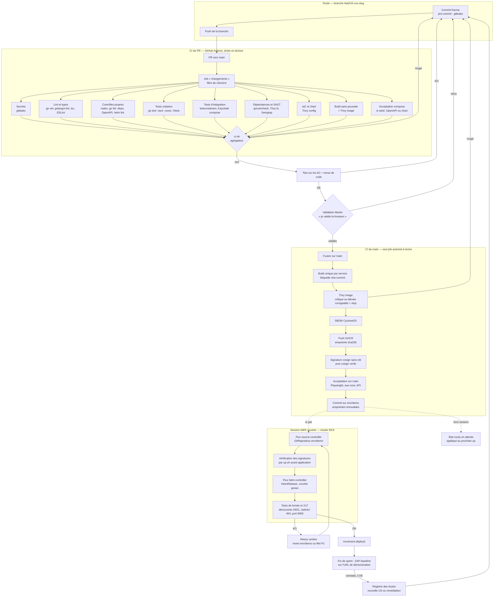

# Processus CI/CD

> Livrable M4 : schéma détaillé du processus CI/CD ; sert aussi M5 et M14 (tests automatisés dans le pipeline, au moins deux types). Critère C4, avec C6, C7 et C8 ([contexte-et-grille.md](../00-cadrage/contexte-et-grille.md)).
> Fonction rédactrice : DevOps. Dernière mise à jour : 2026-10-26.

| Référence | Rôle dans ce document |
|---|---|
| [D10](../decisions/D10-forge-ci-cd.md) | Forge, registre, déploiement, portes : ce document en est la traduction en processus |
| [D11](../decisions/D11-iac-allumage-cout.md) | Scripts `up` et `down`, ordre d'allumage, session AWS |
| [developpement.md](developpement.md) | Cycle de vie d'une US (étapes 1 à 8) ; ce document détaille les étapes 7 et 8 |
| [devsecops.md](devsecops.md) | Mesures de sécurité par étape, gestion des vulnérabilités et des exceptions ; non répétées ici |
| [PILOTAGE.md](../PILOTAGE.md) | Conventions git (§ 6), Definition of Done (§ 5), circuit d'une US (§ 3.3) |
| [tests.md](tests.md) | Types de tests, outils, sorties attendues, parties prenantes |
| [qualite-indicateurs.md](qualite-indicateurs.md) | Indicateurs alimentés par le pipeline |

## 1. Principes

- **Une seule forge, une seule vérification requise** : dépôt GitHub public, GitHub Actions, images sur GHCR. `main` est protégée : PR obligatoire, pas de poussée forcée, vérification requise unique `ci-ok`.
- **La CI ne touche jamais AWS** : elle construit, analyse, signe et publie. Le cluster EKS tire lui-même l'état voulu (Flux, modèle « pull ») ; l'API du cluster reste fermée à Internet (MS1).
- **Construire une fois, promouvoir par empreinte** : l'image est construite sur `main` seulement, déployée par `image@sha256:…`, jamais reconstruite (ES-32, ENF-29).
- **Porte bloquante = pas de fusion** : un contrôle bloquant en échec rend `ci-ok` rouge. Les exceptions suivent [devsecops.md](devsecops.md) § 3.
- **Validation humaine avant `main`** : CI verte, revue faite et phrase de validation de Martin (« je valide la livraison de la feature »).

## 2. Schéma de bout en bout

Lecture : les jobs de PR tournent en parallèle ; seuls ceux concernés par les chemins modifiés s'exécutent, les autres sont « ignorés ». `ci-ok` s'exécute toujours, échoue si un job requis est en échec ou annulé et accepte « ignoré » : une PR qui ne touche que `docs/` reste fusionnable.

## 3. Étapes, portes et preuves

B = bloquant (la fusion ou la publication est refusée) ; NB = non bloquant, archivé.

| # | Déclencheur | Job | Outil | Porte | Durée cible | Artefact, preuve |
|---|---|---|---|---|---|---|
| 1 | Commit local | Pré-commit | gitleaks, formatage | B localement | < 10 s | Commit refusé |
| 2 | PR (chaque push) | Changements | filtre de chemins | — | < 30 s | Liste des jobs à exécuter |
| 3 | PR, `main` | Secrets | gitleaks (diff en PR, historique sur `main`) | B sur tout résultat | < 1 min | SARIF dans l'onglet sécurité |
| 4 | PR | Lint et types | `go vet`, golangci-lint (gosec) ; `tsc --noEmit`, ESLint | B | 2 à 3 min | Journal, SARIF |
| 5 | PR | Contrôles propres | script `jq` du realm (MA1), `go list -deps` (MD5), validation OpenAPI, `helm lint` et rendu | B | 1 à 2 min | Rapport archivé |
| 6 | PR | Tests unitaires | `go test -race -cover`, Vitest | B ; couverture publiée | 2 à 4 min | Rapport JUnit, couverture |
| 7 | PR | Tests d'intégration | testcontainers-go (PostgreSQL, RabbitMQ), Keycloak `start-dev --import-realm` | B | 4 à 6 min | Rapport JUnit |
| 8 | PR, quotidien sur `main` | Dépendances et SAST | govulncheck, Trivy `fs` (npm), Semgrep | B sur critique ou élevée corrigeable ; Semgrep « ERROR » | 2 à 3 min | SARIF |
| 9 | PR | IaC et chart | Trivy `config` (`infra/`, chart rendu, Dockerfile) | B sur critique ou élevée | < 2 min | SARIF |
| 10 | PR | Build et analyse d'image | `docker buildx` (sans poussée), Trivy `image` | B | 2 à 4 min par image, en matrice | Rapport Trivy |
| 11 | PR touchant `web/`, une OpenAPI ou le chart ; `main` | Acceptation | Playwright, axe-core, tests d'API sur pile compose | B | 8 à 12 min | Rapport par AC, captures |
| 12 | PR | `ci-ok` | agrégateur `if: always()` | B (vérification requise) | < 10 s | Statut de la PR |
| 13 | Fusion sur `main` | Build unique | `docker buildx`, étiquette `sha-<commit>` | B | 2 à 4 min par image | Image et empreinte |
| 14 | `main` | Analyse d'image | Trivy `image`, avant la poussée | B | < 1 min | Rapport archivé |
| 15 | `main` | SBOM | Trivy (CycloneDX) | NB | < 30 s | SBOM jointe à l'image |
| 16 | `main` | Publication | push GHCR, cosign sans clé, `cosign verify` | B | < 1 min | Signature dans GHCR, empreinte |
| 17 | `main`, après 11 et 16 | Promotion | commit des empreintes sur `env/demo` | B | < 30 s | Commit `env/demo` lié au commit `main` |
| 18 | `up` ou nouveau commit `env/demo` en session | Réconciliation | Flux (source et helm controllers) | B (`Ready` attendu) | 4 à 6 min au premier `up` | Événements Flux, `flux get` |
| 19 | Fin de `up` ; après une réconciliation en session | Après déploiement | tests de fumée, X17, contrôles TLS et d'exposition | B (retour arrière) | 1 à 2 min | Sortie archivée |
| 20 | Fin de sprint, déclenchement manuel | DAST | ZAP baseline sur l'URL de démonstration | NB ; constats au registre | 5 à 10 min | Rapport ZAP |

Durées cibles de bout en bout : PR en moins de 15 min (10 à 12 visées) ; `main` jusqu'à `env/demo` en moins de 20 min. Leviers : caches Go, npm et couches Docker, base Trivy en cache quotidien avec miroir `public.ecr.aws`, Chromium seul pour Playwright, annulation de l'exécution précédente sur la même PR.

**Chaîne protégée** (ES-32) : droits par défaut en lecture ; écriture GHCR, jeton OIDC pour cosign et écriture de `env/demo` réservés aux jobs 13 à 17 sur `main` ; actions tierces épinglées par empreinte de commit, mises à jour par Dependabot ; jamais `pull_request_target` (une PR issue d'un fork s'exécute sans secret). Démonstration BP3 : une branche contenant une dépendance vulnérable connue et un secret fictif rend `ci-ok` rouge, `main` reste verte.

## 4. Promotion par empreinte immuable

1. Le commit fusionné sur `main` est construit **une seule fois** ; chaque image reçoit l'étiquette `sha-<commit>` et une empreinte `sha256:…`.
2. L'étiquette sert à la lecture humaine ; **seule l'empreinte est déployée**. GHCR ne protège pas une étiquette contre la réécriture : l'immuabilité vient du déploiement par empreinte.
3. Le job de promotion écrit dans `deploy/demo/` de la branche `env/demo` les empreintes de toutes les images et la référence du commit source. `main` n'est jamais écrite par un robot.
4. Flux lit `env/demo` et applique le chart avec ces empreintes. Le filet P1 lit **le même fichier** : une seule source d'état voulu pour les deux chemins.
5. Signature : cosign signe chaque empreinte avec l'identité OIDC du workflow de `main`. La vérification (`cosign verify`, identité et émetteur attendus) a lieu à la publication, puis dans `up.sh` sur toutes les empreintes de `env/demo` avant de créer la source Flux. Une signature absente ou d'une autre identité arrête l'allumage.
6. Environnements : poste (compose), CI (compose éphémère), k3d local et AWS utilisent les mêmes empreintes ; aucune préproduction séparée dans le POC.

## 5. Retour arrière

| Situation | Mécanisme | Qui | Effet |
|---|---|---|---|
| Mise à jour Helm en échec (crochet, pods non prêts) | `upgrade.remediation` de la HelmRelease : retour automatique à la révision précédente | Flux | Version précédente restaurée, événement tracé |
| Fumée ou X17 en échec après une réconciliation | `git revert` du dernier commit de `env/demo` (promotion précédente, mêmes empreintes signées) | DevOps, par PR sur `env/demo` | Flux réapplique les empreintes antérieures, sans reconstruction |
| Défaut découvert plus tard | Revert sur `main` par PR normale : nouveau build, nouvelle promotion | Circuit d'une US | Correction tracée dans l'historique de `main` |
| Flux défaillant ou trop coûteux en pods | Filet P1 : `up.sh --sans-flux`, `helm upgrade --install` avec les empreintes de `env/demo` | DevOps, depuis le poste | Même chart, mêmes valeurs, même artefact |
| Démonstration en cours | `flux suspend helmrelease` avant, `flux resume` après | DevOps | Aucune fusion ne redéploie en direct |

Le filet P1 est exécuté au moins une fois par sprint sur k3d, sinon il ne sera pas fiable le jour où il servira.

## 6. Comportement hors session AWS

Le cluster n'existe que pendant une session du Learner Lab (environ 4 h) ; il est recréé à chaque `up` (D11).

- **Hors session** : la CI tourne entièrement (étapes 1 à 17). Elle reste verte pour des raisons de code uniquement, puisqu'elle ne dépend d'aucun identifiant AWS. Le commit sur `env/demo` constitue un **déploiement en attente**.
- **Au `up` suivant** : Flux est installé, les Secrets sont créés, les signatures sont vérifiées, puis la première réconciliation applique le dernier état de `env/demo`. Ordre détaillé : [D11](../decisions/D11-iac-allumage-cout.md) et avis faisabilité de [D10](../decisions/D10-forge-ci-cd.md).
- **Pendant une session** : chaque nouveau commit sur `env/demo` est réconcilié par Flux. Les tests de fumée sont relancés depuis le poste, l'ALB n'étant ouvert qu'à son adresse hors démonstration (ME5).
- **Au `down`** : Flux est retiré en premier, sinon il recrée les releases supprimées. Rien n'est à reprendre ensuite : `env/demo` reste la seule source de vérité.
- **ZAP de fin de sprint** : exige une session ouverte et l'ALB temporairement ouvert ; planifié dans la session de fin de sprint.

## 7. Tests par étape

| Type | Où dans le pipeline | Bloquant |
|---|---|---|
| Unitaires (Go, front) | PR | Oui |
| Intégration (base, file de messages, jetons Keycloak) | PR | Oui |
| Acceptation fonctionnelle et accessibilité (AC des US) | PR ciblées, `main` | Oui |
| Sécurité statique (SAST, dépendances, secrets, IaC, image) | PR, `main`, quotidien | Oui (seuils de [devsecops.md](devsecops.md)) |
| Fumée et exposition après déploiement | Fin de `up`, après réconciliation | Oui (retour arrière) |
| Sécurité dynamique (ZAP baseline) | Fin de sprint | Non (registre des écarts) |
| Charge | Hors pipeline, en soutenance (M16) | — |

Au moins deux types automatisés et bloquants dans le pipeline (unitaires, intégration, acceptation) : M14 et C7. Périmètre exact, sorties attendues et parties prenantes : [tests.md](tests.md).

## 8. Lien avec les indicateurs

Chaque exécution produit des mesures exploitables par D12 : couverture par service, résultats de lint, vulnérabilités ouvertes par sévérité, durée du pipeline, taux de réussite des PR. Couverture publiée dès le sprint 1 sans porte ; seuil bloquant fixé au sprint 2 sur la mesure réelle, en « pas de baisse » par service. Rapports SARIF publiés dans la forge, artefacts conservés 90 jours, relevé copié dans `docs/mesures/` en fin de sprint. Définition et cibles des indicateurs : [qualite-indicateurs.md](qualite-indicateurs.md).

## 9. Points ouverts

- Vérification de signature pendant une session : faite à la publication et à chaque `up`, mais pas par un contrôleur d'admission dans le cluster (composant de plus, non justifié dans le POC) ; à reconsidérer en V1.
- Mesures MP1 à MP10 citées par la décision de D10 : à reporter dans [devsecops.md](devsecops.md) § 6 une fois rédigées.
- Paquets GHCR à rendre publics à la première publication (sinon `ImagePullBackOff`).
- `ci-ok` rendu obligatoire seulement après une première exécution du workflow.
