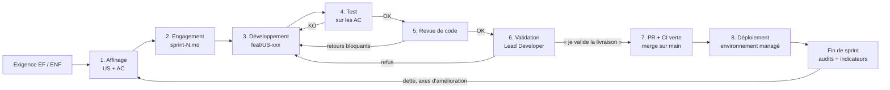

# Processus de développement

Ce document décrit comment une exigence devient un incrément déployé, et comment ce cycle sert les exigences de qualité d'ISO/IEC 25010.
Il répond au livrable M1 de la consigne ([contexte-et-grille.md](../00-cadrage/contexte-et-grille.md) § 3.3) et sert les critères C6 et C7.

Ce document ne répète pas les règles de travail : circuits, statuts, Definition of Done, conventions git et rôles vivent dans [PILOTAGE.md](../PILOTAGE.md). Il les relie entre elles et aux exigences de qualité.

## 1. Principes

| Principe | Traduction dans le processus |
|---|---|
| Itératif et incrémental | Sprints courts ; chaque sprint livre un incrément déployé de bout en bout (sprint 1 : walking skeleton, [PILOTAGE.md](../PILOTAGE.md) § 3.4) |
| Qualité intégrée, pas contrôlée à la fin | Chaque US porte des AC non fonctionnels ; tests, scans et indicateurs tournent à chaque changement |
| Sécurité à chaque étape (DevSecOps) | Avis sécurité sur chaque décision, scans dans la CI, audit en fin de sprint |
| Séparation des fonctions | Celui qui développe ne teste pas son code ; celui qui teste ou relit ne corrige pas ([PILOTAGE.md](../PILOTAGE.md) § 2) |
| Simplicité d'abord | Toute complexité ajoutée est justifiée par une exigence ou un critère ([PILOTAGE.md](../PILOTAGE.md) § 1) |
| Décision tracée | Toute décision structurante passe par le circuit Brainstorm et un fichier `Dxx` ([INDEX.md](../decisions/INDEX.md)) |

## 2. Cycle de vie d'une US

De l'exigence au déploiement, une US traverse huit étapes. Les étapes 3 à 7 reprennent le circuit Dev de [PILOTAGE.md](../PILOTAGE.md) § 3.3.

| # | Étape | Fonction | Entrée | Sortie | Porte de passage |
|---|---|---|---|---|---|
| 1 | Affinage | Lead Developer, avis architecture et sécurité | Exigence (EF/ENF) de [exigences.md](../00-cadrage/exigences.md) | Fichier `backlog/US-xxx-slug.md` ([gabarit](../../backlog/_GABARIT-US.md)) | AC fonctionnels et non fonctionnels rédigés en Given/When/Then, décisions liées citées |
| 2 | Engagement | Lead Developer | US affinées | US engagée dans `backlog/sprints/sprint-N.md` | Capacité du sprint respectée, dépendances levées |
| 3 | Développement | Back, front, ou DevOps pour l'infra | US engagée | Code et tests unitaires sur `feat/US-xxx-slug` | Build et tests de la CI verts sur la branche |
| 4 | Test | Test | AC de l'US (jamais le code) | Tests d'acceptation automatisés, rapport par AC | Chaque AC relié à un test vert (ENF-23) |
| 5 | Revue de code | Revue de code | Diff de la branche | Rapport de revue classé par sévérité | Aucun retour bloquant ouvert |
| 6 | Validation | Lead Developer | Branche testée et relue | Phrase « je valide la livraison de la feature » | Validation explicite ; une formulation ambiguë ne vaut pas validation |
| 7 | Merge | DevOps | PR vers `main` | `main` à jour, branche supprimée | CI verte, DoD cochée ([PILOTAGE.md](../PILOTAGE.md) § 5) |
| 8 | Déploiement | DevOps (pipeline) | Commit sur `main` | Incrément déployé sur l'environnement managé | Tests post-déploiement verts, retour arrière possible (ENF-22) |

Boucle de correction : tout échec aux étapes 4 ou 5 renvoie l'US à l'étape 3, puis le cycle reprend dans l'ordre (test, puis revue). Aucune étape n'est sautée.

Étape 8 : le détail du pipeline (étapes, portes, outils) est fixé par D10 et décrit dans [cicd.md](cicd.md) (à venir). La consigne tolère l'absence de déploiement automatisé en (pré)production ; le déploiement reste alors une commande scriptée (`tools/`), reproductible et réversible.

## 3. Cérémonies du sprint

L'équipe réelle est une personne, le Lead Developer, appuyée par les fonctions architecture, sécurité, back, front, test, revue de code et DevOps ([PILOTAGE.md](../PILOTAGE.md) § 2). Les cérémonies Scrum sont conservées pour leur produit, pas pour leur forme : chacune laisse une trace écrite.

| Cérémonie | Quand | Participants (fonctions) | Durée | Trace |
|---|---|---|---|---|
| Planification | Début de sprint | Lead Developer, architecture, DevOps | 1 h | Sections Objectif, US engagées, Capacité, Risques de `sprint-N.md` |
| Point quotidien | Chaque session de travail | Lead Developer | 10 min | Statuts des fichiers US à jour |
| Affinage du backlog | En continu, avant engagement | Lead Developer, architecture, sécurité | Selon besoin | Fichiers US complétés (AC, décisions liées) |
| Revue (démo) | Fin de sprint | Lead Developer | 30 min | Section Revue de `sprint-N.md` : parcours démontré, écarts |
| Audits | Fin de sprint | Architecture, sécurité | — | `docs/audits/sprint-N-architecture.md`, `docs/audits/sprint-N-securite.md` |
| Relevé des indicateurs | Fin de sprint | DevOps, Lead Developer | 30 min | `docs/mesures/indicateurs-sprint-N.md` |
| Rétrospective | Fin de sprint | Lead Developer | 30 min | Section Rétro de `sprint-N.md` : une à trois actions, reprises au sprint suivant |

Gabarit du fichier de sprint : [_GABARIT-SPRINT.md](../../backlog/sprints/_GABARIT-SPRINT.md). Ordre de clôture : [PILOTAGE.md](../PILOTAGE.md) § 3.4.

## 4. Exigences de qualité et pratiques du processus

Lecture : pour chaque caractéristique ISO 25010, l'exigence non fonctionnelle visée ([exigences.md](../00-cadrage/exigences.md) § 3), la pratique du processus qui la sert, et la preuve produite. Les indicateurs et leurs seuils sont définis dans [qualite-indicateurs.md](qualite-indicateurs.md) (à venir, D12).

| Caractéristique ISO 25010 | ENF | Pratique du processus | Preuve / mesure |
|---|---|---|---|
| Capacité fonctionnelle (aptitude fonctionnelle) | ENF-01, ENF-23 | AC Given/When/Then dans chaque US ; tests d'acceptation écrits depuis les AC par la fonction test ; validation par le Lead Developer | Taux d'AC couverts par un test vert ; rapport de test par AC |
| Performance (efficacité de performance) | ENF-14, ENF-15, ENF-16 | AC « Performance » dans les US concernées ; test de charge progressif à chaque sprint à partir du sprint 2 | 95e centile, taux d'erreur, nombre d'instances avant, pendant et après le pic (`docs/mesures/charge/`) |
| Fiabilité | ENF-11, ENF-12, ENF-13 | Revue d'architecture des points uniques de défaillance ; tests de reprise (destinataire arrêté puis relancé) ; restauration testée | Événements traités après reprise ; rapport de restauration |
| Disponibilité | ENF-10, ENF-11 | Arrêt volontaire d'une instance pendant un test de charge ; observabilité (D09) | Service maintenu, erreurs sous seuil ; sonde de disponibilité |
| Sécurité | ENF-02 à ENF-09 | Avis sécurité sur chaque décision ; AC « Autorisation » négatifs ; scans de code, dépendances, images et secrets bloquants en CI ; audit de fin de sprint | Rapports de scan, tests d'autorisation verts, audit `sprint-N-securite.md` ; détail dans [devsecops.md](devsecops.md) (à venir) |
| Compatibilité | ENF-17, ENF-18, ENF-19 | Contrats d'interface versionnés ; tests de contrat dans la CI | Tests de contrat verts ; contrat publié |
| Maintenabilité | ENF-21, ENF-22, ENF-24 | Revue de code systématique ; indicateurs de dette relevés à chaque sprint ; audit d'architecture de fin de sprint | Indicateurs de `indicateurs-sprint-N.md` ; tendance d'un sprint à l'autre |
| Flexibilité (portabilité) | ENF-28, ENF-29, ENF-30, ENF-31 | Infrastructure en code ; même artefact en local et sur l'environnement managé ; textes externalisés | Allumage et extinction depuis zéro sans action manuelle ; même image dans deux environnements |
| Capacité d'interaction (utilisabilité) | ENF-26, ENF-27 | AC « Accessibilité » ; contrôle automatisé d'accessibilité en CI | Rapport d'accessibilité sans non-conformité bloquante |
| Analysabilité (observabilité) | ENF-25 | Composante d'observabilité livrée dès le walking skeleton (D09) | Incident provoqué puis diagnostiqué en démonstration |

Types de tests, outils, sorties attendues et parties prenantes du test : [tests.md](tests.md) (à venir, D13).
Schéma détaillé du pipeline et portes qualité : [cicd.md](cicd.md) (à venir, D10).

## 5. Parties prenantes et responsabilités

R = réalise · A = approuve (un seul par ligne) · C = consulté · I = informé.
Les fonctions sont décrites dans [PILOTAGE.md](../PILOTAGE.md) § 2 ; ce tableau en donne la vue par activité.

| Activité | Lead Developer | Architecture | Sécurité | Back / Front | Test | Revue de code | DevOps |
|---|---|---|---|---|---|---|---|
| Décision (`Dxx`) | A | R | C | C | — | — | C |
| Affinage d'une US | A, R | C | C | C | C | — | C |
| Planification du sprint | A, R | C | I | I | I | I | C |
| Développement | I | — | — | R | — | — | R (infra) |
| Tests sur les AC | I | — | — | I | R | — | — |
| Revue de code | I | C | C | I | — | R | — |
| Validation de livraison | A, R | — | — | I | I | I | I |
| Merge et déploiement | A | — | — | I | — | — | R |
| Audits de fin de sprint | A | R (archi) | R (sécu) | I | I | I | I |
| Relevé des indicateurs | A | C | C | I | C | C | R |
| Rétrospective | A, R | C | C | C | C | C | C |

Parties prenantes métier (cas d'entreprise, [contexte-et-grille.md](../00-cadrage/contexte-et-grille.md) § 2.2) : la direction exprime les besoins et reçoit la démo de fin de sprint ; les deux développeurs confirmés tiennent les fonctions back et front dans l'organisation cible.

## 6. Dette technique

| Question | Règle |
|---|---|
| Qu'est-ce qui compte comme dette ? | Raccourci assumé (test manquant, contournement, duplication), retour de revue non bloquant reporté, indicateur hors seuil, constat d'audit non traité dans le sprint |
| Où est-elle notée ? | Section « Dette technique » du fichier de sprint où elle apparaît, avec un identifiant `DT-nn`, sa source (revue, audit, indicateur) et son impact |
| Qui la note ? | La fonction qui la constate ; le Lead Developer valide l'inscription |
| Quand la rembourse-t-on ? | À la planification suivante : toute dette à impact sécurité ou fiabilité est engagée en priorité ; le reste est arbitré contre les US, avec une part réservée de la capacité (cible : 20 %) |
| Comment la mesure-t-on ? | Par les indicateurs de [qualite-indicateurs.md](qualite-indicateurs.md) (à venir, D12), relevés à chaque sprint ; une dégradation de tendance crée une entrée `DT-nn` |
| Bilan | Analyse consolidée à J6 dans `docs/mesures/analyse-dette.md` (à venir) : dette remboursée, dette restante, axes d'amélioration |

Une dette remboursée garde sa ligne avec la date et l'US de remboursement : l'historique prouve que la mesure a produit une action.

## 7. Documents liés

| Sujet | Document | État |
|---|---|---|
| Règles de travail, circuits, DoD | [PILOTAGE.md](../PILOTAGE.md) | Existant |
| Exigences fonctionnelles et non fonctionnelles | [exigences.md](../00-cadrage/exigences.md) | Existant |
| Décisions | [INDEX.md](../decisions/INDEX.md) | Existant |
| Exigences de sécurité | [exigences-securite.md](../securite/exigences-securite.md) | Existant |
| Indicateurs qualité | [qualite-indicateurs.md](qualite-indicateurs.md) | À venir (D12) |
| Processus de test | [tests.md](tests.md) | À venir (D13) |
| Processus CI/CD | [cicd.md](cicd.md) | À venir (D10) |
| Cycle DevSecOps | [devsecops.md](devsecops.md) | À venir |
| Gabarit de sprint | [_GABARIT-SPRINT.md](../../backlog/sprints/_GABARIT-SPRINT.md) | Existant |
