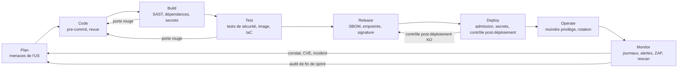

# Cycle de vie DevSecOps

> Livrable M3 : cycle de vie formalisé en DevSecOps, avec les mesures de sécurité de chaque étape clé. Critères C4 et C8 ([contexte-et-grille.md](../00-cadrage/contexte-et-grille.md)).
> Fonction rédactrice : Sécurité. Dernière mise à jour : 2026-10-26.

| Référence | Rôle dans ce document |
|---|---|
| [exigences-securite.md](../securite/exigences-securite.md) | Exigences ES, frontières FC, menaces, échelle de risque (§1.3), preuves attendues (§7.1) |
| [D03](../decisions/D03-hebergement-orchestration.md), [D05](../decisions/D05-communication-interservice.md), [D06](../decisions/D06-authentification-autorisation.md), [D07](../decisions/D07-donnees.md) | Mesures MS1–MS10, MC1–MC10, MA1–MA14, MD1–MD10 |
| [D04](../decisions/D04-stack.md), avis sécurité | Outillage CI par langage, interdits de code (Go, React) |
| [PILOTAGE.md](../PILOTAGE.md) | Rôles (§2), circuit d'une US (§3.3), Definition of Done (§5), conventions git (§6), données sensibles (§7) |

**Indépendance vis-à-vis de la forge.** La forge git, l'outil de CI, le registre d'images et le mode de déploiement sont en cours d'instruction (**D10**). Ce document décrit les contrôles et leurs portes ; leur traduction en fichiers de pipeline se fera **selon D10**. Contrainte déjà posée par MS1 : la CI construit et pousse les images, le déploiement part du poste d'exploitation.

## 1. Vue d'ensemble

Principes :
- **Décaler à gauche** : un contrôle s'exécute à l'étape la plus précoce où il est fiable (secret au commit, interdit de code au build).
- **Porte bloquante** : un contrôle bloquant rend le pipeline rouge ; la fusion sur `main` exige une CI verte (PILOTAGE §6).
- **Preuve ou rien** : une mesure sans preuve archivée ne réduit pas le risque (exigences-securite §1.3). Chaque étape nomme sa preuve.
- **Boucle de retour** : tout constat du Monitor (scan, journal, audit, incident) redevient une entrée du Plan sous forme d'US ou d'action de remédiation.

## 2. Mesures par étape

Légende de la colonne Porte : **B** = bloquant (fusion ou déploiement refusé), **NB** = non bloquant (rapport et suivi), **M** = contrôle manuel tracé.

### 2.1 Plan

| Mesure | Outil candidat | Porte | Preuve produite | Fonction |
|---|---|---|---|---|
| Revue de menaces de chaque US qui touche une frontière de confiance (FC1 à FC11) : menaces STRIDE ajoutées ou modifiées, exigences ES concernées | Gabarit d'US, tableau des FC | M (pas de démarrage sans) | Section « Sécurité » de l'US, renvoi aux ES et menaces | Sécurité |
| AC de sécurité rédigés en tests négatifs (refus sans jeton, mauvais rôle, ressource d'autrui) | Fichier US | M | AC testables dans l'US | Sécurité, Test |
| Avis sécurité sur chaque décision d'architecture | Gabarit de décision | M | Section « Avis sécurité » de la décision | Sécurité |
| Reprise des constats ouverts (registre de fin de sprint, CVE, incidents) dans le sprint | Registre des failles | M | `docs/audits/sprint-N-securite.md` | Sécurité, Lead Developer |

### 2.2 Code

| Mesure | Outil candidat | Porte | Preuve produite | Fonction |
|---|---|---|---|---|
| Détection de secrets avant commit | gitleaks en hook pre-commit | B (local) | Hook installé, documenté dans le README | DevOps |
| Interdits de code D04 : `CGO_ENABLED=0`, aucune option `Skip*` des vérificateurs de jetons, aucun moteur de regex à retour arrière, aucun `dangerouslySetInnerHTML` | Lint dans l'éditeur, repris en Build | NB (local) | — | Back, Front |
| Vérification des jetons uniquement par `libs/platform/` (MA4, MA6) ; validation stricte des messages (MC6) | Revue de code | M | Rapport de revue de l'US | Revue de code |
| Branche par US, pas de push direct sur `main`, revue avant fusion (ES-32) | Protection de branche selon D10 | B | Configuration de la forge | DevOps |
| Aucun secret ni donnée réelle dans le dépôt, `.env.example` fictif (PILOTAGE §7) | Relecture du diff | M | Case DoD cochée | Back, Front, DevOps |

### 2.3 Build

| Mesure | Outil candidat | Porte | Preuve produite | Fonction |
|---|---|---|---|---|
| Installation verrouillée | `go mod verify`, `npm ci --ignore-scripts` | B | Journal du job | DevOps |
| Dépendances Go : toute vulnérabilité **atteignable** bloque (la base Go ne publie pas de gravité, D04) | govulncheck | B | Rapport archivé | Back |
| Dépendances front | `npm audit --omit=dev --audit-level=high`, OSV-Scanner | B (Critique, Élevée) | Rapport archivé | Front |
| Analyse statique orientée sécurité Go | `go vet`, golangci-lint avec gosec | B | Rapport archivé | Back |
| Analyse statique front | ESLint : `react/no-danger`, `react/jsx-no-script-url`, `no-unsanitized/*`, `no-eval`, `no-implied-eval`, `no-new-func` | B | Rapport archivé | Front |
| Règles projet (interdits de D04, `import "C"`, `regexp2`) | Semgrep, règles versionnées | B | Rapport archivé | Sécurité (règles), DevOps (job) |
| Secrets sur tout l'historique, puis à chaque fusion | gitleaks | B | Rapport archivé | DevOps |
| Actions et images de CI figées par empreinte | Selon D10 | M | Définition du pipeline relue | DevOps |

### 2.4 Test

| Mesure | Outil candidat | Porte | Preuve produite | Fonction |
|---|---|---|---|---|
| Tests de sécurité automatisés : BP2 (jeton absent, expiré, signature invalide), BP5 (ressource d'autrui, rôle), BP4 (coordonnées), upload (MD5, MD7), contrôle fermé (ES-31) | Tests Go, Playwright (MA3, MA5, MA12) | B | Résultats de tests en CI | Test |
| Tests de contrat par paire producteur-consommateur ; émetteur `user-id` vérifié (MC2) | Tests de contrat sur `contracts/` | B | Résultats en CI | Test, Back |
| Test de concurrence de la réservation (ES-14) | Test Go | B | Résultats en CI | Test |
| Test d'architecture : aucun consommateur d'événement n'importe le client de paiement (MC10) | Test sur les paquets | B | Résultats en CI | Back |
| Analyse de l'image construite : Critique et Élevée **corrigeables** bloquent | Trivy (image) | B | Rapport archivé | DevOps |
| Analyse de la configuration en code (Terraform, manifests, chart) | Trivy (IaC) ou Checkov | B (Critique, Élevée) | Rapport archivé | DevOps |
| Contrôle du realm Keycloak (MA1) : URI de redirection et origines exactes, flux implicite et « mot de passe » désactivés, `Full scope allowed` désactivé, aucun secret en clair, PKCE `S256` (MA2) | Script de contrôle du JSON de realm | B | Rapport archivé | Sécurité (règles), DevOps (job) |

### 2.5 Release

| Mesure | Outil candidat | Porte | Preuve produite | Fonction |
|---|---|---|---|---|
| Image construite une seule fois, identifiée par son empreinte, promue telle quelle (ES-32) | Registre selon D10 | B | Empreinte de l'image liée au commit | DevOps |
| Nomenclature logicielle de chaque image | Syft (SPDX ou CycloneDX) | NB | SBOM archivée avec la version | DevOps |
| Images de base `scratch` ou distroless `nonroot` ; Keycloak figé par empreinte (MA14) ; charts et modules épinglés (MS9) | Revue du Dockerfile et du chart | M | Dockerfile, valeurs du chart | DevOps |
| Signature de l'image (optionnelle dans le POC) | cosign | NB | Signature dans le registre | DevOps |
| Validation de la livraison par Martin, CI verte, revue faite (DoD) | Circuit PILOTAGE §3.3 | M | Statut « Validée Martin » de l'US | Lead Developer |

### 2.6 Deploy

| Mesure | Outil candidat | Porte | Preuve produite | Fonction |
|---|---|---|---|---|
| Déploiement depuis le poste ; API du cluster limitée à l'adresse du poste (MS1) | Script `up`, IaC | B | Sortie du script | DevOps |
| Image déployée par empreinte ; signature vérifiée si cosign retenu | `kubectl`, cosign | B | Manifest appliqué | DevOps |
| Secrets générés à chaque session, injectés par l'entrée standard, jamais en valeur Helm ni en argument (MS6, MC4, MC5, MD2, MA10) | Secrets Manager, `kubectl` | B | Inventaire des Secrets du Deployment | DevOps |
| Admission : PSS « restricted », refus des Services `LoadBalancer` et NodePorts hors liste, quotas (MS5) | ValidatingAdmissionPolicy | B | Refus constaté d'un manifest non conforme | DevOps |
| Politiques réseau en refus par défaut (MS4, MC3, MC7, MA8) | NetworkPolicy | B | Test de refus | DevOps |
| Contrôle post-déploiement : redirection HTTP, TLS obsolète refusé, certificat, HSTS (BP1, MS2) ; `/admin/`, `/realms/master/`, port 9000 et « réserver » injoignables (MA7, MC7) | Script de contrôle (curl, testssl.sh) | B (retour à l'image précédente) | Rapport TLS et d'exposition archivé | DevOps, Sécurité |
| Migrations par un Job au compte dédié (MD1, MD2) | Sous-commande `goose` | B | Journal du Job | Back, DevOps |

### 2.7 Operate

| Mesure | Outil candidat | Porte | Preuve produite | Fonction |
|---|---|---|---|---|
| Moindre privilège : un compte de base par service (MD1, MD4), droits du canal par sujet (MC1), IMDSv2 (MS3) | IaC, définitions RabbitMQ | M | Matrice des droits par service (fin de sprint) | DevOps, Sécurité |
| Console du broker et de Keycloak par `port-forward` seulement (MC4, MA7) ; compte admin nominatif avec OTP (MA9, MA12) | Procédure d'exploitation | M | Inventaire des points d'entrée | DevOps |
| Rotation : secrets régénérés à chaque `up` ; rotation du jeton de rafraîchissement (MA11) | Script `up`, realm | M | Inventaire des Secrets | DevOps |
| Rejeu de l'outbox par Job tracé, fenêtre plafonnée (MC9) | Job Kubernetes | M | Journal du Job | DevOps |
| Plafonds de mise à l'échelle et alerte de coût (MS10) | HPA, KEDA, budget AWS | M | Configuration relevée | DevOps |
| Mise à jour : version corrective de sécurité de Go, Keycloak, AMI des nœuds (MS9, MA14) | Outil de mise à jour selon D10 | NB | PR de mise à jour | DevOps, Back |

### 2.8 Monitor

| Mesure | Outil candidat | Porte | Preuve produite | Fonction |
|---|---|---|---|---|
| Journaux du plan de contrôle et journaux applicatifs hors du processus des services (MS8) ; journal d'audit (ES-23) | Composante d'observabilité (D09) | NB | Extraits de journaux | DevOps |
| Aucune donnée sensible en journal : jetons, URL présignées, en-tête d'acheteur masqués (MA6, MD7) | Recherche dans les journaux | M | Extrait vérifié en fin de sprint | Sécurité |
| Alertes : messages mis à l'écart, outbox non publiée (MC8), échecs de connexion en rafale (MA13) | Alertes selon D09 | NB | Alertes déclenchées en test de charge | DevOps |
| Analyse dynamique non intrusive de l'environnement déployé : en-têtes, CSP (MD8), erreurs | ZAP baseline | NB (constats au registre) | Rapport ZAP archivé | Sécurité |
| Nouvelle analyse de `main` et des images déployées sans changement de code (CVE publiées après coup) | govulncheck, Trivy, planifiés selon D10 | NB (ouvre un constat) | Rapport daté | DevOps |
| Audit de sécurité de fin de sprint et audit V1 | Registre, matrice exigence → preuve | M | `docs/audits/sprint-N-securite.md` | Sécurité |

## 3. Gestion des vulnérabilités

**Seuils de blocage** (repris d'ES-05 et de l'échelle §1.3 d'[exigences-securite.md](../securite/exigences-securite.md)) :

| Sévérité | Source | Porte |
|---|---|---|
| Critique (CVSS ≥ 9,0) ou Élevée (7,0 à 8,9), **corrigeable** | Trivy, npm audit, OSV-Scanner, gosec, Semgrep | Bloque la fusion et le déploiement |
| Vulnérabilité Go **atteignable** | govulncheck | Bloque, quelle que soit la gravité |
| Secret détecté | gitleaks | Bloque, et déclenche la procédure de fuite (§5) |
| Critique ou Élevée **sans correctif** | Toutes | Non bloquante, exception obligatoire et mesure compensatoire |
| Modérée | Toutes | Non bloquante, constat au registre |
| Faible | Toutes | Non bloquante, réévaluée à chaque audit |

**Délais de correction**, à compter de la détection (y compris sur `main` ou en production par une nouvelle analyse) :

| Priorité (§1.3) | Délai | Si le délai est dépassé |
|---|---|---|
| P1 — Critique | Avant toute nouvelle fusion ; 48 h si l'image est déjà déployée | Arrêt de l'exposition publique (`down`) jusqu'à correction |
| P2 — Élevée | 7 jours, et avant la fin du sprint en cours | Constat NO GO à l'audit de fin de sprint |
| P3 — Modérée | Sprint suivant | Reporté au plan de remédiation |
| P4 — Faible | Réévalué à chaque audit | — |

Le CVSS mesure une sévérité technique : une vulnérabilité sur un composant non exposé ou sans donnée sensible peut descendre d'un niveau, avec une justification écrite (§1.3).

**Exceptions tracées.** Toute exception à une porte bloquante est versionnée dans le dépôt (fichier d'exceptions de l'outil, par exemple `.trivyignore`, emplacement selon D10) avec :

| Champ | Contenu |
|---|---|
| Identifiant | CVE, règle ou empreinte du constat |
| Composant | Module, image, fichier |
| Justification | Non atteignable, pas de correctif, faux positif démontré |
| Mesure compensatoire | Ce qui réduit le risque en attendant |
| Validation | Fonction Sécurité, puis Martin |
| Date et échéance | Date de création ; échéance de 30 jours au plus, renouvelable une fois avec nouvelle justification |

Une exception échue fait de nouveau échouer le pipeline. Les exceptions ouvertes sont listées dans chaque audit de fin de sprint. Les faux positifs écartés y sont aussi documentés.

## 4. Gestion des secrets

Les règles vivent dans [PILOTAGE.md §7](../PILOTAGE.md#7-données-sensibles) et ES-06 ; ce document ne les duplique pas. Points de contrôle par étape :

| Étape | Contrôle | Référence |
|---|---|---|
| Code | gitleaks en pre-commit, relecture du diff | PILOTAGE §5, §7 |
| Build | gitleaks sur l'historique et à chaque fusion ; masquage dans les journaux du pipeline | ES-06, D04 |
| Test | Analyse des couches d'image (Trivy) ; realm JSON sans secret, emplacements `${...}` seuls | MA1 |
| Deploy | Secrets Manager, injection par l'entrée standard, un Secret par service, secret maître absent après amorçage | MS6, MC5, MD2 |
| Operate | Régénération à chaque `up` ; variables `VITE_*` publiques uniquement | MA10, D04 |

## 5. Réponse à incident minimale

| Phase | Actions | Fonction |
|---|---|---|
| Détecter | Alerte (D09), porte rouge sur `main`, constat de scan ou d'audit, signalement | DevOps, Sécurité |
| Qualifier | Sévérité selon §1.3 ; actifs et frontières touchés ; journal de l'incident ouvert (date, heure, constat) | Sécurité |
| Contenir | Secret : révocation ou renouvellement immédiat (PILOTAGE §7). Exposition : retrait de la règle d'ALB ou `down` de l'environnement. Compte : désactivation dans Keycloak, sessions fermées | DevOps, Lead Developer |
| Éradiquer | Correctif par la fonction concernée, revu ; nettoyage de l'historique git si secret commité | Back, Front, DevOps |
| Rétablir | Nouvelle image par le pipeline complet, `up` avec secrets régénérés, contrôle post-déploiement vert | DevOps |
| Tirer les leçons | Retour d'expérience dans l'audit de fin de sprint ; nouvelle règle (Semgrep, test négatif, contrôle) pour empêcher la récidive | Sécurité |

Martin est prévenu dès la qualification. La nature éphémère des sessions (environnement recréé à chaque `up`) limite la durée d'exposition mais ne dispense pas de la révocation.

## 6. Correspondance mesures → étapes

| Mesure | Objet | Étape(s) |
|---|---|---|
| MS1 | API du cluster limitée au poste, déploiement depuis le poste | Deploy |
| MS2 | Nœuds privés, ALB HTTPS, liste blanche de chemins | Deploy (contrôle post-déploiement) |
| MS3 | IMDSv2, accès IMDS restreint | Deploy, Operate |
| MS4 | Politiques réseau en refus par défaut | Deploy |
| MS5 | Admission PSS « restricted », VAP, quotas | Test (IaC), Deploy |
| MS6 | Secrets via Secrets Manager et entrée standard ; état Terraform privé | Deploy, Operate |
| MS7 | RDS et bucket privés, chiffrés, TLS imposé | Test (IaC), Deploy |
| MS8 | Journaux du plan de contrôle et applicatifs hors processus | Monitor |
| MS9 | Versions récentes, charts épinglés, images analysées | Release, Test, Operate |
| MS10 | Plafonds de mise à l'échelle, alerte de coût | Operate, Monitor |
| MC1 | Droits du canal par sujet | Deploy, Operate |
| MC2 | Émetteur vérifié par `user-id` | Code, Test |
| MC3 | Politiques réseau du broker | Deploy |
| MC4 | Identités KEDA et admin du broker, console par `port-forward` | Deploy, Operate |
| MC5 | Identifiants du canal générés à chaque `up` | Deploy, Operate |
| MC6 | Validation stricte des messages | Code, Test |
| MC7 | « Réserver » sur un port interne seul | Deploy (contrôle d'exposition), Test |
| MC8 | Bornes des files, mise à l'écart, alertes | Deploy, Monitor |
| MC9 | Rejeu de l'outbox tracé | Operate |
| MC10 | Aucun consommateur n'importe le client de paiement | Test |
| MA1 | Realm relu et contrôlé en CI | Code, Test |
| MA2, MA3 | Clients et portée `reserver` | Test |
| MA4, MA6 | Vérification des jetons dans `libs/platform/` | Code, Test |
| MA5 | Compte de service sans rôle | Test |
| MA7 | Non-joignabilité de la console Keycloak | Deploy |
| MA8 | Politique réseau prouvée par un test de refus | Deploy |
| MA9, MA10 | Comptes admin nominatifs, mots de passe de test régénérés | Deploy, Operate |
| MA11 | Rotation du rafraîchissement, durée de session | Test, Operate |
| MA12, MA13 | MFA admin, force brute | Test, Monitor |
| MA14 | Image Keycloak figée et analysée | Test, Release, Operate |
| MD1 | Rôles de base sans privilège | Deploy, Test |
| MD2 | Secret de migration au seul Job | Deploy |
| MD3 | Chiffrement et TLS de RDS | Test (IaC), Deploy |
| MD4 | Limites de connexion et délai par rôle | Deploy, Operate |
| MD5 | Décodeurs d'image bornés | Code, Test |
| MD6 | Objet S3 au type fixé, bucket privé | Test (IaC), Deploy |
| MD7 | URL présignées courtes, jamais journalisées | Test, Monitor |
| MD8 | `img-src` limité au bucket | Monitor (ZAP) |
| MD9 | Registre des écarts | Plan, Monitor (audit) |
| MD10 | Procédure de restauration documentée | Operate |

## 7. Points ouverts

- Forge, outil de CI, registre, outil de mise à jour des dépendances et emplacement des rapports : **selon D10**.
- Composante d'observabilité et alertes : **selon D09**. Exposition, domaine et certificat : **selon D08**.
- Signature des images (cosign) : optionnelle dans le POC, recommandée en V1.
- Le schéma détaillé du pipeline (M4) relève de `docs/processus/cicd.md`, qui reprendra les portes de ce document.
