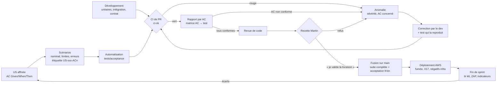

# Processus de test

> Livrables M5, M10, M14, M16 ; critère C7, avec C5, C6 et C8 ([contexte-et-grille.md](../00-cadrage/contexte-et-grille.md)).
> Fonction rédactrice : Test. Dernière mise à jour : 2026-10-26.

Ce document est le mode d'emploi du test : qui teste quoi, avec quel outil, à quel moment, ce qui doit sortir et ce qui se passe en cas d'échec.
Les choix et leur justification sont dans [D13](../decisions/D13-strategie-tests-charge.md) ; ils ne sont pas répétés ici.

| Référence | Rôle dans ce document |
|---|---|
| [D13](../decisions/D13-strategie-tests-charge.md) | Types de tests, tests négatifs imposés, outil de charge, mesures MT1 à MT8 |
| [D12](../decisions/D12-indicateurs-qualite.md) | Indicateurs I1 à I4 alimentés par les tests |
| [developpement.md](developpement.md) | Cycle de vie d'une US ; ce document détaille l'étape 4 (Test) |
| [cicd.md](cicd.md) | Jobs, portes et durées du pipeline |
| [devsecops.md](devsecops.md) | Seuils des scans, délais de correction P1 et P2, exceptions |
| [PILOTAGE.md](../PILOTAGE.md) | Definition of Done (§ 5), séparation des fonctions (§ 2) |

## 1. Objectifs et principes

**Objectifs** : prouver que chaque US répond à ses critères d'acceptation (AC), que rien de ce qui marchait ne casse, que les mesures de sécurité refusent ce qu'elles doivent refuser, et que la plateforme tient la charge annoncée.

| Principe | Règle opérationnelle |
|---|---|
| Les tests viennent des AC | Un test d'acceptation part d'un AC Given/When/Then de `backlog/US-xxx-slug.md`, jamais du code. Un AC sans test vert = US non terminée (DoD) |
| Indépendance du testeur | Celui qui développe ne rédige pas l'acceptation de son code ; celui qui teste ne corrige pas : il signale |
| Traçabilité | Chaque test d'acceptation porte l'identifiant de son AC (`@US-xxx-ACn`) ; la matrice AC → test est générée depuis ces étiquettes |
| Pyramide | Beaucoup de tests rapides (unitaires, intégration), peu de bout en bout ; aucun outil nouveau hors du tir de charge |
| Vraie dépendance | Intégration sur vraie base PostgreSQL et vrai RabbitMQ (testcontainers), pas de simulacre de base |
| Asynchrone sans pause fixe | Le résultat du Contrôle s'attend par interrogation répétée bornée (`expect.poll`), jamais par `sleep` |
| Pas de test instable toléré | Un test instable est corrigé ou mis en quarantaine tracée (dette `DT-nn`) ; jamais relancé jusqu'à ce qu'il passe |
| Données fictives | Catalogue de démonstration chargé par script idempotent ; un utilisateur de test par rôle ; photos synthétiques ; aucune donnée personnelle réelle ; mots de passe régénérés à chaque session, jamais dans le dépôt |
| Seuils fixés avant | Les critères de réussite (seuils de charge, de couverture) sont écrits avant l'exécution, jamais ajustés après coup |

## 2. Types de tests

B = bloquant (fusion ou déploiement refusé) ; NB = non bloquant, archivé.

| Type | Outil | Niveau | Déclencheur, lieu | Sortie attendue | Critère de réussite | Responsable (R) |
|---|---|---|---|---|---|---|
| Unitaire back | `go test -race -cover`, fuzzing natif (`-fuzztime=30s` en CI) | Fonction, paquet | Poste ; chaque PR | Rapport JUnit, couverture par service | Tous verts (B) ; couverture « pas de baisse » à 0,5 point près dès le sprint 2 | Back |
| Unitaire front | Vitest, Testing Library | Composant, hook | Poste ; chaque PR | Rapport JUnit, couverture | Tous verts (B) | Front |
| Intégration | testcontainers-go (PostgreSQL, RabbitMQ), Keycloak de compose | Service + dépendances réelles | Poste ; chaque PR | Rapport JUnit | Tous verts (B) | Back |
| Contrat | `jsonschema`, `kin-openapi` dans `go test` ; exemples de `contracts/` | Paire producteur-consommateur | Chaque PR | Un test par paire | Tous verts ; message malformé ou clé dupliquée refusé (B) | Back ; Test (exemples) |
| Acceptation API | Playwright `request`, TypeScript | US, bout en bout | Pile compose : PR touchant `web/`, une OpenAPI ou le chart ; chaque fusion sur `main` | Rapport HTML par AC, JUnit, matrice AC → test | Chaque AC relié à un test vert (B) | Test |
| Acceptation navigateur (E2E) | Playwright, Chromium | Parcours utilisateur | Idem | Rapport HTML, traces et captures des échecs | Parcours soumission → contrôle → publication → consultation vert ; aucune violation CSP (B) | Test |
| Accessibilité | `@axe-core/playwright` ; `jsx-a11y` au lint | Écran | Avec l'acceptation ; revue manuelle en fin de sprint | Liste des violations | Aucune violation « serious » ou « critical » (B) | Front, Test |
| i18n | Script de parité des traductions ; parcours Playwright `fr` (PR) et `fr` + `en` (`main`) | Fichiers de traduction, parcours | Chaque PR ; `main` | Clés manquantes listées | Zéro clé manquante, aucun texte en dur (B) | Front |
| Non-régression | Toute la suite ci-dessus, rejouée | Tous | Chaque PR, chaque fusion | Historique des exécutions CI | Aucun test précédemment vert en échec (B) | Toutes |
| Sécurité statique | gitleaks, golangci-lint (gosec), Semgrep, govulncheck, Trivy | Code, dépendances, images, IaC | Commit, PR, `main`, quotidien | SARIF, rapports | Seuils de [devsecops.md](devsecops.md) § 3 (B) | DevOps, Sécurité |
| Sécurité négative | `go test`, Playwright API, script `curl` sur AWS | Service, bout en bout, infrastructure | PR, `main`, après déploiement | Un test par mesure (§ 6) | Refus attendu obtenu (401, 403, 404, 409, 413, 429) (B) | Test, Back ; liste : Sécurité |
| DAST | ZAP baseline | Application exposée | Quotidien sur compose ; URL publique en fin de sprint | Rapport ZAP | Constats triés à l'audit de fin de sprint (NB) | Sécurité |
| Après déploiement | Tests de fumée, X17, contrôles TLS et d'exposition | Plateforme déployée | Fin de chaque `up`, après réconciliation | Sortie archivée | Tous verts, sinon retour arrière (B) | DevOps |
| Charge | k6, depuis le poste via l'ALB | Plateforme sous trafic | Session AWS, fin de sprint dès le sprint 2 et soutenance ; profil court NB sur `main` | Rapport HTML k6, CSV Prometheus, captures Grafana | p95 < 500 ms, erreurs < 1 %, retour au minimum (ENF-14 à 16) | DevOps (tir), Test (scénario) |
| Résilience | `kubectl delete pod` pendant le tir ; arrêt et relance de conteneur (testcontainers) | Pod, consommateur | Pendant le tir ; chaque PR pour ENF-12 | Taux d'erreurs sur la fenêtre ; événements comptés en base | < 1 % d'erreurs ; zéro événement perdu | DevOps, Back |

**Types appliqués au POC et verts en CI** (C7, M14) : unitaires, intégration, contrat, acceptation, sécurité négative. Les tests d'acceptation comptent parmi les types exigés par la consigne.

## 3. Parties prenantes

| Partie prenante | Rôle dans le test |
|---|---|
| Test | Dérive les scénarios des AC, automatise l'acceptation, tient la matrice AC → test, rédige le rapport par AC et le scénario de charge |
| Back | Unitaires, intégration, contrat, tests négatifs des services, test de reprise |
| Front | Unitaires front, accessibilité au lint, parité i18n |
| Sécurité | Liste des tests négatifs, tri des scans et de ZAP, relecture des rapports publics (MT7) |
| DevOps | Pipeline, tests après déploiement, exécution du tir de charge, export des mesures |
| Revue de code | Refuse une PR sans test pour un comportement nouveau ou une anomalie corrigée |
| Martin (Lead Developer) | Recette de l'US, seuils de charge, go/no-go du tir, décision de basculer sur la vidéo de secours |
| Direction (cas d'entreprise) | Reçoit la démonstration de fin de sprint et la soutenance |

### RACI

R = réalise · A = approuve (un seul par ligne) · C = consulté · I = informé.

| Activité | Martin | Test | Back / Front | Sécurité | Revue de code | DevOps |
|---|---|---|---|---|---|---|
| Rédaction des AC (dont négatifs) | A, R | C | C | C | — | — |
| Scénarios et tests d'acceptation | I | R | I | C | — | — |
| Unitaires, intégration, contrat | I | C (exemples) | R | — | C | — |
| Liste des tests négatifs | A | R (automatisation) | R (services) | R (liste) | — | C |
| Exécution en CI | I | I | I | I | I | R |
| Rapport de test par AC | I | R | I | — | I | — |
| Correction d'une anomalie | A | I | R | C | C | — |
| Recette et validation de livraison | A, R | I | I | — | I | I |
| Tir de charge | A | R (scénario) | I | C | — | R (tir) |
| Archivage des preuves | A | R | — | C (MT7) | — | R (mesures) |

## 4. Cycle d'une US côté test

1. **AC** : l'US affinée porte ses AC fonctionnels, négatifs (« Autorisation »), et selon le cas « Performance » et « Accessibilité », en Given/When/Then ([gabarit](../../backlog/_GABARIT-US.md)). Un AC ambigu est renvoyé à Martin pour clarification, jamais interprété.
2. **Scénarios** : pour chaque AC, la fonction test écrit le cas nominal, les cas limites et les cas d'erreur, au format Given/When/Then, étiquetés `US-xxx-ACn`.
3. **Automatisation** : scénarios codés dans `tests/acceptance/` (Playwright, API ou navigateur), sans lecture du code de production. Les développeurs livrent en parallèle unitaires et intégration.
4. **Exécution** : sur compose en local, puis en CI sur la PR. Les jobs bloquants doivent être verts (`ci-ok`).
5. **Rapport** : un rapport par AC (conforme, non conforme, non couvert), lié dans le fichier de l'US. Un rapport où tout est conforme est un résultat valide.
6. **Revue de code**, puis **recette par Martin** : il joue le parcours et prononce « je valide la livraison de la feature ».

## 5. Gestion des anomalies

Une anomalie existe seulement si le comportement observé contredit un AC ou une exigence explicite. Elle est décrite par : AC concerné, attendu (citation), réel observé, étapes de reproduction, preuve (trace, capture, extrait de rapport).

| Sévérité | Définition | Effet |
|---|---|---|
| Bloquante | AC fonctionnel ou négatif non respecté ; faille de sécurité ; perte de données ou d'événement | US renvoyée en développement ; aucune revue ni recette avant correction |
| Majeure | AC respecté partiellement, seuil non fonctionnel dépassé (performance, accessibilité « serious ») | US renvoyée en développement dans le sprint |
| Mineure | Écart sans impact sur un AC (libellé, confort) | Corrigée dans l'US si simple, sinon inscrite en dette `DT-nn` au fichier de sprint |

**Boucle de correction** : le testeur signale → la fonction concernée (back, front, DevOps) corrige → elle ajoute un test qui reproduit l'anomalie → la CI rejoue toute la suite → le testeur revérifie l'AC → la revue de code reprend. Aucune étape n'est sautée.
Les vulnérabilités issues des scans suivent les délais P1 et P2 de [devsecops.md](devsecops.md) § 3 ; leur détail n'est jamais publié tant qu'elles sont ouvertes (MQ5).

## 6. Non-régression

- Pas d'outil dédié : la suite complète est rejouée à chaque PR (selon les chemins modifiés) et intégralement à chaque fusion sur `main`.
- Toute anomalie corrigée laisse un test qui la reproduit : la suite grandit avec l'historique des défauts.
- La couverture est comparée à `couverture-reference.json` : baisse de plus de 0,5 point = PR bloquée dès le sprint 2 (I4).
- Acceptation en `fr` seul sur les PR, `fr` et `en` sur `main`.

## 7. Tests de sécurité et tests négatifs

Chaque mesure d'autorisation ou d'exposition est prouvée par un test qui doit obtenir un refus. Liste source : [D13](../decisions/D13-strategie-tests-charge.md) § 2, complétée par MT1 à MT4.

| Famille | Exemples de refus attendus | Où |
|---|---|---|
| Authentification | Jeton absent, expiré, signature invalide, mauvais émetteur ou audience → 401 ; jeton de rafraîchissement rejoué → refusé | `go test`, acceptation API, intégration |
| Rôle et objet | Vendeur B sur l'article de A → 403 ou 404 ; acheteur sur une route vendeur ; non-admin sur la liste « à vérifier » | Acceptation API |
| Adjoint confus | « Réserver » refusé sans jeton de service, sur un article non publié ou pour un autre acheteur | Intégration, AWS |
| Canal | Publication hors sujet, `user-id` falsifié, message dupliqué, malformé ou redélivré → écarté ou sans double effet | Intégration, contrat |
| Base | Mauvais rôle sur `marche`, `CREATE TABLE` refusé, connexion RDS sans TLS refusée | Intégration ; AWS |
| Entrées | Fichier non image, corps trop gros → 413, image à pixels excessifs, clés JSON dupliquées sur les API, décision admin périmée → 409, réservation concurrente : une seule gagnante | Intégration, acceptation |
| Exposition | `/admin/`, `/realms/master/`, traversées et encodages (`--path-as-is`) → 404 ; port 9000 injoignable ; `X-Forwarded-For` forgé (valeur unique et liste) → 429 ; flux réseau non autorisé refusé | AWS, après déploiement |

MT1 et MT6 sont vérifiés avant toute ouverture de l'ALB à Internet. Le 429 est rejoué après chaque tir de charge (MT4).

## 8. Test de charge et scénario de soutenance

Le scénario minuté, les seuils et la règle de bascule vers la vidéo sont décrits dans [D13](../decisions/D13-strategie-tests-charge.md) (« Scénario de soutenance ») et repris dans `presentation/demo-script.md`.

| Étape | Règle |
|---|---|
| Préparation | Seuils inscrits dans `tests/charge/` avant le tir ; jetons des vendeurs de test obtenus par Playwright juste avant, dans un fichier hors dépôt, un vendeur par utilisateur virtuel (MT5) |
| Limites de débit | Relevées uniquement pour l'adresse de Martin, injectée à la session, jamais versionnée ; aucune route de contournement (MT6) |
| Exécution | k6 depuis le poste ; deux fenêtres : tableau de bord k6 (client) et Grafana (pods, HPA, KEDA) ; `--http-debug` interdit |
| Paliers | Nominal → montée → vague de soumissions → suppression d'un pod → descente |
| Critère de réussite | Code de sortie k6 nul : p95 consultation < 500 ms, erreurs < 1 %, contrôles de contenu ≥ 99 % ; retour au nombre minimal de pods |
| Répétitions | Profil court non bloquant sur `main` ; deux répétitions complètes sur AWS avant la soutenance |
| Go/no-go | Martin ; bascule vers la vidéo si le test HTTPS n'est pas vert à H − 20 min ou sans montée 2 min après le début du tir |

## 9. Rapports et preuves archivées

| Preuve | Produite par | Emplacement | Conservation |
|---|---|---|---|
| Rapport par AC, matrice AC → test | Test | Artefact CI ; lien dans le fichier de l'US | Lien permanent dans l'US validée |
| Rapports JUnit, couverture | CI | Artefacts GitHub Actions, `qualite.json` | Résumé de chaque exécution sur `main` |
| SARIF des scans | CI | Onglet sécurité du dépôt | Compteurs publics seulement (MQ5) |
| Rapport ZAP | Sécurité | Audit de fin de sprint | Constats ouverts non détaillés publiquement |
| Sortie des tests après déploiement | DevOps | Archive de session | Une par `up` |
| Rapport HTML k6, CSV Prometheus, captures | DevOps | `docs/mesures/charge/<date>/` | Versionné |
| Rapport de recette | Martin | Fichier de l'US (date, phrase de validation) | Versionné |

Avant tout commit d'un rapport public : relecture MT7 (aucun jeton, `code`, `state`, adresse IP de Martin ni constat ouvert détaillé).

## 10. Lien avec les indicateurs

| Indicateur ([D12](../decisions/D12-indicateurs-qualite.md)) | Alimenté par | Seuil | Effet |
|---|---|---|---|
| I1 — Taux d'AC couverts par un test vert | Étiquettes `US-xxx-ACn` croisées avec le JUnit de l'acceptation sur `main` ; part des AC de sécurité publiée à part | 100 % | US non terminée en dessous |
| I2 — Latence p95, délai de mise à l'échelle | Tir k6 et Prometheus | p95 < 500 ms ; ≤ 90 s | Bloque l'US qui porte l'AC « Performance » |
| I3 — Fiabilité sous perte d'instance | Suppression d'un pod pendant le tir ; comptage SQL outbox / traités ; files `.ecartes` | < 1 % ; 0 perdu | Un événement perdu bloque la clôture du sprint |
| I4 — Couverture par service | `go test -coverprofile`, Vitest `json-summary` | ≥ 70 % indicatif ; pas de baisse > 0,5 point | Bloquant dès le sprint 2 |

Les valeurs sont relevées en fin de sprint dans `docs/mesures/indicateurs-sprint-N.md` ; une dégradation crée une entrée de dette `DT-nn` ([developpement.md](developpement.md) § 6).
